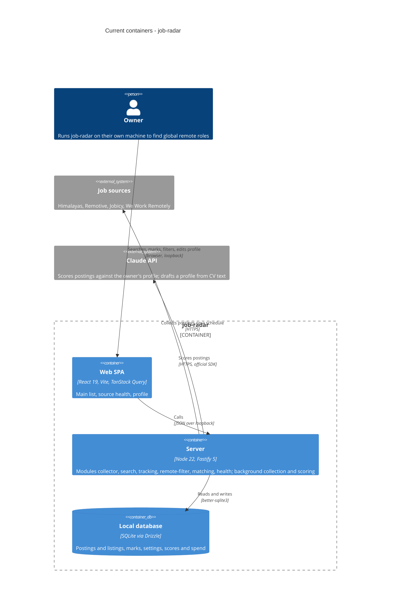

# Architecture map — job-radar

> The **current** architecture (what exists today), produced by `survey` and read by
> specify / design / data-model / implement. Refresh with `survey` when the repo drifts past
> `reflects_commit`. Root `CLAUDE.md` and `docs/adr/0001–0003` are the authored rules; this map
> reconciles with them (see the last section). Replaces the greenfield-bootstrap map of 133499e.

## Stack

- Language / runtime: TypeScript `^7.0.2` on Node.js 22+ (`.nvmrc` = 22), ESM, pnpm workspaces via corepack (`package.json`, `pnpm-workspace.yaml`)
- Server: Fastify `^5.12.5`, Drizzle ORM `^0.45.3` + drizzle-kit, better-sqlite3 `^13.0.3`, `@anthropic-ai/sdk` (match scoring) — `apps/server/package.json`
- Web: React `^19.3.0`, React Router 8, Vite `^8.3.1`, TanStack Query `^5.104.0`, Tailwind v4 via `@tailwindcss/vite`, Testing Library + jsdom — `apps/web/package.json`
- Build / test / lint: `pnpm build` (`pnpm -r`: server `tsc -p tsconfig.build.json`, web `tsc --noEmit && vite build`) · `pnpm test` (Vitest `^5.0.2`, both apps) · `pnpm lint` (Biome) · `pnpm format`
- Migrations: `pnpm --filter @job-radar/server db:generate` (drizzle-kit) · `db:migrate` (`src/core/migrate.ts`, backs up the DB file first)

## C4 — system as it is

## Module inventory

| Module | Path | Layers | Wired at | Responsibility |
|---|---|---|---|---|
| core | `apps/server/src/core/` | infra | `apps/server/src/app.ts` | Config (`config.ts`), DB handle (`db.ts`), error envelope (`errors.ts`), access guard (`access.ts`), IDs (`id.ts`), migrate (`migrate.ts`) |
| health | `apps/server/src/modules/health/` | ports | `app.ts` (first) | `GET /health`; reference shape |
| tracking | `apps/server/src/modules/tracking/` | domain/app/infra/ports | `app.ts` (`createTracking`) | Applied/skipped marks with undo and grace day, look-alike rule; table `tracking_marks`; routes `/api/v1/tracking/marks/*`; provides `protectedPostings` to the collector |
| collector | `apps/server/src/modules/collector/` | domain/app/infra/ports | `app.ts` (`collectorModule`) | Scheduled collection, one adapter per source (`infra/sources/`), merging postings and listings, closing/reopening, first fill, clean-up, source health; tables `collector_*` (sources, runs, run_sources, postings, listings, state, app_sessions, …); routes `/api/v1/collector/*` |
| remote-filter | `apps/server/src/modules/remote-filter/` | domain/app/infra/ports | `app.ts` (`createRemoteFilter`) | Country filter, location verdicts on read, one-off look; table `remote_filter_settings`; routes `/api/v1/remote-filter/*` |
| matching | `apps/server/src/modules/matching/` | domain/app/infra/ports | `app.ts` (`createMatching`) | Profile, CV draft, background scorer with spend cap, scoring health; tables `matching_settings`, `matching_scores`, `matching_spend`; routes `/api/v1/matching/*`; provides `scoreReader` to search |
| search | `apps/server/src/modules/search/` | domain/app/infra/ports | `app.ts` (`searchModule`) | Visits, skill match, in-memory snapshots of ordered ids, newest / best-match order, paging, marked view; table `search_state`; routes `/api/v1/search/*` |
| web | `apps/web/src/` | ui | `apps/web/src/main.tsx`, `App.tsx` | Routes `/` (Home), `/sources` (SourceHealth), `/profile` (Profile) |

## Conventions (cited — the rules a new feature must match)

- **Module wiring / registration:** each module exports a Fastify plugin (or a `create<Module>()` returning `{ plugin, …ports }`) from `index.ts`; `apps/server/src/app.ts` creates and registers them in order tracking → collector → remote-filter → matching → search, on one shared DB handle.
- **Module layering:** `domain` (pure) → `app` (use cases + the only exports other modules may import) → `infra` / `ports`; per `docs/adr/0002-feature-modules-mirror-roadmap.md` and `CLAUDE.md`.
- **Inter-module communication:** direct imports of another module's `app/` — search → collector, remote-filter, tracking; tracking → collector; remote-filter → collector; matching → collector, search. Where two modules need each other, one side is injected at the composition root (matching's `scoreReader` into search, `ownerList` into matching; tracking's `protectedPostings` into the collector) — match-score ADR-0004, collector ADR-0006.
- **Error handling:** one envelope `{ "error": { "code", "message" } }` from `registerErrorHandling` (`core/errors.ts`); expected failures throw `AppError(code, message, status)`.
- **Access:** loopback Host only, and every state-changing request must be same-origin with a JSON body (`core/access.ts`, collector ADR-0007).
- **IDs:** UUIDv7 via `newId()` (`core/id.ts`), generated in the app.
- **Time:** calendar days in `machineTimeZone()` (`core/config.ts`), e.g. tracking's grace day and collector clean-up (`collector/domain/retention.ts`).
- **Settings:** one-row singletons with `id = 1`, upserted lazily (`search_state`, `remote_filter_settings`, `matching_settings`); toggles as `POST … {on}` (`remote-filter/ports/routes.ts`).
- **Persistence / DB access:** Drizzle schema per module in `<module>/infra/schema.ts` (picked up by the glob in `apps/server/drizzle.config.ts`); queries only in `infra/`; rules in `domain/`.
- **Migrations:** drizzle-kit SQL in `apps/server/drizzle/` (latest `0006_silky_polaris.sql`), forward-only; `db:migrate` writes `<file>.bak-<timestamp>` first; rollback = restore it.
- **Tests:** Vitest. Unit next to code (`*.test.ts`, e.g. `collector/domain/merge.test.ts`); server integration in `apps/server/test/*.integration.test.ts` against a temp SQLite file (`test/helpers/temp-db.ts`), recorded source payloads in `test/fixtures/sources/`; web tests with Testing Library next to routes/components (`apps/web/src/routes/Home.test.tsx`).
- **Configuration:** env only — `DATABASE_FILE` (default `data/job-radar.sqlite`), `ANTHROPIC_API_KEY` (never stored or logged), `MATCHING_MODEL`, `MATCHING_PRICE_*` (`core/config.ts`, `CLAUDE.md`).

## Datastores

| Store | Engine | Accessed via | Notes |
|---|---|---|---|
| Local database | SQLite file (`data/job-radar.sqlite`, `DATABASE_FILE`) | Drizzle ORM over better-sqlite3, one connection shared by all modules (`core/db.ts`) | WAL, foreign keys on; synchronous on the event loop; tests use temp files or `:memory:` |
| Search snapshots | In process memory (`search/app/snapshots.ts`) | search only | Ordered ids fixed per load; LRU, expire when idle; lost on restart by design (search ADR-0003) |

## Frontend / UI foundation

- **Component library / design system:** in-repo components; canon + inventory in `docs/design-system.md` (tool: code)
- **Design tokens:** `apps/web/src/styles/tokens.css` (semantic CSS variables incl. `--score-high/mid/low`, light + dark, exposed through Tailwind `@theme`)
- **Styling approach:** Tailwind v4 utilities, mobile-first, tokens only (no raw hex)
- **Shared primitives:** `apps/web/src/components/` — `AppNav`, `Badge`, `Button`, `InlineBanner` (errors with retry), `SkeletonRow`
- **Feature folders:** `apps/web/src/features/{search,tracking,remote-filter,matching,source-health}/`
- **State / data-fetching:** TanStack Query hooks per feature (`features/*/queries.ts`); infinite list with kept previous data while refetching
- **Closest UI precedent:** `apps/web/src/routes/Home.tsx` (main screen; `OrderSwitch` from `features/matching/`, `LocationFilterBar` from `features/remote-filter/`) and `features/search/PostingCard.tsx` (card with match summary, location check, mark actions)

## Where things live / closest precedents

- A new server capability → `apps/server/src/modules/<name>/`, created and registered in `app.ts`; closest recent precedent: matching (match-score) or remote-filter (settings singleton + toggle route + verdicts read by search).
- A new job source → an adapter in `collector/infra/sources/` behind the one adapter contract (`collector/domain/adapter.ts`, collector ADR-0004), with a recorded payload in `test/fixtures/sources/<source>/`.
- A change to the list or its order → `search/app/search.ts` (snapshot build) and `search/domain/order.ts`.
- A new card element or list control → `apps/web/src/features/<feature>/`, rendered from `PostingCard.tsx` / `Home.tsx`.

## Constraints & known tech-debt

- Node 22+ required (`.nvmrc`); the dev machine's default nvm Node is older, so put Node 22 first on PATH for builds and tests.
- Background collection and scoring run only while the server runs (personal laptop tool).
- One SQLite connection on the event loop: long synchronous work in a request delays everything else.
- Search snapshots live in memory; a restart drops them and the web reloads the list.
- Source terms (`CLAUDE.md`): postings keep naming and linking their source. `CLAUDE.md` also lists Remote OK, but there is no Remote OK adapter.
- drizzle-kit has no down migrations; rollback is a file restore.

## Reconciliation with the authored architecture doc

No `docs/architecture.md`; root `CLAUDE.md` and `docs/adr/0001–0003` are authoritative and agree with this scan. Feature-level decisions live in `docs/features/<slug>/adr/` (remote-boards-collector, search-postings, applied-skipped, remote-filter, match-score, realness-score). The realness-score SAD plans a `realness` module and migration `0007`; neither exists yet.
