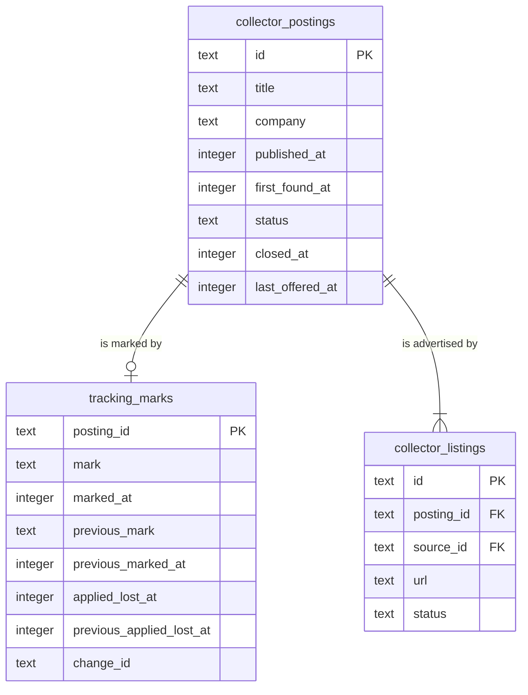

# Data model — applied-skipped

Derived from spec §5 (AC-03, AC-04, AC-05, AC-07, AC-08, AC-09, AC-15), sad.md §5 ("State kept by tracking", "Snapshots"), §8 (Mark consistency, Protection from clean-up, ID strategy, Time), the persist and read hints of sad.md §6 flows 1–6, and [ADR-0003](adr/0003-keep-one-mark-row-per-posting-with-its-previous-state-deleted-with-the-posting.md). Conventions follow project ADR `docs/adr/0003-sqlite-with-drizzle.md` and the pattern the collector and search set. Nothing new is decided here:

- SQLite through Drizzle. The table lives in `apps/server/src/modules/tracking/infra/schema.ts`, which matches the existing `drizzle.config.ts` glob `./src/modules/*/infra/schema.ts`, so no config change is needed.
- Names are snake_case with the module prefix `tracking_`.
- Status-like text values (`applied` / `skipped`) are checked in TypeScript, not by `CHECK`. There are no DB `DEFAULT`s, no triggers and no blanket audit columns. Rules live in `tracking/domain`.
- Times are integer UTC epoch milliseconds. Change ids are UUIDv7 from `core/id.ts`.
- `foreign_keys = ON` is already set in `core/db.ts`, which the cascade and the AC-15 refusal rely on.

**Scope.** The feature adds one table: `tracking_marks`. Snapshots stay in memory (search ADR-0003, ADR-0002 here). Postings are read through the collector's `app` exports, and **the collector schema is unchanged**: no new column, no new index.

## ER diagram

The collector tables (trimmed to the columns tracking and search read) are shown only for the read side and the reference. The collector owns and migrates them.

## Entities

### Mark aggregate (tracking-owned)

#### `tracking_marks`

| Column | Type | Constraints | Notes |
|---|---|---|---|
| `posting_id` | text | PK, FK → `collector_postings.id` **ON DELETE CASCADE** | At most one mark per posting (AC-06). The cascade lets clean-up remove skipped and cleared postings (AC-09). A write for a removed posting fails on the reference, which is AC-15. This partly supersedes collector ADR-0006, which planned the delete as restricted. |
| `mark` | text | | `applied` \| `skipped`. `NULL` means cleared. The row is kept, so a cleared closed posting can show "Cleared, removed after <date>" (AC-05, AC-07). A cleared open posting is unmarked for search. |
| `marked_at` | integer | NOT NULL | When the current state was set: the mark's date (AC-05), or when it was cleared. The marked view orders by it, newest first. Undo restores it to `previous_marked_at` (AC-03). |
| `previous_mark` | text | | The state before the latest change: `applied` \| `skipped` \| `NULL`. A `NULL` here **with** `previous_marked_at` `NULL` means the posting was never marked, so undo deletes the row. With `previous_marked_at` set, it means it was cleared. |
| `previous_marked_at` | integer | | The previous state's original date, restored by undo (AC-03). |
| `applied_lost_at` | integer | | When applied was last lost, by clearing or changing to skipped. It starts the grace day, which ends at the end of the next calendar day in the owner's time zone (AC-07). Set to `NULL` when the posting is marked applied again. |
| `previous_applied_lost_at` | integer | | `applied_lost_at` before the latest change. Undo restores it, so the "removed after" date returns exactly (AC-03). |
| `change_id` | text | NOT NULL | UUIDv7, replaced on every change, undo included. Undo is one `UPDATE … WHERE posting_id = ? AND change_id = ?`. Zero rows changed means the mark changed elsewhere (AC-04), even back to the same mark. |

**Aggregate root:** root. One row per posting the owner ever marked and clean-up has not removed. There is no history (spec §7).
**Lifecycle:** created on the first mark. Updated in place on change, clear and undo. Deleted by undo of a first mark, or by cascade when the collector removes the posting.
**Not stored:** the look-alike key (ADR-0004 computes it on read from the collector's current title and company), and a "protected" flag (computed from `mark` + `applied_lost_at` + the clock).

### Read from the collector (not owned, unchanged)

| Tracking need | Collector column(s) / export | Rule |
|---|---|---|
| Look-alike key (AC-10) | `collector_postings.company`, `.title` via `collector/app/match-keys.ts` | Collector merge normalization, then tracking's bracket and Sr/Jr rules |
| Cleared rows shown in the marked view (AC-05) | `collector_postings.status` | A cleared row shows only while its posting is `closed` |
| "Removed after" date, at-risk flag (AC-07) | `collector/app/retention-outlook.ts` (`closed_at`, `last_offered_at`, disabled periods) | Later of the grace-day end and the retention date |

## Indexes

No new index. The FK column is the primary key, so the FK needs no separate index. Each read and write in sad.md §6 was checked with `EXPLAIN QUERY PLAN` against 15,000 postings (10,000 open) and 5,000 mark rows (4,000 skipped, 700 applied, 300 cleared), p95 over 50 runs:

| Query (flow) | Plan | p95 | Verdict |
|---|---|---|---|
| Mark / change / clear / guarded undo by posting id (flows 1, 4) | PK `sqlite_autoindex_tracking_marks_1` | < 0.1 ms | Covered |
| Currently marked ids, `mark IS NOT NULL` (flows 2, 5, every page and waiting count) | `SCAN tracking_marks` | 1.96 ms | Candidate partial index on `posting_id WHERE mark IS NOT NULL` **discarded**: almost every row is marked, so the scan reads the same rows. |
| Marked view in mark order, cleared rows only when closed (flow 3) | `SCAN m` → collector PK, temp B-tree for `ORDER BY` | 4.89 ms | Candidate `tracking_marks(marked_at)` **discarded**: sorting 5,000 rows takes about 5 ms against a 1 s budget, and the view filters by the posting's status and the skills anyway. |
| Protected among clean-up candidates (flow 6) | PK lookup per id | 1.73 ms (2,000 ids) | Covered |
| Look-alike source rows: marked rows joined to company and title (flows 2, 5) | `SCAN m` → collector PK | 5.68 ms | Covered. Normalizing the strings is app work (ADR-0004). |
| Cascade on clean-up delete (flow 6) | PK on `tracking_marks` | 6.1 ms per 1,000 deletes | Covered |

## Migrations (staged)

| Ordinal | File | What |
|---|---|---|
| 01 | `migrations/01_create_tracking_marks.up.sql` / `.down.sql` | Creates `tracking_marks` |

Staged only; `implement` promotes them (see the audit report). The `.down.sql` is a manual dev rollback. Real rollback restores the pre-migration file backup (project ADR-0003). Marks set after that backup are lost then (spec §8 open question, a changelog warning by default).

## Seeds

None. There is no bootstrap or lookup data, and marks are created by the owner only.

## Test fixtures

Not in migrations. They go in `apps/server/test/helpers/`, beside `temp-db.ts` and `seedOpenPostings`:

- `seedMarks(db, postingIds, { mark, markedAt, appliedLostAt })` — inserts mark rows directly, with fresh UUIDv7 change ids. Used by the spec §6 "Search with marks" (5,000 marked) and "Marked view" NFR tests.
- `fakeProtectedPostings(protectedIds)` — replaces the collector's `fakeMarkedPostings` after the port rename (`ProtectedPostings.protectedAmong`).
- The AC-10 look-alike example pairs (`Acme Inc` / `ACME`, `Sr. Backend Engineer (Go) – Remote` / `Senior Backend Engineer`) form a **unit-test table** in `tracking/domain/look-alike.test.ts`, not DB data. Every other company name is `Example Co`, and URLs use `https://jobs.example.test/<id>`.
