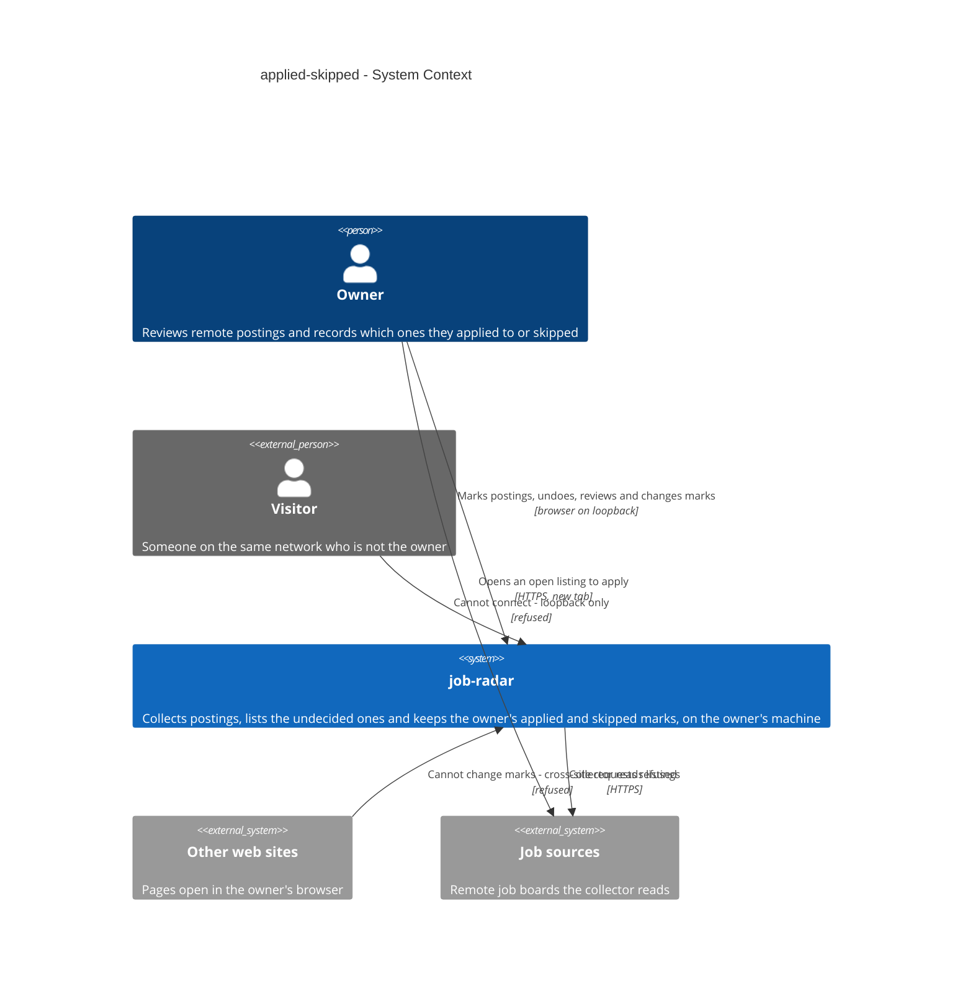
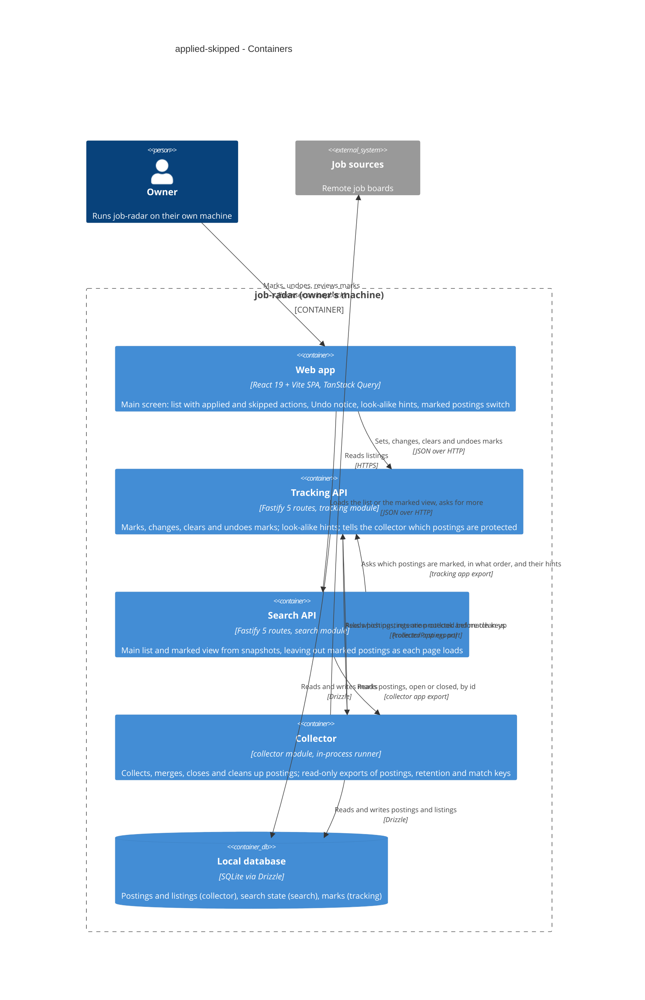
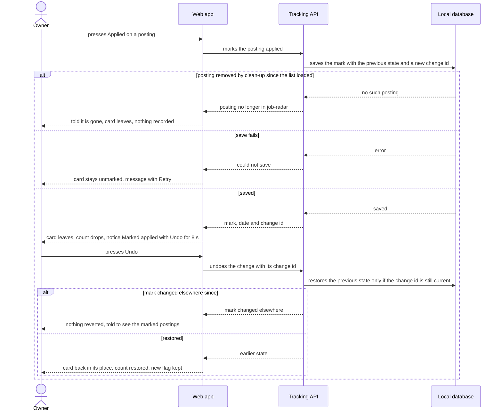
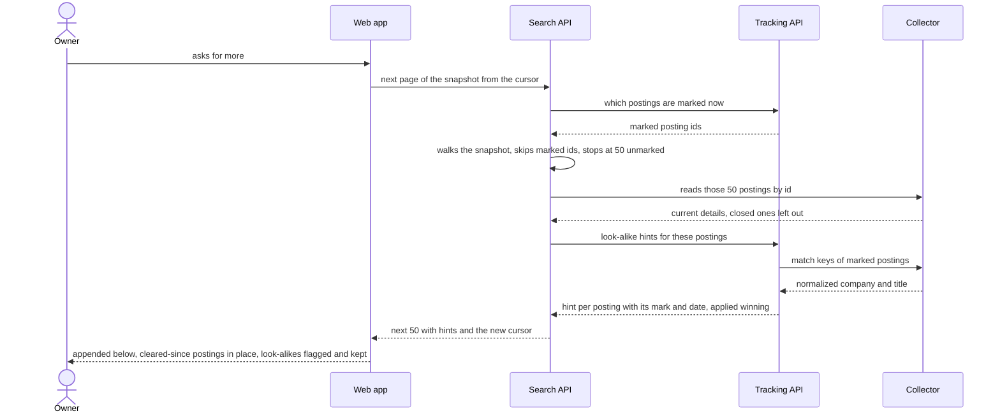

# Software Architecture Document — applied-skipped

<!-- 12 Arc42 sections. Empty section → <!-- N/A: <one-line reason> -->. -->
<!-- C4 Context (L1) lives inline in §3. C4 Container (L2) lives inline in §5. -->
<!-- Numbers in §10 come VERBATIM from spec.md §6 NFR — no inventing, no rounding. -->

## 1. Introduction and goals

**Intent.** Applied-skipped turns job-radar's main list into an inbox. On any posting the owner can mark it applied or skipped. Either mark takes the posting out of the main list, so the list holds only postings the owner has not decided on yet. The mark belongs to the posting, so it holds through merges, closing, reopening and restarts. A few-second Undo, plus a "Show marked postings" view that includes closed postings, lets the owner fix a mis-click or change their mind later. A separate posting that looks like a marked one carries a hint about the earlier mark and is never hidden. This feature supplies the real marks behind the collector's marks port (collector ADR-0006). Clean-up now protects only applied postings, plus a grace day after the owner removes an applied mark.

**Top-3 quality goals (1-liners; full scenarios in §10):**

1. **A decided posting never comes back on its own.** Nothing the collector does (merge, close, reopen, update, restart, clean-up) and no paging puts a marked posting back in the main list, and a look-alike is flagged, never hidden.
2. **No mark is lost or silently wrong.** 100% of confirmed marks survive a restart. Undo restores exactly the earlier state, or refuses when the mark changed elsewhere. A failed save shows nothing that was not saved.
3. **Marking stays instant at collection scale.** ≤ 300 ms p95 per mark. Search and the marked view stay within ≤ 1 s p95 with 10,000 open and 5,000 marked postings.

**Stakeholders.**

| Role | Interest | Sign-off owner? |
|---|---|---|
| Owner | Marks postings applied or skipped, undoes, reviews and changes marks, sees look-alike hints (US-01 – US-07) | No |
| Visitor | None. Must not be able to change marks; cannot connect at all (AC-16) | No |
| Tech Lead | SAD approval | Yes |
| Security Lead | Confirms no new access boundary: marks change only through the existing loopback, same-origin rule (spec §6.1, collector ADR-0007) | Yes |

<!-- Decision overrides (¶4) — populated by the critic resolution loop, empty otherwise. -->

## 2. Constraints

**Technical.**
- TypeScript `^7.0.2` on Node.js 22+ (`.nvmrc`), pnpm workspaces: `apps/server` + `apps/web` (project ADR `docs/adr/0001-typescript-monorepo-react-fastify.md`).
- Server: Fastify `^5.12`, one process on `127.0.0.1:3000` that also serves the built SPA (collector ADR-0001, ADR-0007).
- Web: React `^19.3` + Vite `^8.3` single-page app, TanStack Query `^5.104`, React Router `^8.4`, Tailwind v4 with the semantic tokens in `apps/web/src/styles/tokens.css`.
- Datastore: one SQLite file through `better-sqlite3` `^13` + Drizzle ORM `^0.45`. Migrations come from `drizzle-kit` `^0.31`, forward-only, with a file backup before each migrate (project ADR `docs/adr/0003-sqlite-with-drizzle.md`). One connection is shared by every module (`app.ts`), and calls are synchronous on the server's single event loop.
- Postings and listings, their open/closed state, merging and clean-up belong to the collector (collector ADR-0005). The ordered list and its snapshots belong to search (search ADR-0003). This feature reads both through their `app/` exports and never writes collector tables.
- Clean-up already asks a port which postings to keep, and removes nothing that day if the port fails (`collector/app/cleanup.ts`, collector ADR-0006).
- Layering per project ADR `docs/adr/0002-feature-modules-mirror-roadmap.md`: `modules/<name>/{domain,app,infra,ports}`. A module reaches another only through that module's `app/` exports.

**Organisational.**
- One owner-developer. Size S: 1–2 PRs, about 1–2 days (spec §1, `.size`). No deadline is stated.
- Roadmap wave 4 runs step 6 alongside steps 4, 5 and 10. The roadmap lists `tracking/` as disjoint, but this feature also changes `search/app/` and adds exports to `collector/app/` (§11).

**Conventions.**
- `CLAUDE.md` (layout, layering, errors, IDs, persistence, tests, UI) and `docs/design-system.md` (mobile-first posture, component inventory, interaction conventions).
- Errors use one envelope `{ "error": { "code", "message" } }`, shaped only by `core/errors.ts`; expected failures throw `AppError(code, message, status)`.
- IDs are UUIDv7 from `core/id.ts`, generated in the app.
- Tests use Vitest. Unit tests sit beside the code; server integration tests live in `apps/server/test/` against a temp SQLite file; web tests use Testing Library.

**Regulatory / external.**
- Data classification is internal. The only new personal data is, per marked posting, the mark and when it was set. That reveals which companies the owner applied to, so it is moderately sensitive and stays on the owner's machine (spec §6.1). No compliance regime applies.
- Source terms are unchanged: every shown posting names its sources, and the marked view links only listings still open (spec AC-05, `CLAUDE.md` §Source terms).

## 3. Context and scope

The owner runs job-radar on their own laptop. The collector fills the local database from remote job boards, and search shows the owner a list of open postings. This feature adds the owner's decisions to that list. Marks are set, changed and cleared only from the owner's own job-radar screen. Nothing new leaves the machine, and no outside caller can reach the marks.

<!-- brownfield: architecture-map.md is stale (reflects 133499e, greenfield-bootstrap); the code was scanned directly. Modules: health, collector (owns postings/listings, daily clean-up consulting the `MarkedPostings` stub `noMarks`), search (in-memory snapshots, TanStack infinite list). No tracking module or marks table yet; latest migration 0003. -->

**External systems (in / out):**

| Actor or system | Type | Interaction |
|---|---|---|
| Owner | Person | Marks, undoes, reviews and changes marks on the main screen |
| Visitor | Person (external) | Can reach the machine over the network but cannot connect to the app: loopback only (AC-16, collector ADR-0007) |
| Other web sites | System (external) | Pages open in the owner's browser; a request from them to change a mark is refused as cross-site (AC-16) |
| Job sources | System (external) | Read by the collector, unchanged; the owner's browser opens an open listing's page on its source |

**C4 Context (L1):**



The owner uses job-radar in their browser to mark postings and review their marks, and opens a source's own page to apply. job-radar reads the job sources as before. The two ways in that must stay shut are a visitor on the network, who cannot connect at all, and another site's page in the owner's browser, whose mark requests are refused.

## 4. Solution strategy

**Target surfaces:** `[backend-service, web-frontend]`, per [ADR-0001](adr/0001-ship-marks-as-new-tracking-module-plus-main-screen-actions.md). A new `tracking` module in the existing Fastify server owns the marks, the mark, change, clear and undo rules and routes, the look-alike rule, and the collector's port. Search asks tracking which postings are marked as each page loads. The web app's main screen (SCR-01) gains the applied and skipped actions, the Undo notice, the look-alike hint, the "nothing left to review" state and the "Show marked postings" switch. There is no new screen.

**UI architecture (web-frontend):** unchanged from the project: a single-page app (project ADR-0001), server data through TanStack Query (collector ADR-0002), with the main list as search's infinite query. Marks are TanStack Query mutations. A card leaves the list only after the server confirms the save (AC-14), with no optimistic removal. The Undo notice and its 8 s timer are client state on SCR-01. Undo puts the card back at its earlier position in the pages already shown. The marked view is the same list component fed by search's marked mode. Visual states belong to `screens.md`, and existing components are reused (Button, InlineBanner, Badge, PostingCard). This is inline only; no new UI-architecture choice crosses the gate.

**Top strategic choices (the seeds for ADRs):**

1. **A new `tracking` module, with mark actions on the main screen.** Tracking owns marks end to end: storage, rules, routes, the look-alike rule, and the implementation of the collector's port. Dependencies run search → tracking → collector through `app/` exports. The collector sees tracking only through the port wired in `app.ts`, so there is no import cycle. This is the module the roadmap planned for step 6 and the one collector ADR-0006 names, and a later alerts module can read marks without depending on search. See [ADR-0001](adr/0001-ship-marks-as-new-tracking-module-plus-main-screen-actions.md).
2. **Snapshot every matching posting, and drop marked ones as each page loads.** A search snapshot keeps every matching open posting, marked ones included. Each page reads the currently marked ids, walks the snapshot from the cursor, and returns the next 50 unmarked postings. A posting cleared since loading is therefore back in its place, one marked since is gone, and nothing is skipped (AC-12). The count of marked matches for the "nothing left to review" state comes from the same pass (AC-13). The marked view is a second snapshot mode: marked postings ordered by mark time, newest first (AC-05). See [ADR-0002](adr/0002-snapshot-every-matching-posting-and-drop-marked-ones-as-each-page-loads.md).
3. **One mark row per posting, holding its previous state, deleted with the posting.**
   - The row holds the current mark and its date, the previous mark and its date, and a change id. Undo succeeds only if its change id is still current, so it restores exactly the earlier state (AC-03) or refuses when the mark changed elsewhere (AC-04).
   - The row references the posting with on-delete cascade, so clean-up removes skipped and cleared postings like unmarked ones (AC-09). A write for a removed posting fails on that reference (AC-15).
   - The collector's port narrows from "marked" to "protected": applied postings, plus any posting that lost applied, until the end of the next calendar day (AC-07).
   - This partly supersedes collector ADR-0006. See [ADR-0003](adr/0003-keep-one-mark-row-per-posting-with-its-previous-state-deleted-with-the-posting.md).
4. **Find look-alikes on read.** For each page, tracking builds a map from a look-alike key to the winning mark (an applied mark if any, else the most recent skip) over the current marks, closed postings included and cleared ones excluded. Each unmarked posting on the page is then looked up in that map. The key is the collector's merge normalization plus tracking's extra title rules (non-region brackets dropped, Sr/Jr read as Senior/Junior). This keeps the hint current with titles, and lets the rule widen after spec §8's question with no data migration (AC-10, AC-11). See [ADR-0004](adr/0004-find-look-alikes-on-read-with-the-collectors-merge-normalization.md).

**Inline decisions (below the ADR gate):**
- The port is renamed `MarkedPostings.markedAmong` → `ProtectedPostings.protectedAmong`. Clean-up's code changes only by that name, and its fail-safe stays: if the port fails, nothing is removed that day.
- The grace day covers any loss of applied, whether cleared or changed to skipped. It lasts until the end of the next calendar day in the owner's time zone, the same zone clean-up uses for its day (collector `deps.timeZone`). An undo back to applied simply ends it.
- One undo level only: the latest change in this window (spec §8 open question, default kept).

Each tactical decision in later sections traces to one of these seeds. Tactical decisions that *contradict* a strategic choice are red flags — surface them in §11.

## 5. Building block view

Tracking follows the repo's feature-module layering (project ADR-0002).
- **`domain`** holds the rules the acceptance criteria state, pure and clock-injected:
  - the mark state machine: set, change, clear, and undo guarded by the change id (AC-03, AC-04, AC-06);
  - the grace day (AC-07);
  - which postings are protected (AC-09);
  - the look-alike key and which mark the hint names (AC-10, AC-11).
- **`app`** runs the mark use cases. It answers search's "which of these are marked" and "hints for this page" questions, and implements the collector's port.
- **`infra`** holds the one marks table.
- **`ports`** holds the Fastify routes.

Search changes only its paging and counts. The collector gains read-only exports and a renamed port.

**Internal decomposition:**

```
apps/server/src/
├── app.ts                       creates tracking first, passes its ProtectedPostings to the collector, registers all three
├── modules/collector/app/
│   ├── marked-postings.ts       port renamed: ProtectedPostings.protectedAmong (applied or in grace); noMarks stub kept for tests
│   ├── open-postings.ts         + postings by id including closed ones (sources named, links only for open listings)
│   ├── retention-outlook.ts     NEW read-only: per posting, past 60 counted days? and the date clean-up will remove it
│   └── match-keys.ts            NEW read-only re-export of normalizeCompany / normalizeTitle (collector/domain/merge.ts)
├── modules/tracking/            NEW
│   ├── domain/                  mark.ts (state machine, undo guard) · grace.ts (end of next calendar day)
│   │                            look-alike.ts (key = collector normalization + brackets + Sr/Jr; winning mark)
│   ├── app/                     marks.ts (mark / change / clear / undo) · queries.ts (marked ids, marked order, hints)
│   │                            protected-postings.ts (the collector's port)
│   ├── infra/                   schema.ts (tracking_marks) · repo.ts (the only SQL in the module)
│   ├── ports/                   routes.ts — mark, change or clear, undo
│   └── index.ts                 Fastify plugin + the port object
└── modules/search/app/
    ├── search.ts                snapshot keeps marked matches; first page drops marked; total / new / marked-match counts
    ├── pages.ts                 next page walks the snapshot past marked ids until 50 unmarked (ADR-0002)
    ├── waiting.ts               counts only unmarked waiting postings
    └── marked.ts                NEW marked view: snapshot of marked ids by mark time, skills applied, closed included

apps/web/src/
├── api/tracking.ts              NEW typed client for the tracking routes
├── features/tracking/           NEW MarkActions (applied / skipped, 44×44 px, 8 px apart) · UndoNotice (8 s)
│                                LookAlikeHint · MarkedToggle · mutations.ts
└── features/search/             PostingCard composes MarkActions + LookAlikeHint; SearchList handles counts,
                                 "nothing left to review" and the marked mode
```

**State kept by tracking.** One `tracking_marks` row per posting the owner ever marked and that clean-up has not removed:
- the posting id (references the collector's posting, on-delete cascade);
- the current mark (applied, skipped, or none once cleared) and when it was set;
- the previous mark and when it was set;
- when applied protection was lost, if it was;
- the change id (UUIDv7, replaced on every change).

Exact columns and indexes belong to `data-model`. Nothing is kept in browser storage.

**Snapshots.** Search's in-memory snapshots keep their shape, limits and expiry (search ADR-0003). A main-list snapshot now also includes marked matches. A marked-view snapshot holds marked and cleared-closed posting ids ordered by mark time, newest first, with cleared ones by when they were cleared. It is fixed when the view loads (AC-05).

**C4 Container (L2):**



The owner's browser talks to two server parts: the Tracking API to change marks, and the Search API to load the main list or the marked view. Search asks tracking which postings are marked, and reads posting details from the collector. Tracking reads posting details, retention dates and match keys from the collector. Before clean-up, the collector asks tracking which postings are protected. All three keep their data in the one local SQLite file.

## 6. Runtime view

**Critical flow 1: the owner marks a posting applied, then presses Undo (US-01, US-03; AC-01, AC-03, AC-04, AC-14, AC-15)**



**Critical flow 2: the owner asks for more after marking, with a look-alike on the next page (US-06, US-07; AC-10, AC-11, AC-12)**



The `sequences` stage completes coverage. Still to draw: the marked view with change, clear and the AC-07 confirm step (AC-05 – AC-07); clean-up asking the port (AC-08, AC-09); the "nothing left to review" state (AC-13); and the refused cross-site request (AC-16).

## 7. Deployment view

<!-- N/A: reuses existing deployment unit, no infra change -->

The deployment is unchanged: one Node.js process on `127.0.0.1:3000` serving the API and the built SPA (collector SAD §7). The tracking module is one more Fastify plugin registered in `app.ts`. The only persistent addition is the `tracking_marks` table, created by a forward-only migration with the usual file backup.

## 8. Crosscutting concepts

| Concept | Convention | Where defined |
|---|---|---|
| Logging | Fastify's pino logger with child field `module=tracking`. One line per mark change carries the action and duration. Posting titles and company names are never logged, since together with the marks they reveal where the owner applied (spec §6.1) | `apps/server/src/main.ts` + here |
| Access control | Unchanged: loopback bind, Host check, and state-changing requests accepted only same-origin with a JSON body; no CORS. Every tracking route changes state, so all are JSON POSTs behind the global guard (AC-16) | collector [ADR-0007](../remote-boards-collector/adr/0007-allow-only-loopback-same-origin-requests-without-accounts.md), `core/access.ts` |
| Error handling | Envelope `{ "error": { "code", "message" } }` via `AppError`, with distinct codes and plain-language messages for: the posting is no longer in job-radar (AC-15); the mark changed elsewhere, so undo is refused (AC-04); marks cannot be saved right now, which the web shows with Retry, keeping its earlier state (AC-14). Codes are fixed by `api` | `core/errors.ts` + here |
| Mark consistency | Each change is one synchronous SQLite statement on the shared connection, so there are no partial writes. Undo is one update guarded by the change id. A mark is confirmed to the owner only after the write returns (spec §6 Durability); the web never removes a card before that | `tracking/infra/repo.ts`, ADR-0003 |
| Protection from clean-up | The port answers "protected" for applied postings and for postings that lost applied until the end of the next calendar day. Skipped and cleared postings are not protected. If the port fails, clean-up removes nothing that day | `tracking/app/protected-postings.ts`, ADR-0003 |
| Look-alike rule | Key = the collector's company and title normalization, then non-region bracketed parts dropped and Sr/Jr read as Senior/Junior. Publication times and location restrictions are not compared. Any marked posting still held can match, closed ones included; cleared ones cannot. An applied match wins over skips; otherwise the most recent skip wins. The look-alike is never hidden and never inherits the mark | `tracking/domain/look-alike.ts`, ADR-0004 |
| Untrusted source content | Titles and companies in the hint are rendered as React text only, the same as search AC-09 | search SAD §8 |
| ID strategy | UUIDv7 from `core/id.ts` for change ids. The mark row is keyed by posting id | `core/id.ts` |
| Time | Marks are stored as UTC epoch milliseconds. The grace day ends at midnight after the next calendar day in the owner's time zone, the zone clean-up already uses. The clock is injected, so grace and undo are tested with a fake clock | `tracking/domain/grace.ts`, collector `deps.timeZone` |
| UI data access | TanStack Query: mutations for marks; search's infinite list is never refetched while shown (AC-12). The marked view is a separate query that starts off on every visit (AC-05) | collector [ADR-0002](../remote-boards-collector/adr/0002-fetch-ui-data-with-tanstack-query-and-poll-run-progress.md) |
| UI styling | Semantic tokens only, mobile-first from 360 px. The applied and skipped actions are each at least 44×44 px and at least 8 px apart | `docs/design-system.md` |
| Internationalisation | N/A: single language (English) UI | — |
| Events | N/A: modules call each other's `app` exports in-process, and the collector calls tracking through its port; there is no event bus | project ADR-0002 |

## 9. Architecture decisions

| # | Title | Status | Section |
|---|---|---|---|
| 0001 | Ship marks as a new tracking module plus mark actions on the main screen | Accepted | §4 |
| 0002 | Snapshot every matching posting and drop marked ones as each page loads | Accepted | §4 |
| 0003 | Keep one mark row per posting with its previous state, deleted with the posting | Accepted | §4 |
| 0004 | Find look-alikes on read with the collector's merge normalization | Accepted | §4 |

ADR files live under `docs/features/applied-skipped/adr/NNNN-<title>.md`.

## 10. Quality requirements

**QG-1. A decided posting never comes back on its own**
- **When:** the owner has marked postings applied and skipped. Then the collector merges another listing into one, closes one, reopens one and updates one's text; job-radar restarts; daily clean-up runs with one skipped and one applied posting past the 60-day limit; and the owner pages through the list while marks are set and cleared in another window.
- **Then:**
  - Every marked posting keeps its mark and first-collected time, never re-enters the main list, and is not counted as new (AC-08).
  - Clean-up removes the skipped posting and keeps the applied one (AC-09).
  - Later pages leave out postings marked since loading and include postings cleared since, in place, with nothing skipped (AC-12).
  - A look-alike of a marked posting is shown with the hint, never hidden (AC-10, AC-11).
  - Target from spec §7: 0 decided postings come back, every look-alike of an applied posting carries the hint, 100% in the AC-10 example set.
- **How verify:**
  - A server integration test over every collector event (merge, close, reopen, update, restart, clean-up) with real tracking marks.
  - An integration test that pages the list with a fake clock while marks change underneath.
  - A unit test of `tracking/domain/look-alike.ts` over the AC-10 example set.

**QG-2. No mark is lost or silently wrong**
- **When:** the owner marks a posting and the server restarts; presses Undo after the mark was changed in another window; or marks while the database refuses writes.
- **Then:**
  - 100% of marks confirmed to the owner survive a restart; a mark is confirmed only once saved.
  - Undo restores exactly the earlier state with its original date, or reverts nothing when the mark changed since (AC-03, AC-04).
  - A failed save leaves the screen in its earlier state with a retry action (AC-14).
  - The Undo notice shows for 8 s, and closes sooner on the next mark, search, switch of the marked postings or reload.
- **How verify:**
  - Integration test: mark, restart, reload.
  - Integration test: two "windows" racing an undo.
  - Failure-path test with an injected write error.
  - Web component test of the Undo notice with a controlled clock.

**QG-3. Marking stays instant at collection scale**
- **When:** the owner presses applied or skipped, searches, asks for more, or opens the marked view, against a collection of 10,000 open postings with 5,000 marked postings and up to 20 skills.
- **Then:**
  - ≤ 300 ms p95 from the owner pressing applied / skipped to the posting leaving the list.
  - The search-postings targets (≤ 1 s p95 first page and next page) still hold with 10,000 open postings and 5,000 marked postings.
  - ≤ 1 s p95 to show the first 50 marked postings, with 5,000 marked postings (about 60 days of skips plus every applied posting) and up to 20 skills.
- **How verify:**
  - Integration test over 100 marks against a collection of 10,000 open postings.
  - The search NFR test, re-run with 5,000 marked postings seeded.
  - Marked view: integration test against a seeded collection; p95 over 50 loads.

**QG-4. Usable on a phone**
- **When:** the main screen and the marked view are shown at 360 px width.
- **Then:** the applied and skipped actions are each at least 44×44 px and at least 8 px apart; the marked view is usable at 360 px with no horizontal scrolling.
- **How verify:** browser check at 360 px (manual at ship until spec search-postings §8 R6 is automated).

**QG-5. Only the owner changes marks**
- **When:** a visitor on the network, or a page from another site in the owner's browser, tries to mark, change or clear a mark.
- **Then:** it cannot: the visitor cannot connect, and the cross-site request is refused before any route runs (AC-16).
- **How verify:** integration test sending the tracking routes a request with a foreign Host and one marked cross-site; both refused, no mark recorded.

## 11. Risks and technical debt

| Risk / debt | Severity | Mitigation | Owner |
|---|---|---|---|
| Applied postings are protected by the port's answer alone. Delete-restricted becomes cascade (ADR-0003), so a bug in the port could let clean-up remove an applied posting and its mark for good | Medium | The AC-09 integration test with real marks guards every build. The port keeps its fail-safe (an error removes nothing that day). The port is unit-tested over applied, skipped, cleared and grace cases | Volodymyr Kozlov |
| Collector ADR-0006 still describes a delete-restricted reference and a "marked" port | Low | Add "Partly superseded by applied-skipped ADR-0003" to collector ADR-0006, and rename the port's test fixtures, in the first `tracking` task (before `/sdd:implement`) | Volodymyr Kozlov |
| When most matching postings are marked, a page walks far into the snapshot to find 50 unmarked ones (ADR-0002) | Low | Bounded by snapshot size; QG-3's search test seeds 5,000 marked of 10,000 open; `durationMs` stays in search's log line | Volodymyr Kozlov |
| Look-alike work per page grows with the number of marks (ADR-0004) | Low | QG-3 covers 5,000 marks; if a page passes 1 s p95, keep the key map for the snapshot's lifetime | Volodymyr Kozlov |
| Wave 4 runs steps 4, 5 and 10 in parallel. The roadmap lists `tracking/` as disjoint, but this feature also edits `search/app/` (paging, counts) and `collector/app/` (exports, port name). Steps 4 and 5 will likely change the same list | Medium | Land this feature's `search/app/` change in one PR before steps 4/5 touch paging; update the roadmap's wave 4 row | Volodymyr Kozlov |
| Restoring the pre-migration database backup drops marks set after the backup (spec §8) | Low | Default: warn in the changelog. Resolve the spec §8 question before `/sdd:ship` | Volodymyr Kozlov |
| The look-alike rule may miss re-posts whose titles differ by an added or dropped word (spec §8) | Low | The rule lives in one pure function (ADR-0004). Tune it after two weeks of real look-alikes, by 2026-10-31 | Volodymyr Kozlov |
| `docs/architecture-map.md` is stale (reflects `133499e`, greenfield-bootstrap) and misses collector, search and now tracking | Low | Re-run `/sdd:survey` after this feature ships | Volodymyr Kozlov |

**Accepted debt (acceptable in v1, plan to fix later):**
- One undo level: earlier marks are fixed from the marked postings (spec §8).
- No history of marks: the mis-click KPI comes from the owner's own log (spec §7).
- No database-level backstop for applied postings (ADR-0003).

## 12. Glossary

| Term | Meaning |
|---|---|
| Owner | The one person who runs job-radar on their own machine; the only human role in v1 (CONTEXT). |
| Visitor | Anyone who can reach the owner's machine over a network but is not the owner; cannot connect to the app (CONTEXT). |
| Posting | One open role at one company as the owner sees it; may be advertised on several sources (CONTEXT). |
| Listing | One source's copy of a posting, with that source's link, text and publication time (CONTEXT). |
| Source | An external job board or feed job-radar reads postings from (CONTEXT). |
| Closed posting | A posting every enabled source listing it has confirmed as no longer open; shown in the marked view only (CONTEXT, AC-05). |
| Mark | The owner's decision on a posting: applied or skipped, at most one per posting; it belongs to the posting and takes it out of the main list (CONTEXT). |
| Applied | The mark the owner sets after applying; an applied posting is kept for good, even after it closes (CONTEXT). |
| Skipped | The mark the owner sets when deciding not to apply; it hides the posting but does not protect it from clean-up (CONTEXT). |
| Look-alike posting | An unmarked open posting from the same company as a marked one, whose company and title match by the look-alike rule, that the collector did not merge; shown with a hint, never hidden (CONTEXT). |
| Collection run | One pass that reads every enabled source that is due (CONTEXT). |
| Skill | A word or short phrase the owner enters to narrow the postings they see (CONTEXT). |
| Marked postings (marked view) | The view behind the "Show marked postings" switch: only marked postings, closed ones included, plus cleared closed postings not yet removed, most recently marked first (AC-05). *Not yet in CONTEXT — glossary follow-up.* |
| Grace day | After a posting loses its applied mark, it stays protected from clean-up until the end of the next calendar day, so the owner can mark it applied again (AC-07). *Not yet in CONTEXT — glossary follow-up.* |
| Protected posting | A posting clean-up must not remove: marked applied, or in its grace day. What the collector's port answers (ADR-0003). |
| Change id | The id a mark change gets; Undo succeeds only while it is still the posting's current change id (ADR-0003). |
| Snapshot | The ordered list of posting ids a search produced, kept in server memory; now includes marked matches, which each page leaves out (search ADR-0003, ADR-0002). |
