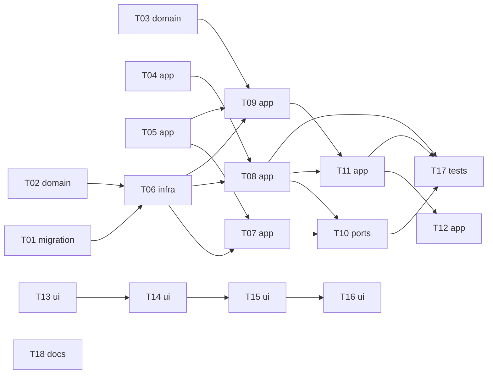

# Epic — applied-skipped

> **Spec:** [spec.md](../spec.md) · **Design:** [sad.md](../sad.md) · **Data model:** [data-model.md](../data-model.md) · **API:** [openapi.yaml](../contracts/openapi.yaml) · **Screens:** [screens.md](../screens.md) · **ADRs:** [adr/](../adr/)

## Goal

The owner never re-reviews a posting they applied to or skipped: a mark takes it out of the main list and holds through merges, closing, reopening, restarts and clean-up. Every mark can be undone at once or changed later from the marked postings, and a look-alike re-post carries a hint instead of inviting a second application (spec §2).

## Scope

- **In:** new `tracking` module (domain, infra, app, ports) and the `tracking_marks` migration; `search/app/` paging, counts and the marked view; read-only `collector/app/` exports and the port rename; the main screen's mark actions, Undo notice, look-alike line, nothing-left state and marked view (SCR-01).
- **Out:** application tracking beyond the mark and its date; hiding look-alikes; blocking a company; bulk marking; remembering a skip after clean-up; changing the collector's merge rules (spec §3).

## Task map

- **Wave 1:** T01, T02, T03, T04, T05, T13, T18
- **Wave 2:** T06, T14
- **Wave 3:** T07, T08, T09, T15
- **Wave 4:** T10, T11, T16
- **Wave 5:** T12, T17

## Tasks

See [tracker.md](./tracker.md) for status. Machine contract: [tasks.json](../tasks.json).

| # | Task | Layer | Blocked by | DoD (short) |
|---|---|---|---|---|
| T01 | [Create the tracking_marks table and promote its staged migration](./t01-tracking-marks-table.md) | migration | — | drizzle-kit generates the next migration from tracking/infra/schema.ts matching the staged SQL; it applies on… |
| T02 | [Write the mark state machine, undo guard and grace day as pure domain functions](./t02-mark-state-machine-and-grace-day.md) | domain | — | mark.test.ts and grace.test.ts pass with a fake clock over set / change / clear / no-op / undo (first mark, ch… |
| T03 | [Write the look-alike key and winning-mark rule, on the collector's exported merge normalization](./t03-look-alike-key.md) | domain | — | look-alike.test.ts passes over the AC-10 example table (Acme Inc / ACME, 'Sr. Backend Engineer (Go) – Remote'… |
| T04 | [Rename the collector's marks port to ProtectedPostings.protectedAmong and record ADR-0006 as partly superseded](./t04-rename-port-to-protected-postings.md) | app | — | Every collector reference uses ProtectedPostings.protectedAmong (noMarks stub kept, renamed fixture fakeProtec… |
| T05 | [Add the collector's read-only exports: postings by id including closed, and the retention outlook](./t05-collector-read-exports.md) | app | — | An integration test shows postingsById returns closed postings with every source named and links only for open… |
| T06 | [Write the tracking repo: guarded mark writes, undo, and the mark reads every flow needs](./t06-marks-repo.md) | infra | T01, T02 | tracking-repo.integration.test.ts passes on a temp DB: upsert of the computed row, guarded undo (1 row vs 0 ro… |
| T07 | [Implement the mark, change, clear and undo use cases with their error mapping and MarkState](./t07-mark-use-cases.md) | app | T05, T06 | tracking-marks.integration.test.ts passes: setMark/undoMark return MarkState with the right at_risk and remove… |
| T08 | [Implement ProtectedPostings in tracking and wire it into the collector in app.ts](./t08-protected-postings-port.md) | app | T04, T06 | tracking-protected.integration.test.ts runs dailyCleanup with the real port: a skipped and an applied posting… |
| T09 | [Implement tracking's read queries for search: marked ids, the marked order, and look-alike hints](./t09-mark-queries-and-hints.md) | app | T03, T05, T06 | tracking-queries.integration.test.ts passes: markedIds reflects current marks; markedOrder returns marked + cl… |
| T10 | [Expose setMark and undoMark as Fastify routes behind the access guard and register the tracking plugin](./t10-tracking-routes.md) | ports | T07, T08 | tracking-routes.integration.test.ts validates every response against the applied-skipped contract (loadContrac… |
| T11 | [Make search's main list mark-aware: snapshot keeps marked, pages skip them, counts and hints](./t11-search-main-list-with-marks.md) | app | T08, T09 | search-marks.integration.test.ts passes (marked left out of first and next pages, cleared-since returns in pla… |
| T12 | [Add search's marked view: a fixed-order marked snapshot with skills, closed and cleared postings](./t12-search-marked-view.md) | app | T11 | search-marked.integration.test.ts passes: runMarkedView returns marked + cleared-closed postings newest first… |
| T13 | [Add the web tracking client, the MarkActions component and PostingCard's look-alike line, marked variant and actions slot](./t13-web-client-markactions-postingcard.md) | ui | — | MarkActions.test.tsx covers unmarked / marked / pending / confirm states and accessible names; PostingCard.tes… |
| T14 | [Wire marking and the 8-second Undo notice into the main list](./t14-web-mark-and-undo.md) | ui | T13 | Home.test.tsx (contract-example mocks) shows: card leaves and counts drop only after setMark 200; the notice s… |
| T15 | [Show the save-error, posting-gone and nothing-left-to-review states on the main screen](./t15-web-save-error-gone-nothing-left.md) | ui | T14 | Home.test.tsx shows: a 503 on setMark or undoMark keeps the earlier state with the API message and Retry that… |
| T16 | [Build the Show marked postings switch and the marked view with change, clear, at-risk confirm and cleared cards](./t16-web-marked-view.md) | ui | T15 | Home.test.tsx shows: the switch starts off, turning it on runs runMarkedView and lists marked cards with Badge… |
| T17 | [Prove marks hold through every collector event and a restart, and that marking stays under 300 ms p95](./t17-marks-hold-through-collector-and-restart.md) | tests | T08, T10, T11 | tracking-collector-events.integration.test.ts passes over merge, close, reopen, text update, restart (reopen t… |
| T18 | [Add the marked view and grace day to CONTEXT.md and update the roadmap's wave-4 row](./t18-glossary-and-roadmap.md) | docs | — | CONTEXT.md glossary defines 'Marked postings (marked view)' and 'Grace day' with a NOT-reference each; roadmap… |

## Risks / Hard rules

- A module reaches another only through that module's `app/` exports; this feature never writes collector tables (sad §2).
- Errors only through `AppError` and the one envelope; change ids are UUIDv7 from `core/id.ts` (sad §2).
- Posting titles and company names are never logged (sad §8).
- No optimistic removal: a card leaves only after the server confirms the save (sad §4, AC-14).
- Applied postings are protected by the port alone, so T08's AC-09 test with real marks guards every build (sad §11 risk 1).
- Land the `search/app/` change (T11) in one PR before roadmap steps 4/5 touch paging (sad §11 risk 5).
- The look-alike region list is not defined upstream; T03 keeps it as a named constant and raises it in review (spec §8, due 2026-10-31).
