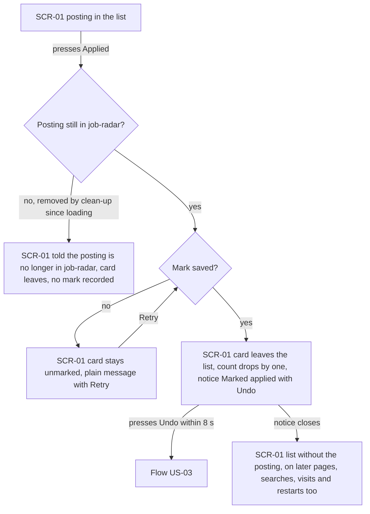
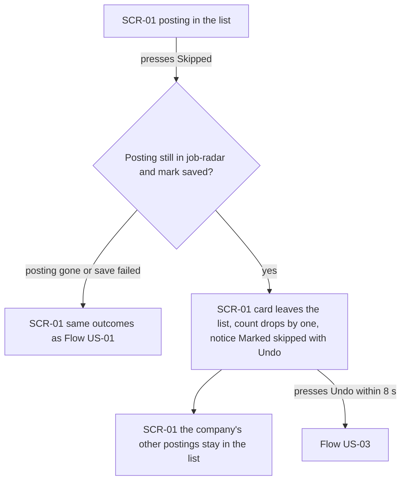
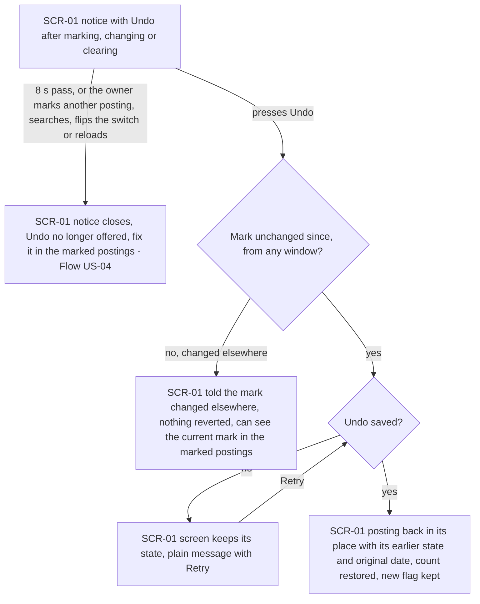
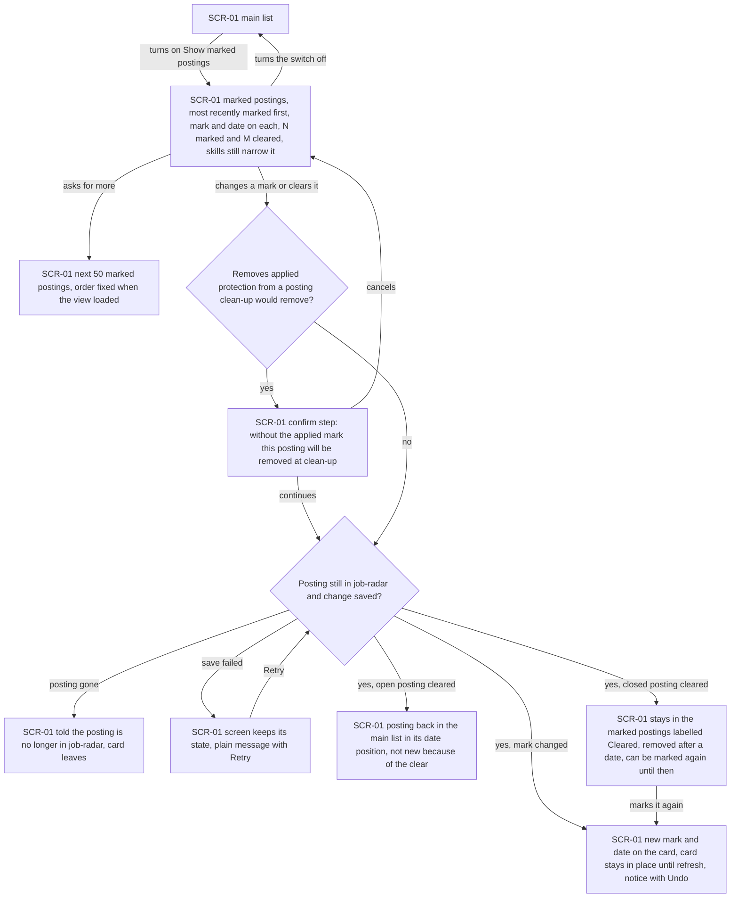
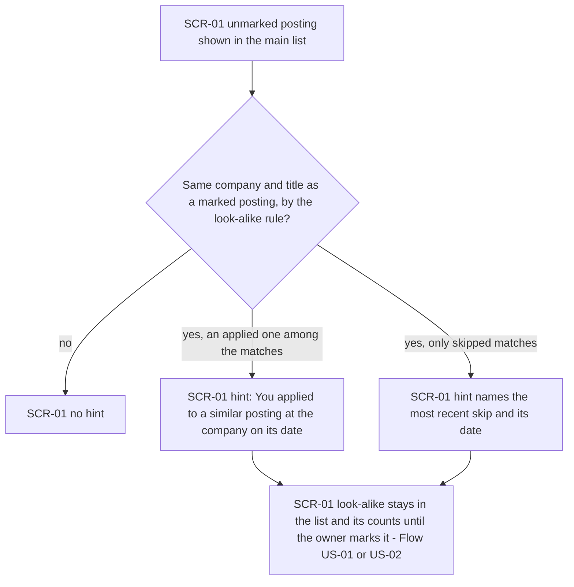
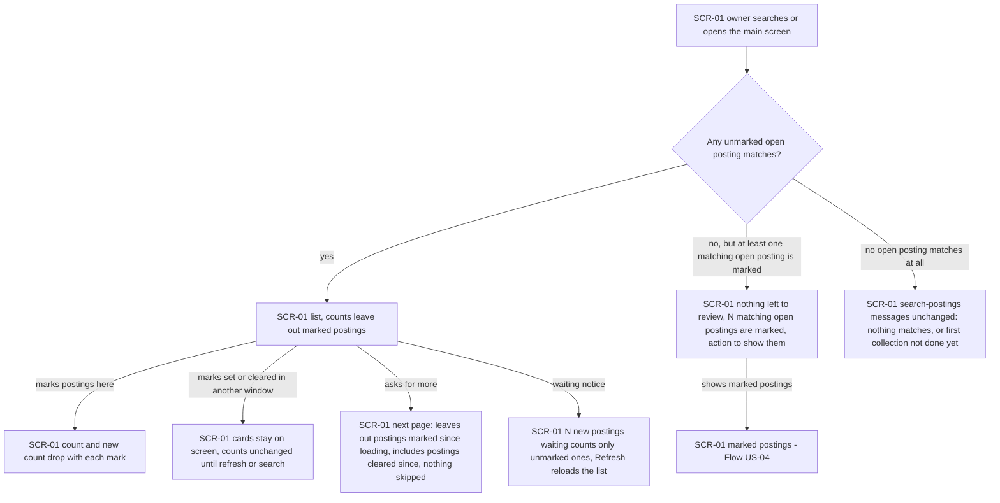

# UX flows — applied-skipped

> User flows for every UI-touching §4 user story, produced by `ux-flows` (after `clarify`, before
> `design`) and read by `design` (evidence for the target-surface + UI-architecture decisions),
> `sequences` (UI-driven flows align on SCR ids), `screens` (details every inventory row) and
> `plan-tests` (the e2e-through-UI paths). **Always markdown + mermaid `flowchart`**, whatever the
> design tool — this artifact is flow-altitude, not visual design.

## Platform decisions

- **Posture:** mobile-first, per `docs/design-system.md`, the same as search-postings. In v1 the app opens only on the owner's machine, so it runs in a laptop browser, but every flow starts from the 360 px layout (spec §6: applied and skipped are each 44×44 px and at least 8 px apart).
- **Navigation:** no new screen. The applied and skipped actions sit on each posting on the main screen (SCR-01), and "Show marked postings" is a switch on that screen that swaps the list for the marked postings. The switch starts off on every visit (AC-05). SCR ids match the search-postings and remote-boards-collector inventories; only SCR-01 changes.
- **Undo:** a notice on SCR-01, not a separate step. It shows for 8 s and closes sooner on the next mark, search, switch or reload (AC-03). After that, the fix is made in the marked postings.
- **Losing applied protection:** a confirm step in place (continue or cancel) shown before the change, and only when clean-up would otherwise remove the posting (AC-07). Every other mark change happens at once, with Undo as the safety net.
- **Look-alike hint:** shown on the posting's card in the main list. It is information only, with no action of its own; the owner marks the look-alike like any other posting (AC-10, AC-11).
- **Other windows:** a list on screen never changes by itself because of a mark set in another window. It catches up when the owner refreshes, searches or asks for more (AC-12). *Design input:* whether mark checks happen per page load or another way is `design`'s call.

## Screen inventory

| ID | Screen | Purpose | Entry | Exit |
|---|---|---|---|---|
| SCR-01 | Main screen | The search-postings list, now with applied and skipped actions on each posting, the Undo notice, the look-alike hint, the "nothing left to review" state, and the "Show marked postings" switch, which shows the marked postings (marked and cleared-closed postings, change and clear actions, the confirm step before losing applied protection) | Opening the app | A source's page via a listing link; source health as in search-postings (SCR-02, unchanged and not visited by these flows) |

## Flows

> **Out of scope (no owner interaction):** US-05 "Keep marks through collection changes". The collector merges, closes, reopens, updates and cleans up postings with no step by the owner. What the owner sees is covered by the list flows (a marked posting simply never appears in the main list). AC-08 and AC-09 are verified by tests, not drawn.

### Flow: US-01 — Mark a posting applied

On the main screen the owner presses Applied on a posting. If clean-up removed the posting after the list loaded, the owner is told it's no longer in job-radar and its card leaves the list with nothing recorded (AC-15). If the mark can't be saved, the card stays unmarked and a plain message offers Retry (AC-14). Otherwise the card leaves at once, the count drops by one, and a "Marked applied" notice with Undo appears (AC-01). Undo within 8 seconds leads to Flow US-03. Once the notice closes, the posting stays out of the list on later pages, in later searches and visits, and after a restart.

### Flow: US-02 — Mark a posting skipped

Skipping works exactly like marking applied, with the same outcomes when the posting is gone or the save fails. On success the card leaves, the count drops, and the notice reads "Marked skipped" with Undo. Other postings from the same company stay in the list, because a skip is about one role, not the company (AC-02).

### Flow: US-03 — Undo a mark right away

After any mark, change or clear, the notice offers Undo for 8 seconds. It closes sooner when the owner marks another posting, searches, flips the marked-postings switch or reloads, and from then on the fix is made in the marked postings (Flow US-04). Pressing Undo first checks that nothing has changed the mark since, from this window or another. If something has, nothing is reverted and the owner is told the mark changed elsewhere (AC-04). If the undo can't be saved, the screen stays as it is with a Retry message (AC-14). Otherwise the posting returns to its place exactly as before: unmarked, or its previous mark with that mark's original date. The count is restored and the posting keeps its "new" flag (AC-03).

### Flow: US-04 — Review and change my marks

The owner turns on "Show marked postings". The list now shows only marked postings, most recently marked first, each with its mark and date. Closed postings are labelled "Closed", with their sources named and links only where a listing is still open. Closed postings whose mark was cleared are shown labelled "Cleared, removed after <date>", and the count reads "N marked and M cleared". Skills narrow this view too, Show more pages through it in an order fixed when it loaded, and turning the switch off goes back to the main list (AC-05). When the owner changes or clears a mark on an applied posting that clean-up would then remove, a confirm step warns them first. Cancelling leaves everything as it was (AC-07). Then the usual checks apply: a removed posting is reported and its card leaves (AC-15), and a failed save keeps the screen as it was, with Retry (AC-14). On success there are three outcomes:
- A changed mark shows its new date and the card stays in place until refresh, with an Undo notice.
- A cleared open posting goes back to the main list in its date position, and doesn't count as new because of the clear (AC-06).
- A cleared closed posting stays in this view, labelled with its removal date, and can be marked again until then (AC-07).

### Flow: US-06 — Be warned about look-alike re-posts

For each unmarked posting in the main list, job-radar checks whether its company and title match a posting the owner marked, using the collector's matching plus ignored brackets and Sr/Jr. A closed marked posting counts as a match; a cleared one doesn't. With no match there is no hint. If an applied posting is among the matches, the hint says "You applied to a similar posting at <company> on <date>"; otherwise it names the most recent skip and its date (AC-10). Either way the look-alike is never hidden and never inherits the mark. It stays in the list and its counts until the owner marks it, through Flow US-01 or US-02. A posting from the same company with a different title gets no hint (AC-11).

### Flow: US-07 — Trust the list while I mark

When the owner searches or opens the main screen, the list shows unmarked postings only, and its counts leave marked postings out. If nothing unmarked matches but at least one matching open posting is marked, the screen says nothing is left to review, gives the number of marked matching open postings, and offers to show them, which opens Flow US-04 (AC-13). If no open posting matches at all, search-postings' own messages appear unchanged. While the list is on screen there are four cases:
- Marking a posting here drops the count, and the new count too if the posting was new.
- Marks set or cleared in another window leave this window's cards and counts as they are until the owner refreshes or searches.
- Asking for more loads a page that leaves out postings marked since the list loaded and includes postings cleared since, in their date position, with nothing skipped.
- The "N new postings waiting" notice counts only unmarked postings, and Refresh reloads the list (AC-12).

## AC coverage

| AC | Shown by | Notes |
|---|---|---|
| AC-01 | Flow US-01 → card leaves, notice Marked applied → list without the posting | |
| AC-02 | Flow US-02 → card leaves, notice Marked skipped; the company's other postings stay | |
| AC-03 | Flow US-03 → notice lifetime branch; Undo → back in place with original date | |
| AC-04 | Flow US-03 → mark changed elsewhere → nothing reverted | |
| AC-05 | Flow US-04 → switch on → marked postings, Show more, switch off | Order fixed when the view loads; switch starts off on every visit (platform decision) |
| AC-06 | Flow US-04 → mark changed / open posting cleared | |
| AC-07 | Flow US-04 → confirm step; closed posting cleared → labelled, can be re-marked | |
| AC-08 | N/A | US-05: collector events need no owner step; verified by tests |
| AC-09 | N/A | US-05: clean-up needs no owner step; verified by tests |
| AC-10 | Flow US-06 → applied hint / skipped hint | |
| AC-11 | Flow US-06 → no hint; look-alike stays until marked | |
| AC-12 | Flow US-07 → counts drop, other window, next page, waiting notice | |
| AC-13 | Flow US-07 → nothing left to review → show marked; no match → search messages | |
| AC-14 | Flows US-01, US-03, US-04 → save failed → screen unchanged, Retry | |
| AC-15 | Flows US-01, US-04 → posting gone → told, card leaves | |
| AC-16 | N/A | A visitor or another site has no screen in job-radar; the access rule is checked in tests, as in search AC-17 |
