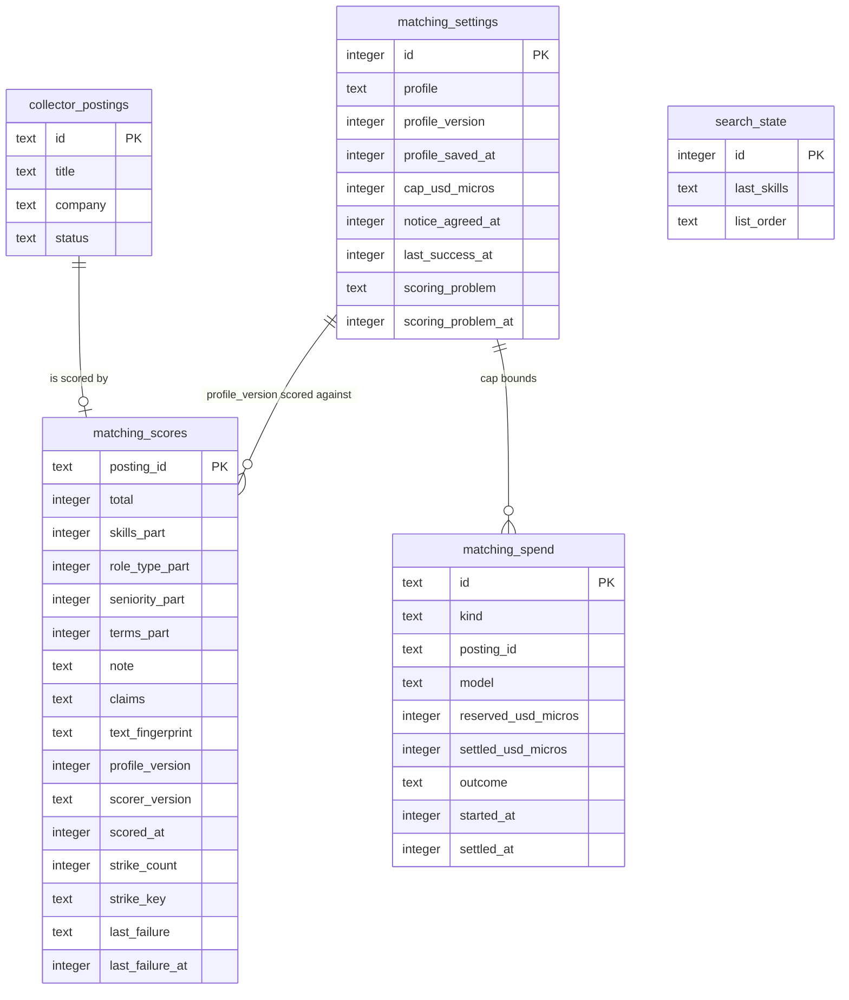

# Data model — match-score

Derived from spec §5 (AC-04, AC-06, AC-10 – AC-15, AC-18 – AC-20), sad.md §5 (tables named there), §7 (configuration), §8 (Personal data, Secrets, ID strategy, Time), the persist and read notes of sad.md §6 flows 1–9, and [ADR-0005](adr/0005-keep-one-score-per-posting-with-text-and-profile-fingerprints.md), [ADR-0006](adr/0006-reserve-the-largest-possible-cost-before-each-attempt-and-settle-from-usage.md), [ADR-0008](adr/0008-constrain-model-output-to-part-scores-and-compute-the-total-in-job-radar.md). Conventions follow project ADR `docs/adr/0003-sqlite-with-drizzle.md` and the pattern the collector, search, tracking and remote-filter set:

- SQLite through Drizzle. The new tables live in `apps/server/src/modules/matching/infra/schema.ts`, which matches the `drizzle.config.ts` glob `./src/modules/*/infra/schema.ts`. `search_state` gains one column in `search/infra/schema.ts`.
- Names are snake_case with the module prefix `matching_`. sad.md §5 named two tables `match_scores` and `scoring_spend`. They are `matching_scores` and `matching_spend` here so that the prefix matches the module, as `tracking_marks` and `remote_filter_settings` do.
- Text values that act like an enum (`kind`, `outcome`, `scoring_problem`, `list_order`) are checked in TypeScript, not by `CHECK`. There are no DB `DEFAULT`s, no triggers and no blanket audit columns. Rules live in `matching/domain`.
- Times are integer UTC epoch milliseconds. Spend ids are UUIDv7 from `core/id.ts`. Scores are keyed by posting id.
- Money is an integer number of **millionths of a dollar** (`*_usd_micros`). One scoring costs a few cents, and per-token prices go below a cent, so whole cents would round every attempt. Integers keep the cap comparison exact.

**Scope.** Three new tables (`matching_settings`, `matching_scores`, `matching_spend`) and one new nullable column (`search_state.list_order`). The collector schema is unchanged: the score references `collector_postings.id` the same way `tracking_marks` does. **Not stored:** the CV or its text (ADR-0007, AC-07), the provider key (`ANTHROPIC_API_KEY`, sad.md §8), the best-match order and score states (built in search's in-memory snapshot, ADR-0004), staleness (computed by comparing fingerprints, ADR-0005), "cap reached" (computed from the ledger and the cap), and the oldest pending age (computed from the list and the scores).

## ER diagram

The links from `matching_settings` are logical, not foreign keys: a score records the profile version it was made against, and every spend row counts against the cap. `matching_spend` is trimmed here: the token columns are listed under Entities. `collector_postings` is trimmed to the columns the scorer's fingerprint and the list read. The collector owns and migrates it.

## Entities

### Settings aggregate (matching-owned)

#### `matching_settings`

| Column | Type | Constraints | Notes |
|---|---|---|---|
| `id` | integer | PK | Always 1, upserted lazily like `remote_filter_settings` and `search_state`. |
| `profile` | text | | JSON: `{ skills: [{ name, core }], years, seniority, roleTypes[], minSalary: { amount, currency, period }, engagementForms[] }`, with the fixed lists from CONTEXT: Profile. It is checked in `matching/domain` (AC-16) and never holds a name or contact detail (AC-09). `NULL` means no profile yet (AC-15). It is one JSON value because the profile is only ever read and replaced whole (AC-07: confirming replaces the whole profile). |
| `profile_version` | integer | NOT NULL | 0 with no profile. +1 on a save that changes a profile field. A save with no change, or a cap change, leaves it (AC-10 note). The upsert writes 0. |
| `profile_saved_at` | integer | | When the profile last changed. |
| `cap_usd_micros` | integer | NOT NULL | The scoring cap, 0 to 100,000,000 ($0–$100, AC-19), checked in TypeScript. The upsert writes 5,000,000 ($5 default, AC-12). |
| `notice_agreed_at` | integer | | The one-time data notice agreement (AC-20). `NULL` means the server refuses every save, draft and scoring that would send something (flows 4, 5). |
| `last_success_at` | integer | | Scoring health: when scoring last succeeded (AC-14). Set on each usable answer. |
| `scoring_problem` | text | | `provider_unreachable` \| `rate_limited` \| `key_missing` \| `key_refused`, or `NULL`. Raises the problem marker (flow 9). Cleared on the next usable answer. "Cap reached" is computed, so it can never be left set after the month turns or the cap is raised. |
| `scoring_problem_at` | integer | | When the current problem was first seen. |

**Aggregate root:** root. One row per database.
**Lifecycle:** created on first read. The profile, the cap, the notice and the problem are updated in place. Never deleted.

### Score aggregate (matching-owned)

#### `matching_scores`

| Column | Type | Constraints | Notes |
|---|---|---|---|
| `posting_id` | text | PK, FK → `collector_postings.id` **ON DELETE CASCADE** | One current score per posting (ADR-0005). The score is removed with the posting, like `tracking_marks`. |
| `total` | integer | | 0–100, computed in `matching/domain` from the parts with weights 50/20/15/15 and the neutral rule (AC-01 note, ADR-0008). `NULL` means never scored: the row exists only to carry strikes. |
| `skills_part`, `role_type_part`, `seniority_part`, `terms_part` | integer | | 0–100 each. `NULL` means "not stated" (AC-04). They are only meaningful when `total` is set. |
| `note` | text | | Fit note of up to 40 words, validated before storing (AC-18) and shown as plain text (AC-03). |
| `claims` | text | | JSON array of quoted claims from the posting, shown as "the posting says…" (AC-03, AC-05). |
| `text_fingerprint` | text | | Hash of the scored text: title, company, description and the open listings' location restrictions (ADR-0005). Different from today's means "scored against an earlier version of this posting" (AC-06). |
| `profile_version` | integer | | The profile version the score was made against. Lower than today's means "scored against your previous profile" (AC-10). |
| `scorer_version` | text | | Version of the prompt and output schema (ADR-0008). A change makes the score stale and is shown as a previous-profile staleness. |
| `scored_at` | integer | | When the current score was stored. |
| `strike_count` | integer | NOT NULL | Consecutive unusable answers (AC-18). At 3 with a current `strike_key`, the posting shows "could not be scored" and is skipped. Reset to 0 on a usable answer. |
| `strike_key` | text | | Text fingerprint + profile version + scorer version the strikes were made against. When it differs from today's key, the strikes are void ("until the posting or the profile changes"), and the next strike starts again from 1. |
| `last_failure` | text | | Plain-language reason for the last unusable answer, shown on the card. |
| `last_failure_at` | integer | | Scoring health counts the postings that could not be scored this month by this column. |

**Aggregate root:** root (references a collector posting).
**Lifecycle:** created on the first usable answer or the first strike. Replaced in place on re-scoring (flow 7). Deleted by cascade when the collector removes the posting. Marked postings keep their row, which the marked view reads as is (flow 8).

### Spend aggregate (matching-owned)

#### `matching_spend`

| Column | Type | Constraints | Notes |
|---|---|---|---|
| `id` | text | PK | UUIDv7. |
| `kind` | text | NOT NULL | `score` \| `draft` (AC-12 counts both). |
| `posting_id` | text | | The scored posting. `NULL` for a draft. **No FK**: spend must outlive posting clean-up, or the month's sum would drop (precedent: `collector_listings.last_seen_run_id`). |
| `model` | text | NOT NULL | Model id the attempt used, for auditing against the bill. |
| `reserved_usd_micros` | integer | NOT NULL | Largest possible cost, written in the same synchronous transaction as the cap check (ADR-0006). |
| `settled_usd_micros` | integer | | Real cost from usage. `NULL` while in flight or when no answer came: the reservation then counts in full (AC-12 note). A crash mid-attempt leaves it `NULL`, so overspend stays impossible. |
| `outcome` | text | NOT NULL | `reserved` \| `answered` \| `unusable` \| `no_answer`. |
| `input_tokens`, `cache_write_tokens`, `cache_read_tokens`, `output_tokens` | integer | | Usage as the provider reports it. `NULL` without an answer. |
| `started_at` | integer | NOT NULL | Decides the calendar month in the machine's time zone. |
| `settled_at` | integer | | When the attempt settled. |

**Aggregate root:** root. Append-only, one row per attempt (about 1,500–3,000 a month, sad.md §7).
**Month's spend:** `SUM(COALESCE(settled_usd_micros, reserved_usd_micros)) WHERE started_at >= <month start>`.
**Lifecycle:** inserted at reservation and settled once. Trimming rows older than 12 months is optional housekeeping (sad.md §7). It is not part of this feature.

### Search state (search-owned, one new column)

#### `search_state.list_order`

| Column | Type | Constraints | Notes |
|---|---|---|---|
| `list_order` | text | | `newest` \| `best_match`. `NULL` means never chosen, which reads as newest first (AC-11 note). Written by the order switch (flow 8). Nullable, so adding it needs no backfill and no expand/contract. |

## Indexes

Each candidate comes from a read in sad.md §6. Plans were checked with `EXPLAIN QUERY PLAN` on the live schema plus the staged migrations (see the audit).

| Index | Columns | Query it serves |
|---|---|---|
| `matching_spend_started_idx` | `matching_spend(started_at)` | The month's spend. It is summed inside the reservation transaction before **every** attempt (flows 1, 5, 6, 7) and for scoring health (flow 9). The plan is `SEARCH … USING INDEX (started_at>?)`. Without the index, a ledger kept for years would be scanned on every attempt. |
| *(PK)* `matching_scores.posting_id` | | Scores for the list's ids through the score reader (flows 2, 8), the scorer's fingerprint read (flows 1, 7) and the cascade on clean-up. The FK column is the PK, so it needs no separate FK index. |
| *(PK)* `matching_settings.id` | | Profile, cap, notice and problem reads (flows 4–6, 9). |

**Discarded candidates:**
- `matching_scores(strike_count, last_failure_at)` for the health count. The table has at most one row per open posting (10,000 in the search NFR), and it is read once per health request, so a scan is enough.
- `matching_spend(kind, outcome)` for the last success. `last_success_at` is stored on the settings row instead.
- `matching_spend(posting_id)`. No flow reads spend by posting.

## Migrations (staged)

| Ordinal | File | What |
|---|---|---|
| 01 | `migrations/01_create_matching_settings.up.sql` / `.down.sql` | Creates `matching_settings` |
| 02 | `migrations/02_create_matching_scores.up.sql` / `.down.sql` | Creates `matching_scores` with its FK to `collector_postings` |
| 03 | `migrations/03_create_matching_spend.up.sql` / `.down.sql` | Creates `matching_spend` and `matching_spend_started_idx` |
| 04 | `migrations/04_add_search_list_order.up.sql` / `.down.sql` | Adds `search_state.list_order` |

These are staged only. `implement` promotes them by writing the Drizzle schema and running `db:generate`, which produces one live migration (see the audit report). Each `.down.sql` is a manual rollback for a development database. Real rollback restores the file backup taken before migrating (project ADR-0003). Restoring a backup restores the profile it held (spec §6.1).

## Seeds

None. The settings row is upserted lazily with `profile_version = 0` and `cap_usd_micros = 5_000_000`, in code, like the other singletons. There is no lookup data. Seniority, role types and engagement forms are fixed lists in `matching/domain` (CONTEXT: Profile), not tables.

## Test fixtures

Not in migrations. They go in `apps/server/test/helpers/`, beside `temp-db.ts`, `seedOpenPostings` and `seedMarks`:

- `seedProfile(db, overrides?)`: writes the settings row with the AC-01 profile (TypeScript and React core, Node nice-to-have, senior, backend and fullstack, 6,000 EUR a month gross, B2B), a given `profile_version`, cap and `notice_agreed_at`. It never contains a name or contact detail.
- `seedScores(db, postingIds, { total, parts, profileVersion, textFingerprint, strikeCount })`: scores in every state (current, stale by text, stale by profile, striking out, never scored), for the AC-11 order test and the "Never a hide by score" property test.
- `seedSpend(db, { month, reservedUsdMicros, settledUsdMicros, outcome })`: brings a month to $4.98 for AC-12, and adds charged failures and open reservations for the spending NFR.
- `fakeScoreReader(states)`: a stand-in `ScoreReader` for search tests (sad.md §10 QG-1).
- A CV fixture full of contact details for AC-09 and the "No personal details sent" NFR uses `Test User`, `user-0001@example.test`, `+48 000 000 000`, `1 Example Street` and `https://example.test/u/0001`. Posting text uses `Example Co` and `https://jobs.example.test/<id>`.
