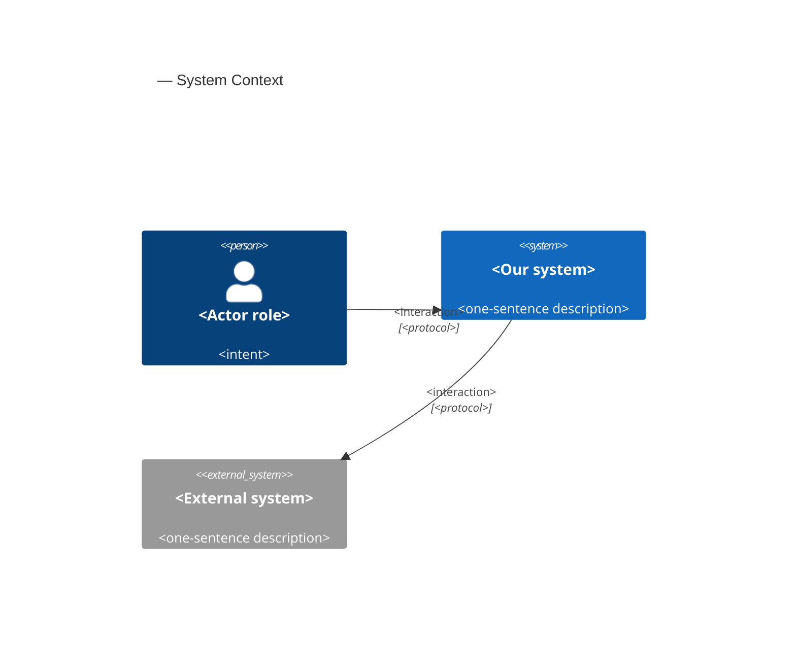
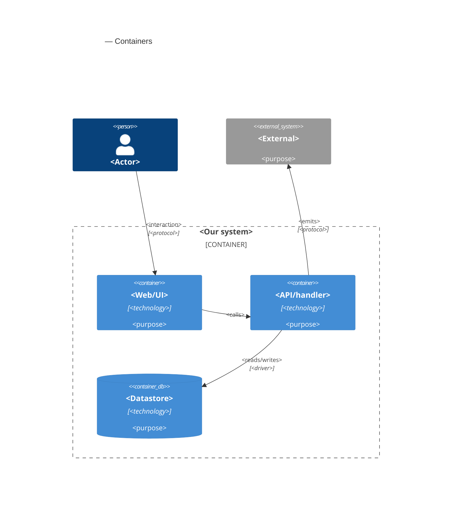

# Software Architecture Document — match-score

<!-- 12 Arc42 sections. Empty section → <!-- N/A: <one-line reason> -->. -->
<!-- C4 Context (L1) lives inline in §3. C4 Container (L2) lives inline in §5. -->
<!-- Numbers in §10 come VERBATIM from spec.md §6 NFR — no inventing, no rounding. -->

## 1. Introduction and goals

**Intent.** The match score tells the owner, on every posting in their list, how well it fits what they are looking for — a number from 0 to 100 split into skills, role type, seniority and terms, with a fit note of at most 40 words on why it fits and what is missing. The owner describes what they are looking for once, in a short editable profile, which they can draft from an uploaded CV. In the background, job-radar asks a language model to score each posting in the owner's list against the profile, within a monthly scoring cap the owner sets. The list stays newest first; "best match first" is a choice, in which postings without a score come first. A score orders the list and never hides a posting, and every posting without one says why. Scoring's own health shows beside the sources' on the source health screen. This is the first feature that sends personal data off the owner's machine: the CV text once, to draft the profile, and the profile — never a name or contact detail — with every scoring, only after the owner has agreed once (spec AC-20).

**Top-3 quality goals (1-liners; full scenarios in §10):**

1. **A score never costs the owner a posting.** 0 postings left out of the list or its counts because of their score; every posting without a score says why (pending, cap reached, could not be scored, no profile yet).
2. **Spending stays within the owner's cap.** The month's scoring and profile drafting never exceed the scoring cap (default $5); 0 attempts started after the cap is reached.
3. **Personal data leaves only as agreed.** 0 scorings carry a name, email, phone number, address or profile link; nothing is sent off the machine before the owner's one-time agreement.
4. **The list stays fast and scores arrive fresh.** ≤ 1 s p95 to the first 50 postings shown, with 10,000 open postings, scores and a profile, in either order; a posting entering the owner's list is scored within 15 minutes p95 while the cap is not reached and the provider answers.

**Stakeholders.**

| Role | Interest | Sign-off owner? |
|---|---|---|
| Owner | Sets up and edits the profile (from a CV or by hand), reads scores and fit notes, orders the list by best match, sets the scoring cap, watches scoring health (US-01 – US-06) | No |
| Visitor | None. Must not upload a CV, read or change the profile, or spend the scoring cap; cannot connect at all (AC-17) | No |
| Tech Lead | SAD approval; owner of the model choice and the scoring contract | Yes |
| Security Lead | Security review required by spec §6.1: the first personal data sent off the machine, a new secret, a new outside party; owner of spec §8 Q2, resolved in §2 | Yes |

## 2. Constraints

**Technical.**
- TypeScript on Node.js 22+ (`.nvmrc`), pnpm workspaces: `apps/server` + `apps/web` (project ADR `docs/adr/0001-typescript-monorepo-react-fastify.md`).
- Server: Fastify `^5.12`, one process on loopback that also serves the built SPA (collector ADR-0001, ADR-0007). Inbound request bodies are limited to Fastify's default 1 MB; no multipart support is installed; every state-changing request must carry a JSON body and must not be cross-site (`core/access.ts`).
- Web: React 19 + Vite single-page app, react-router 8 (routes `/` and `/sources` today), TanStack Query 5, Tailwind v4 with the semantic tokens in `apps/web/src/styles/tokens.css` — which already define `--score-high`, `--score-mid` and `--score-low`.
- Datastore: one SQLite file through `better-sqlite3` + Drizzle ORM; forward-only `drizzle-kit` migrations with a file backup before each migrate (project ADR `docs/adr/0003-sqlite-with-drizzle.md`). One connection shared by every module, synchronous on the server's event loop.
- Language model: Claude through the official Anthropic TypeScript SDK (`docs/architecture-map.md`: "the model is chosen in the match-score feature"). Not installed yet; neither is any PDF or Word reader.
- Background work runs in the server process, as the collector's scheduler does: started on the server's ready hook, stopped through an abort signal on close, in-flight work awaited (`collector/index.ts`, collector ADR-0002).
- Postings, listings, merges and the "updated posting" rule belong to the collector (collector ADR-0004, ADR-0005; `collector/infra/repo/postings.ts`); a posting's change is detected by comparing title, description, location restriction and link, with no stored fingerprint. The list, its snapshots, its fixed order and paging belong to search (search ADR-0003, applied-skipped ADR-0002); location verdicts to remote-filter (remote-filter ADR-0002); marks to tracking.
- Layering per project ADR `docs/adr/0002-feature-modules-mirror-roadmap.md`: `modules/<name>/{domain,app,infra,ports}`; a module reaches another only through that module's `app/` exports.

**Organisational.**
- One owner-developer. Size M, route standard (`.size`, `.route`). No deadline is stated.
- Roadmap wave 4: step 4 runs in parallel with step 10 (LinkedIn adapter, `collector/infra/sources/`), which does not touch the list.

**Conventions.**
- `CLAUDE.md` (layout, layering, errors, IDs, persistence, tests, UI) and `docs/design-system.md` (mobile-first posture, component inventory, 44×44 px touch targets).
- Errors use one envelope `{ "error": { "code", "message" } }`, shaped only by `core/errors.ts`; expected failures throw `AppError(code, message, status)`.
- IDs are UUIDv7 from `core/id.ts`, generated in the app. Tests use Vitest: unit beside the code, server integration in `apps/server/test/` against a temp SQLite file, web with Testing Library.

**Regulatory / external.**
- Data classification is confidential (spec §6.1): the CV and the profile describe the owner's career, level and salary expectations.
- Provider data terms (resolves spec §8 Q2, owner decision 2026-10-15): the standard Anthropic API data terms are accepted; zero data retention is not required. Exposure is kept small by design: the CV text is sent once, to draft the profile, and is not kept locally; afterwards only the profile — no name or contact detail — and each posting's public text are sent. The one-time notice (AC-20) names the provider and points to its terms.
- Source terms are unchanged: postings keep naming their sources (`CLAUDE.md` §Source terms). Sending a posting's public text to the provider for scoring is the owner's personal use and does not republish it.

## 3. Context and scope

<!-- 🎯 Why: draws the SYSTEM BOUNDARY — who talks to it from outside, where the trust zone ends.
     Without §3, §5 and §8 (authorization) blur — unclear what's «inside» vs «outside».
     📋 Write: 2–3 sentences of business context + an external-systems table + a C4Context block.
     📌 «External: none (deliberate, no third-party in v1)» is itself a decision worth stating.
     Trust boundary — the line past which you don't trust data without checking it.
     Never N/A — greenfield still draws the planned actors + external systems. -->

<Business context in 2–3 sentences. What the system does for whom.>

<!-- brownfield: <one-line scan summary> (or «N/A — greenfield repo» if no source existed) -->

**External systems (in / out):**

| Actor or system | Type | Interaction |
|---|---|---|
| <author role> | Person | <what they do> |
| <external service> | System (internal/external) | <interaction> |
| <identity provider> | System (external) | <provides auth tokens> |

**C4 Context (L1):** <!-- syntax → references/c4-mermaid-syntax.md. Real names, no <placeholder> stubs. -->



## 4. Solution strategy

<!-- 🎯 Why: the 3–4 STRATEGIC PILLARS every ADR grows from. Without §4 each ADR looks random —
     there's no umbrella. ⭐ The densest section — the blast-radius gate fires almost always here
     (decisions are irreversible + multi-module).
     📋 Write: 3–4 choices; each a heading + 2–3 sentences of rationale.
     📌 «Store content as a table of typed blocks» is a pillar — ADR-0001 grows from it. -->

**Top strategic choices (the seeds for ADRs):**

1. **<e.g. Module isolation through events>** — <2–3 sentences citing quality goals + constraints>.
2. **<e.g. Single-store persistence>** — <2–3 sentences>.
3. **<e.g. Server-rendered read side>** — <2–3 sentences>.

Each tactical decision in later sections should trace to one of these seeds. Tactical decisions that *contradict* a strategic choice are red flags — surface them in §11.

## 5. Building block view

<!-- 🎯 Why: INTERNAL DECOMPOSITION — modules, containers, datastores. The static topology: who
     may talk to whom. Without §5, §6 (the flows) has no vocabulary of participants.
     📋 Write: 1 ¶ on the style (layered / hexagonal / clean / event-driven) + a folder tree + a
     C4Container block.
     📌 Draw ONE Container per declared `target_surface` (frontmatter): a fullstack
     [backend-service, web-frontend] = a backend-API container + a web/SPA container; a
     [backend-service, mobile-app] = the API + the mobile app. The Container(web, …) line below is
     just one surface's container — swap/add per what was declared in §4. → _shared/surfaces.md
     📌 e.g. «web app, content API, media worker, datastore, object store, CDN». -->

<One paragraph: layered / hexagonal / clean / event-driven, and why.>

**Internal decomposition:**

```
<e.g. modules/<feature>/>
├── domain/       <entities + sentinel errors>
├── app/          <use cases / services>
├── infra/        <repository + integration impl>
├── ports/        <handlers, DTOs, error mapping>
└── wiring        <self-wiring entry point>
```

**C4 Container (L2):** <!-- syntax → references/c4-mermaid-syntax.md. Real names, no <placeholder> stubs. ONE Container per declared target_surface (frontmatter); the web container below is one example surface. -->



## 6. Runtime view

<!-- 🎯 Why: the RUNTIME FLOW of 1–2 critical scenarios — who talks to whom, when, in what order.
     Without §6, §5 is just boxes with no life.
     📋 Write: a Mermaid sequenceDiagram. Participants are names from §5 (don't invent new ones).
     Messages are semantic («saves a draft»), NO HTTP verbs / paths / status codes — endpoint-level
     sequences arrive at the `api` stage.
     📌 e.g. «author → web: composes draft → web → content API: save». Seed the primary flow(s) here;
     the `sequences` stage then covers every §5 AC (no cap). Never N/A for M+; XS/S keeps ≥1 happy-path flow. -->

**Critical flow 1: <flow name>**

```mermaid
sequenceDiagram
    actor Actor
    participant Web
    participant Service
    participant Store
    Actor->>Web: <action>
    Web->>Service: <call>
    Service->>Store: <write>
    Store-->>Service: ok
    Service-->>Web: result
    Web-->>Actor: confirmation
```

**Critical flow 2: <e.g. async event propagation>** — <if applicable, otherwise N/A>.

## 7. Deployment view

<!-- 🎯 Why: the TOPOLOGY DevOps must know without reading the deploy charts — how many replicas,
     where the background worker lives, AT WHAT NUMBERS we scale.
     📋 Write: 2–3 sentences on topology + monitoring + concrete threshold numbers.
     📌 e.g. «500 authors → partition by quarter» (not «we'll think about scale later»).
     🎯 N/A allowed for XS/S that reuses an existing deployment unit with no change.
     Deployment-diagram scaffold → templates/deployment.md. -->

<Topology in 2–3 sentences. Where it runs, replicas, scaling thresholds.>

**Monitoring:**
- <Metrics — e.g. `<metric_name>`>
- <Alerts — e.g. «worker lag > 10 min → page on-call»>
- <Tracing — e.g. spans on the request boundary>

**Scaling thresholds:**
- <e.g. comfortable in one table up to N rows/year>
- <e.g. partition by quarter above N rows/year>

<!-- For XS/S with no deployment change: <!-- N/A: reuses existing deployment unit, no infra change --> -->

## 8. Crosscutting concepts

<!-- 🎯 Why: CROSS-CUTTING PATTERNS spanning several modules: logging, errors, authorization, ID
     strategy, events, caching. ⭐ The second-densest section. A pattern inside one module is NOT
     here; a project-wide convention belongs in the convention file.
     📋 Write: a table — concept / convention / where defined. One row per concept.
     📌 e.g. «sortable time-based IDs generated in the app layer» as a default from the convention file. -->

| Concept | Convention | Where defined |
|---|---|---|
| Logging | <e.g. structured, fields `module=<name>`> | <convention file §X or here> |
| Authentication | <e.g. token-based via middleware> | <convention file §X> |
| Error handling | <e.g. domain sentinel → ports error mapping → JSON> | <convention file §X> |
| ID strategy | <e.g. sortable time-based ID in the app layer> | <convention file §X> |
| Internationalisation | <e.g. N/A, single language> | — |
| Observability | <e.g. tracing on the request boundary> | — |
| Events | <module-specific patterns, if any> | <here> |

## 9. Architecture decisions

<!-- 🎯 Why: the REVERSE INDEX onto the adr/ folder. `ls adr/` gives the files; §9 gives the
     semantics — why they exist, which SAD section they attach to, what status.
     📋 Write: a 4-column table, one row per ADR. Mixed status is fine.
     📌 e.g. «0001 | Store content as a table of typed blocks | Accepted | §4». -->

| # | Title | Status | Section |
|---|---|---|---|
| <NNNN> | <imperative — e.g. "Use a sliding-window counter for rate limiting"> | Accepted | §<N> |
| <NNNN> | <imperative — e.g. "Co-locate the worker in the API process"> | Accepted | §<N> |

ADR files live under `docs/features/<slug>/adr/NNNN-<title>.md`.

## 10. Quality requirements

<!-- 🎯 Why: the QUALITY TREE — take a goal from §1 and break it into concrete leaves: tests,
     metrics, configs, drills. ⭐ Without §10, §1 is a manifesto. With §10 each declaration maps
     to something PROVABLE.
     📋 Write: per §1 goal — When / Then / How-verify. Numbers from spec §6 NFR VERBATIM (don't
     round ≤250ms to ≤300ms — that's a critic F6 hit).
     📌 e.g. «p95 ≤ 500 ms on a block update, verified by a 100 req/s load test». -->

Each top-3 goal from §1 expanded into a full scenario:

**QG-1. <quality attribute>**
- **When:** <trigger condition>
- **Then:** <expected behaviour with numbers from spec §6 NFR>
- **How verify:** <test / chaos drill / load test / metric>

**QG-2. <quality attribute>**
- **When:** <trigger>
- **Then:** <expected>
- **How verify:** <how>

**QG-3. <quality attribute>**
- **When:** <trigger>
- **Then:** <expected>
- **How verify:** <how>

## 11. Risks and technical debt

<!-- 🎯 Why: ⭐ collects EVERYTHING that can break — not only the technical. Without §11 risks get
     discussed at standups and lost; debt lives only in the head of whoever accepted it.
     📋 Write: a risk/debt table — severity — mitigation — owner. Accepted debt in its own block.
     📌 The first risk is often a product risk, not a technical one. That's normal. -->

<!-- Severity literals: Low / Medium / High for regular risks; "Open question" for rows created by
     a Save-as-OQ resolution during the Socratic walk (see references/socratic.md). -->

| Risk / debt | Severity | Mitigation | Owner |
|---|---|---|---|
| <e.g. Worker lag may reach hours during a downstream outage> | Medium | <alert >10 min, on-call playbook, retry backoff> | <DevOps> |
| <e.g. No event-schema versioning in v1> | Medium | <ADR-NNNN planned for v2, tolerate unknown fields> | <Backend> |
| Open architectural decision: <decision-headline> | Open question | Resolve before <stage trigger or YYYY-MM-DD>; <inline rationale from the Save-as-OQ> | <owner> |

**Accepted debt (acceptable in v1, plan to fix later):**
- <e.g. the entity is immutable / unversioned — OK for v1, may need audit versioning in v2>

## 12. Glossary

<!-- 🎯 Why: ⭐ the DOMAIN GLOSSARY that ends arguments a year later («checkpoint — weekly or
     biweekly? quarter — calendar or fiscal?»).
     📋 Write: a term / meaning table. Business + technical terms mixed.
     📌 e.g. «Lesson | a unit inside a course made of blocks (text, video)». -->

| Term | Meaning |
|---|---|
| <e.g. domain object A> | <its meaning in this domain> |
| <e.g. domain object B> | <its meaning> |
| <e.g. domain invariant name> | <the rule, in plain language> |
