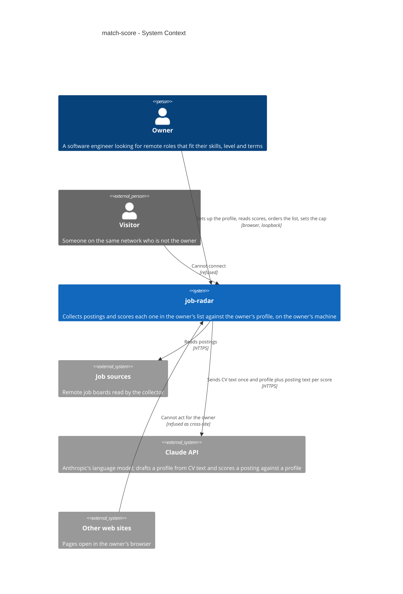
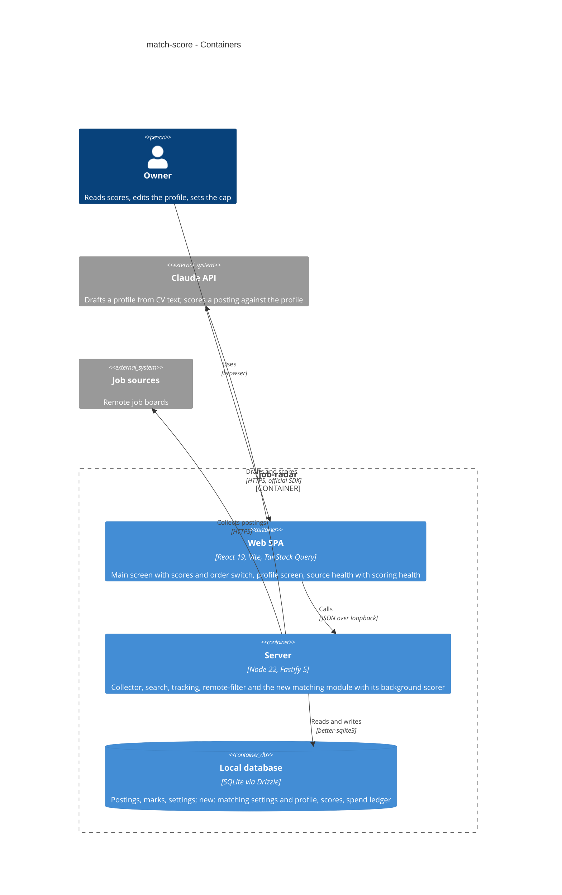
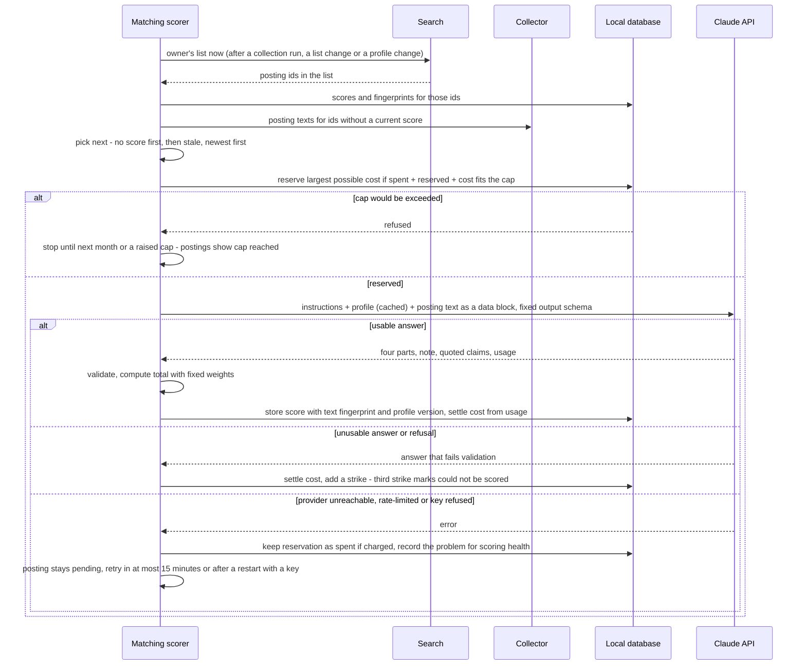
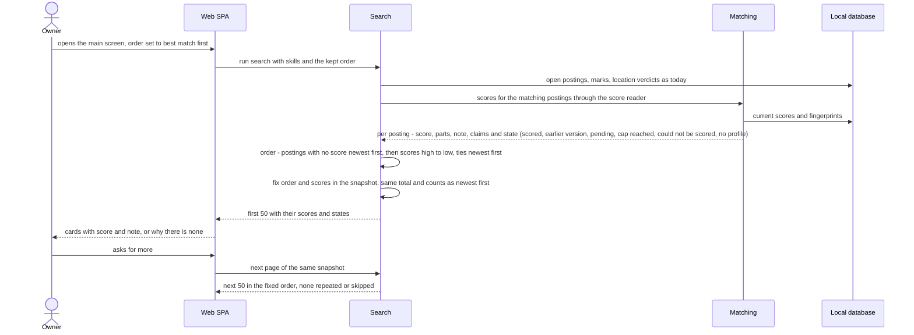
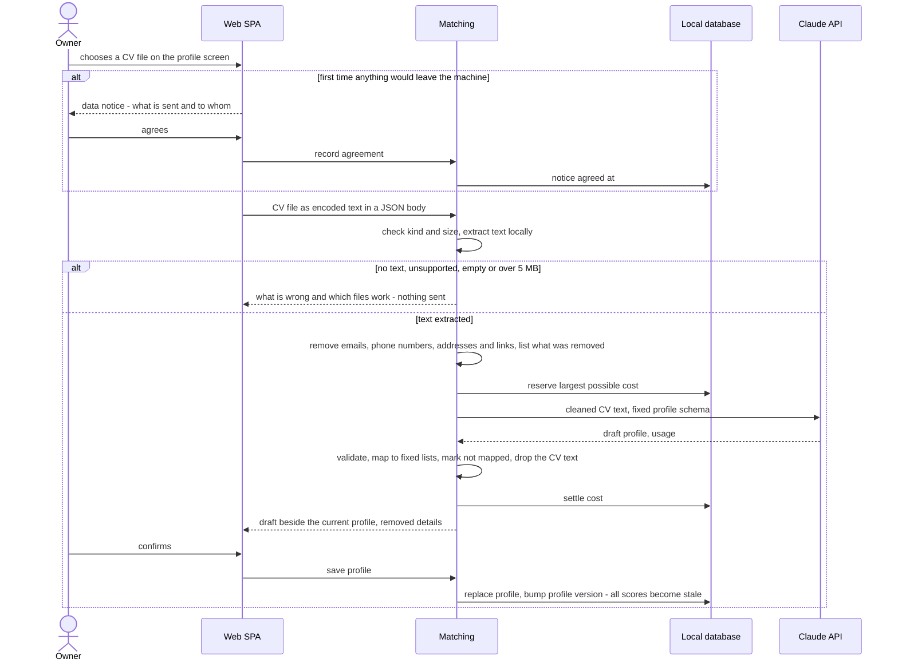

# Software Architecture Document — match-score

<!-- 12 Arc42 sections. Empty section → <!-- N/A: <one-line reason> -->. -->
<!-- C4 Context (L1) lives inline in §3. C4 Container (L2) lives inline in §5. -->
<!-- Numbers in §10 come VERBATIM from spec.md §6 NFR — no inventing, no rounding. -->

## 1. Introduction and goals

**Intent.** The match score tells the owner, on every posting in their list, how well it fits what they are looking for — a number from 0 to 100 split into skills, role type, seniority and terms, with a fit note of at most 40 words on why it fits and what is missing. The owner describes what they are looking for once, in a short editable profile, which they can draft from an uploaded CV. In the background, job-radar asks a language model to score each posting in the owner's list against the profile, within a monthly scoring cap the owner sets. The list stays newest first; "best match first" is a choice, in which postings without a score come first. A score orders the list and never hides a posting, and every posting without one says why. Scoring's own health shows beside the sources' on the source health screen. This is the first feature that sends personal data off the owner's machine: the CV text once, to draft the profile, and the profile — never a name or contact detail — with every scoring, only after the owner has agreed once (spec AC-20).

**Top-3 quality goals (1-liners; full scenarios in §10):**

1. **A score never costs the owner a posting.** 0 postings left out of the list or its counts because of their score; every posting without a score says why (pending, cap reached, could not be scored, no profile yet).
2. **Spending stays within the owner's cap.** The month's scoring and profile drafting never exceed the scoring cap (default $5); 0 attempts started after the cap is reached.
3. **Personal data leaves only as agreed.** 0 scorings carry a name, email, phone number, address or profile link; nothing is sent off the machine before the owner's one-time agreement.
4. **The list stays fast and scores arrive fresh.** ≤ 1 s p95 to the first 50 postings shown, with 10,000 open postings, scores and a profile, in either order; a posting entering the owner's list is scored within 15 minutes p95 while the cap is not reached and the provider answers.

**Stakeholders.**

| Role | Interest | Sign-off owner? |
|---|---|---|
| Owner | Sets up and edits the profile (from a CV or by hand), reads scores and fit notes, orders the list by best match, sets the scoring cap, watches scoring health (US-01 – US-06) | No |
| Visitor | None. Must not upload a CV, read or change the profile, or spend the scoring cap; cannot connect at all (AC-17) | No |
| Tech Lead | SAD approval; owner of the model choice and the scoring contract | Yes |
| Security Lead | Security review required by spec §6.1: the first personal data sent off the machine, a new secret, a new outside party; owner of spec §8 Q2, resolved in §2 | Yes |

## 2. Constraints

**Technical.**
- TypeScript on Node.js 22+ (`.nvmrc`), pnpm workspaces: `apps/server` + `apps/web` (project ADR `docs/adr/0001-typescript-monorepo-react-fastify.md`).
- Server: Fastify `^5.12`, one process on loopback that also serves the built SPA (collector ADR-0001, ADR-0007). Inbound request bodies are limited to Fastify's default 1 MB; no multipart support is installed; every state-changing request must carry a JSON body and must not be cross-site (`core/access.ts`).
- Web: React 19 + Vite single-page app, react-router 8 (routes `/` and `/sources` today), TanStack Query 5, Tailwind v4 with the semantic tokens in `apps/web/src/styles/tokens.css` — which already define `--score-high`, `--score-mid` and `--score-low`.
- Datastore: one SQLite file through `better-sqlite3` + Drizzle ORM; forward-only `drizzle-kit` migrations with a file backup before each migrate (project ADR `docs/adr/0003-sqlite-with-drizzle.md`). One connection shared by every module, synchronous on the server's event loop.
- Language model: Claude through the official Anthropic TypeScript SDK (`docs/architecture-map.md`: "the model is chosen in the match-score feature"). Not installed yet; neither is any PDF or Word reader.
- Background work runs in the server process, as the collector's scheduler does: started on the server's ready hook, stopped through an abort signal on close, in-flight work awaited (`collector/index.ts`, collector ADR-0002).
- Postings, listings, merges and the "updated posting" rule belong to the collector (collector ADR-0004, ADR-0005; `collector/infra/repo/postings.ts`); a posting's change is detected by comparing title, description, location restriction and link, with no stored fingerprint. The list, its snapshots, its fixed order and paging belong to search (search ADR-0003, applied-skipped ADR-0002); location verdicts to remote-filter (remote-filter ADR-0002); marks to tracking.
- Layering per project ADR `docs/adr/0002-feature-modules-mirror-roadmap.md`: `modules/<name>/{domain,app,infra,ports}`; a module reaches another only through that module's `app/` exports.

**Organisational.**
- One owner-developer. Size M, route standard (`.size`, `.route`). No deadline is stated.
- Roadmap wave 4: step 4 runs in parallel with step 10 (LinkedIn adapter, `collector/infra/sources/`), which does not touch the list.

**Conventions.**
- `CLAUDE.md` (layout, layering, errors, IDs, persistence, tests, UI) and `docs/design-system.md` (mobile-first posture, component inventory, 44×44 px touch targets).
- Errors use one envelope `{ "error": { "code", "message" } }`, shaped only by `core/errors.ts`; expected failures throw `AppError(code, message, status)`.
- IDs are UUIDv7 from `core/id.ts`, generated in the app. Tests use Vitest: unit beside the code, server integration in `apps/server/test/` against a temp SQLite file, web with Testing Library.

**Regulatory / external.**
- Data classification is confidential (spec §6.1): the CV and the profile describe the owner's career, level and salary expectations.
- Provider data terms (resolves spec §8 Q2, owner decision 2026-10-15): the standard Anthropic API data terms are accepted; zero data retention is not required. Exposure is kept small by design: the CV text is sent once, to draft the profile, and is not kept locally; afterwards only the profile — no name or contact detail — and each posting's public text are sent. The one-time notice (AC-20) names the provider and points to its terms.
- Source terms are unchanged: postings keep naming their sources (`CLAUDE.md` §Source terms). Sending a posting's public text to the provider for scoring is the owner's personal use and does not republish it.

## 3. Context and scope

The owner runs job-radar on their own laptop. The collector fills the local database from remote job boards, search shows the owner the open postings that match their skills, the remote filter hides those not open to their country, and marks take decided postings out of the list. This feature adds one outside party, the Claude API: job-radar sends it the owner's CV text once to draft a profile, and the profile with each posting's text to score the posting. It is the first trust boundary crossed in both directions — personal data goes out only after the owner's one-time agreement, and what comes back is model output built from third-party posting text, so it is checked against a fixed shape and shown as plain text before anything uses it.

<!-- brownfield: architecture-map.md is stale (reflects 133499e); the code was scanned directly on 2026-10-15. Modules: health, collector (postings, listings, merge, source readers, scheduler with abort-signal shutdown, source health + problems endpoint), search (in-memory snapshots of ordered ids, order fixed at load, verdicts and checks computed at snapshot time), tracking (marks), remote-filter (settings singleton, verdicts on read). No LLM SDK, file upload or PDF/Word reader yet; latest migration 0005. -->

**External systems (in / out):**

| Actor or system | Type | Interaction |
|---|---|---|
| Owner | Person | Sets up the profile (CV or by hand), reads scores and fit notes, orders the list, sets the scoring cap |
| Visitor | Person (external) | Can reach the machine over the network but cannot connect: loopback only (AC-17, collector ADR-0007) |
| Other web sites | System (external) | Pages open in the owner's browser; a request from them to upload a CV, change the profile or the cap is refused as cross-site (AC-17) |
| Job sources | System (external) | Read by the collector, unchanged; their posting text is what gets scored |
| Claude API (Anthropic) | System (external) | New. Receives the CV text once (draft profile) and the profile with each posting's text (scoring), over HTTPS with the owner's provider key; returns a draft or a score that job-radar checks before use |

**C4 Context (L1):**



## 4. Solution strategy

**Target surfaces: `backend-service` + `web-frontend`** ([ADR-0001](adr/0001-ship-match-score-as-a-new-matching-module-plus-a-profile-screen-and-card-additions.md)). The profile, the background scorer, spend accounting, CV reading and scoring health live in a new `matching` server module, in the existing server process — no separate worker. The UI stays the existing React SPA (react-router, TanStack Query, the design-system components and tokens), gaining a `/profile` route (SCR-03) and additions to the main screen (SCR-01) and source health (SCR-02). No UI-architecture change: inline, not a separate decision.

**Top strategic choices (the seeds for ADRs):**

1. **Claude Opus 5.5 at low effort, one posting at a time, in the background** ([ADR-0002](adr/0002-score-with-claude-opus-5-5-at-low-effort.md), [ADR-0003](adr/0003-score-one-posting-at-a-time-with-the-messages-api-in-a-background-scorer.md)). Quality of the parts and the fit note drives the success KPI and resistance to planted wording (spec §7, AC-03), so the owner chose the strongest model over volume; at the $5 default about 270 scorings fit in a month, and the owner raises the cap for their full stream (AC-19). Ordinary requests, one at a time, keep a new posting's score within seconds (freshness ≤ 15 minutes p95) and make every attempt a single spend reservation; prompt caching of the instructions and profile lowers input cost.
2. **The list is search's; scores flow back through an injected reader** ([ADR-0004](adr/0004-read-scores-into-search-through-an-injected-reader-and-read-the-list-from-search.md)). Matching scores exactly the owner's list (AC-13), read from a new search export; search reads scores through a `ScoreReader` wired in `app.ts`, as it already reads location verdicts, and fixes scores and the best-match order when it builds a snapshot. No import cycle; one definition of the list.
3. **A score is stored once per posting and judged stale by fingerprints** ([ADR-0005](adr/0005-keep-one-score-per-posting-with-text-and-profile-fingerprints.md)). The score row records a hash of exactly the text that was scored and the profile version; a mismatch marks it stale (AC-06, AC-10) without touching the collector.
4. **Trust boundaries are enforced in code, not left to the model** ([ADR-0006](adr/0006-reserve-the-largest-possible-cost-before-each-attempt-and-settle-from-usage.md), [ADR-0007](adr/0007-extract-cv-text-locally-and-send-only-text.md), [ADR-0008](adr/0008-constrain-model-output-to-part-scores-and-compute-the-total-in-job-radar.md)). Money: a ledger reserves each attempt's largest possible cost before it starts, so the cap cannot be exceeded. Personal data: CV text is extracted and cleaned of contact details locally, so a scan is refused and contacts are removed before anything leaves the machine. Untrusted output: the model returns only part scores, a note and quoted claims in a fixed schema; job-radar validates them and computes the total itself, so planted wording cannot set the score.

Each tactical decision in later sections traces to one of these seeds. Tactical decisions that contradict a strategic choice are red flags — surface them in §11.

## 5. Building block view

Layered, as every module in the repo (project ADR 0002): `domain/` holds pure rules with no I/O, `app/` the use cases and the exports other modules may call, `infra/` the tables, the Claude client and the CV reader, `ports/` the routes. `matching` reads postings through `collector/app/` and the owner's list through a new `search/app/` export; search reads scores through a `ScoreReader` that `app.ts` wires in (ADR-0004). Scoring health is matching's own; the web shows the main-screen problem marker when either the collector's problems or matching's scoring health report a problem, so the collector is unchanged.

**Internal decomposition:**

```
apps/server/src/modules/matching/
├── domain/       profile rules (fixed lists, field checks, contact detection), score total (weights 50/20/15/15, neutral rule),
│                 answer validation (AC-18), text fingerprint, cap rule (largest possible cost, month boundary)
├── app/          profile use cases (save, change-detection, notice consent), CV draft, scorer (queue, one attempt at a time,
│                 retry policy), scoring health, scoreReader export for search, cap settings
├── infra/        schema (matching_settings singleton, match_scores, scoring_spend), repo, claude client (SDK wrapper:
│                 structured output, usage, error classes), cv text extraction (PDF, DOCX, text)
├── ports/        routes: profile, CV draft, cap, notice, scoring health
└── index.ts      createMatching(deps) → { plugin, scoreReader, start/stop } registered in app.ts

apps/server/src/modules/search/   app/deps.ts gains ScoreReader; app/ gains ownerListIds(); snapshot keeps a score per posting
                                  and the best-match order; search_state keeps the chosen order (AC-11)
apps/web/src/                     routes/Profile.tsx (SCR-03), features/matching/ (score on PostingCard, order switch,
                                  no-profile and cap lines, notice step), features/source-health/ (scoring health block, marker)
```

Tables (shapes fixed in `data-model`): `matching_settings` — one row: the profile (fields per CONTEXT: Profile) and its version, the scoring cap, when the data notice was agreed; `match_scores` — one row per scored posting: four parts, note, quoted claims, total, text fingerprint, profile version, strikes and last failure, removed with the posting; `scoring_spend` — one row per attempt: kind (score / draft), reserved and settled cost, model, usage, outcome, time. The chosen list order lives in search's existing `search_state` row, beside the last skills.

**C4 Container (L2):**



## 6. Runtime view

Participants are the §5 containers, with the server shown by module. Messages are semantic; endpoint-level detail arrives at the `api` stage. The `sequences` stage covers the remaining ACs (profile edit, cap change, stale scores, marked view).

**Critical flow 1: background scoring of one posting** (AC-01, AC-06, AC-12 – AC-14, AC-18; ADR-0003, ADR-0004, ADR-0006, ADR-0008)



**Critical flow 2: loading the list in best-match order** (AC-02, AC-11, AC-15; ADR-0004)



**Critical flow 3: drafting the profile from a CV** (AC-07 – AC-09, AC-20; ADR-0006, ADR-0007)



## 7. Deployment view

No new deployment unit: the `matching` module and its background scorer run in the existing server process on the owner's machine, started on the server's ready hook and stopped through an abort signal on close, as the collector is (ADR-0001, ADR-0003). One new migration adds the three matching tables and the order field on `search_state`; it runs with the existing `db:migrate`, which backs up the database first. New configuration, read once at start: the provider key from the `ANTHROPIC_API_KEY` environment variable (the SDK's standard source; never in the repository, never shown or logged), the model id and the price table (defaults for `claude-opus-5-5`: $4 input, $20 output, $0.20 cache read per million tokens), and the scorer's concurrency (default 1). Without a key the feature runs in its AC-14 state ("not scored", reason shown); nothing else breaks. Deployment checklist gains: set the key, and set a spending limit in the provider account as the backstop for a leaked key (spec §6.1).

**Monitoring:**
- Scoring health on SCR-02 is the monitor: last success, spend this month against the cap, pending count and the oldest pending age, could-not-be-scored count, current problem; a problem raises the main-screen marker (AC-14).
- Server logs, structured, `module=matching`: one line per attempt with posting id, outcome, tokens and cost — never CV text, profile, prompt bodies or the key (§8).
- Alert by the marker: provider problem or key problem while postings are pending; oldest pending older than 15 minutes while the cap is not reached.

**Scaling thresholds:**
- One attempt at a time keeps the 15-minute freshness target up to about 200 new postings an hour entering the list (a scoring takes seconds); above that, raise the scorer's concurrency to 2–3.
- `match_scores` holds at most one row per open posting (10,000 in the search NFR); `scoring_spend` grows by one row per attempt — about 1,500–3,000 a month — comfortable in SQLite for years; trimming rows older than 12 months is optional housekeeping.

## 8. Crosscutting concepts

| Concept | Convention | Where defined |
|---|---|---|
| Access | Loopback only, same-origin, JSON body on every state-changing request; applies unchanged to profile, CV draft, cap and notice actions (AC-17) | `core/access.ts`, collector ADR-0007 |
| CV upload transport | The file travels base64-encoded inside a JSON body; that one route raises its body limit to 7 MB (5 MB file plus encoding); no multipart, so the JSON rule above stays the CSRF guard | here |
| Error handling | Expected failures throw `AppError(code, message, status)`; one envelope `{ "error": { "code", "message" } }` | `core/errors.ts`, `CLAUDE.md` |
| Provider errors | Classified by the SDK's typed errors: rate limit, overloaded, connection and timeout → provider problem (pending, retried, AC-14); authentication or permission → key problem (retried after a restart); validation failure or `refusal` stop reason → unusable answer, a strike (AC-18). The SDK's own retries are off (`maxRetries: 0`), so every attempt passes through a spend reservation (ADR-0006) | here |
| Logging | Structured, `module=matching`; never log CV text, profile fields, prompt or answer bodies, or the key; log posting id, outcome, tokens, cost | here, Fastify logger |
| Secrets | Provider key only from `ANTHROPIC_API_KEY`; never stored in the database, shown on screen, put in an error message or logged | here, spec §6.1 |
| Untrusted text | Posting text and model output are data: the fit note and quoted claims render as plain text, claims as "the posting says…" (AC-03); posting text enters prompts only inside a delimited data block | search AC-09, ADR-0008 |
| Personal data | CV text never stored; contact details removed before sending (AC-09) and rejected on save (AC-16); profile holds no name or contact detail; nothing sent before the one-time notice is agreed (AC-20) | ADR-0007, spec §6.1 |
| ID strategy | UUIDv7 from `core/id.ts` for spend rows; scores keyed by posting id | `CLAUDE.md` |
| Time | Calendar month in the machine's time zone (`machineTimeZone()` in `core/config.ts`), as the grace day | `core/config.ts` |
| Internationalisation | N/A — single language (English UI) | — |
| Observability | Scoring health (SCR-02) plus logs; no tracing | §7 |

## 9. Architecture decisions

<!-- 🎯 Why: the REVERSE INDEX onto the adr/ folder. `ls adr/` gives the files; §9 gives the
     semantics — why they exist, which SAD section they attach to, what status.
     📋 Write: a 4-column table, one row per ADR. Mixed status is fine.
     📌 e.g. «0001 | Store content as a table of typed blocks | Accepted | §4». -->

| # | Title | Status | Section |
|---|---|---|---|
| 0001 | Ship match score as a new matching module plus a profile screen and card additions | Accepted | §4 |
| 0002 | Score with Claude Opus 5.5 at low effort | Accepted | §4 |
| 0003 | Score one posting at a time with the Messages API in a background scorer | Accepted | §4 |
| 0004 | Read scores into search through an injected reader and read the list from search | Accepted | §4 |
| 0005 | Keep one score per posting with text and profile fingerprints | Accepted | §4 |
| 0006 | Reserve the largest possible cost before each attempt and settle from usage | Accepted | §4 |
| 0007 | Extract CV text locally and send only text | Accepted | §4 |
| 0008 | Constrain model output to part scores and compute the total in job-radar | Accepted | §4 |

ADR files live under `docs/features/match-score/adr/NNNN-<title>.md`.

## 10. Quality requirements

Each quality goal from §1 expanded into a full scenario; numbers from spec §6 verbatim.

**QG-1. A score never costs the owner a posting**
- **When:** the owner's list is built with scores present, low scores included, in either order.
- **Then:** "0 postings left out of the list or its counts because of their score" (spec §6 Never a hide by score); every posting without a score carries its reason (pending, cap reached, could not be scored; no profile once for the list).
- **How verify:** property test in `apps/server/test/`: for generated collections and score sets, the list with and without scores holds the same postings and the same total, hidden, "new" and marked counts; a stand-in `ScoreReader` returns every score state.

**QG-2. Spending stays within the owner's cap**
- **When:** scoring and a CV draft run against a cap with little left, including charged failures and two attempts reserving at once.
- **Then:** "the month's scoring and profile drafting never exceed the scoring cap (default $5); 0 attempts started after the cap is reached" (spec §6 Spending).
- **How verify:** unit tests of the cap rule and the reserve-and-settle ledger (ADR-0006) with a stand-in provider that answers, fails after charging, times out and refuses; scoring health shows the month's spend.

**QG-3. Personal data leaves only as agreed**
- **When:** the owner uploads a CV full of contact details, then scoring runs; or anything would be sent before the notice is agreed.
- **Then:** "0 scorings carry a name, email, phone number, address or profile link" (spec §6 No personal details sent); nothing is sent before the one-time notice is agreed (AC-20).
- **How verify:** unit tests over what the stand-in provider receives for the draft and for scorings, with a CV holding an email, phone, address and links; an integration test that a draft or scoring before agreement sends nothing.

**QG-4. The list stays fast and scores arrive fresh**
- **When:** the list loads with 10,000 open postings, scores and a profile, in either order; postings enter the list at up to 50 an hour; a CV of up to 5 MB is uploaded.
- **Then:** "≤ 1 s p95 to the first 50 postings shown, with 10,000 open postings, scores and a profile — unchanged from search, in either order" (spec §6 Search response with scores); "a posting with no score that enters the owner's list is scored within 15 minutes p95, also while stale scores are being redone" (spec §6 Scoring freshness); "the draft profile is shown ≤ 60 s p95 after a CV upload of up to 5 MB" (spec §6 Draft profile time).
- **How verify:** the existing `search-nfr` integration test rerun with scores and best match first; an integration test with a stand-in provider feeding 50 postings an hour during a re-score, asserting the oldest pending age; an integration test of the draft path with a 5 MB file and a stand-in provider.

**QG-5. Scores are stable and resist planted wording**
- **When:** the same posting is scored repeatedly against the same profile; postings carry wording addressed to the scorer or location phrases in their description.
- **Then:** "the same posting scored twice against the same profile differs by ≤ 10 points in 95% of cases" (spec §6 Score stability); over five scorings of each version, the median with planted wording is no more than 10 points above the median without it (AC-03), and a description location phrase moves the median by no more than 10 points (AC-05).
- **How verify:** an evaluation run with the real model over a fixed set of postings and one profile — run by hand before `ship` and after any change to the prompt, the output schema or the model, not in the regular gate (it costs about $1–2 a run on Opus 5.5). The regular gate stays free and deterministic with a stand-in provider.

## 11. Risks and technical debt

| Risk / debt | Severity | Mitigation | Owner |
|---|---|---|---|
| Product: at the $5 default, Opus 5.5 covers about 270 scorings — roughly one to two weeks of the owner's stream (ADR-0002) | Medium | The cap-reached line says so and when scoring resumes (AC-12); the owner raises the cap (AC-19, about $15–30 for the full stream); measure the real cost per scoring in `implement` and, if needed, switch the model by configuration after a Score stability run | Volodymyr Kozlov |
| Planted wording in posting text still moves the part scores | Medium | Fixed output schema, total computed in job-radar, posting text in a delimited data block, claims shown as the posting's words (ADR-0008); AC-03 evaluation run before `ship` | Volodymyr Kozlov (Security Lead) |
| Scores bunch in a narrow band and the applied-vs-skipped KPI is missed | Medium | Review the KPI at 30 days (spec §7); calibrate the instructions and part definitions; re-run the evaluation set after each change | Volodymyr Kozlov |
| The stored price drifts from the provider's price list, so job-radar's spend count understates the bill | Low | Price table is configuration; set a spending limit in the provider account (spec §6.1, §7 deployment checklist) | Volodymyr Kozlov |
| Two new dependencies for reading PDF and Word files | Low | Pick small, maintained libraries in `tasks`; they only read local files; pin versions | Volodymyr Kozlov |
| Brownfield: `docs/architecture-map.md` is stale (reflects 133499e, about 200 commits behind) | Low | Run `/sdd:survey` to refresh it after this feature ships | Volodymyr Kozlov |
| Spec §8 Q1 open: should the profile's core skills also bring postings into the list | Low | Default stays: typed skills alone decide the list; decide by 2026-10-31 | Volodymyr Kozlov |

**Accepted debt (acceptable in v1, plan to fix later):**
- Only the current score per posting is kept; no history of earlier scores.
- The scorer runs one attempt at a time; raise concurrency if the stream exceeds about 200 postings an hour (§7).
- Postings that newly enter the list after switching the filter off, widening skills or starting a one-off look show "pending" until scored in their turn (AC-13).

## 12. Glossary

<!-- 🎯 Why: ⭐ the DOMAIN GLOSSARY that ends arguments a year later («checkpoint — weekly or
     biweekly? quarter — calendar or fiscal?»).
     📋 Write: a term / meaning table. Business + technical terms mixed.
     📌 e.g. «Lesson | a unit inside a course made of blocks (text, video)». -->

| Term | Meaning |
|---|---|
| <e.g. domain object A> | <its meaning in this domain> |
| <e.g. domain object B> | <its meaning> |
| <e.g. domain invariant name> | <the rule, in plain language> |
