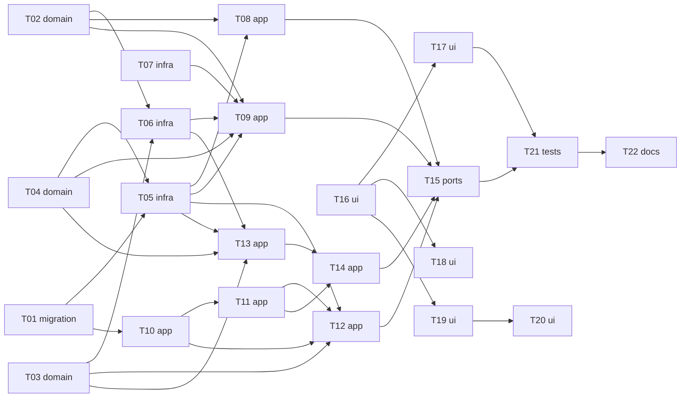

# Epic — match-score

> **Spec:** [spec.md](../spec.md) · **Design:** [sad.md](../sad.md) · **Data model:** [data-model.md](../data-model.md) · **API:** [openapi.yaml](../contracts/openapi.yaml) · **Screens:** [screens.md](../screens.md) · **ADRs:** [adr/](../adr/)

## Goal

Every posting in the owner's list carries a match score with a short fit note, or says why it has none. The owner keeps one editable profile, drafted from a CV or typed by hand, and can put the best matches first. Scoring stays within a monthly cap, and its health shows beside source health (spec §2).

## Scope

- **In:** a new `matching` server module (all four layers), changes in `search` (score reader, best-match order, owner-list export, marked-view scores), `app.ts` wiring, the web main screen (SCR-01), source health (SCR-02) and a new profile screen (SCR-03), and the docs and contract pointers.
- **Out (spec §3):**
  - hiding postings by score or by a threshold;
  - judging location from the description;
  - CV tailoring or cover letters;
  - several profiles;
  - scoring postings the owner does not see.

## Task map

- **Wave 1:** T01, T02, T03, T04, T07, T16
- **Wave 2:** T05, T06, T10, T17, T18, T19
- **Wave 3:** T08, T09, T11, T13, T20
- **Wave 4:** T12, T14
- **Wave 5:** T15
- **Wave 6:** T21
- **Wave 7:** T22

The backend chain (T01 → T05 → T08/T09/T12/T13 → T14 → T15) and the web chain (T16 → T17/T18/T19 → T20) run in parallel. The web builds against the contract's examples. T21 joins them, and T22 closes the epic.

## Tasks

See [tracker.md](./tracker.md) for status. Machine contract: [tasks.json](../tasks.json).

| # | Task | Layer | Blocked by | DoD (short) |
|---|---|---|---|---|
| T01 | Promote the staged schema: the three matching tables and search_state.list_order | migration | — | The generated drizzle migration applies on a copy of a database at 0005, and `matching-schema.integration.test.ts` passes (columns, FK refusal, cascade, NOT NULL cap). |
| T02 | Write the profile rules: fixed lists, field checks, contact detection, change detection and salary periods | domain | — | `profile.test.ts` passes for every AC-16 case, the AC-09 contact kinds, the AC-10 change/no-change pairs and the F-6 period table. |
| T03 | Write the score rules: total with fixed weights, answer validation, text fingerprint, staleness and the match state | domain | — | `score.test.ts` passes: AC-01's example scores ≥ 80, AC-04's unstated parts do not lower it, every AC-18 unusable shape is refused, and staleness/state follow the contract table. |
| T04 | Write the spend rules: largest possible cost, settled cost from usage, month boundary and cents rounding | domain | — | `spend.test.ts` passes, including the AC-12 $4.98 refusal, the $0 pause and the month boundary in the machine time zone. |
| T05 | Write matching's repo: settings singleton, scores, and the spend ledger with reserve-in-one-transaction | infra | T01, T04 | `matching-repo.integration.test.ts` passes: the lazy upsert, reserve refusal at $4.98/$5, two back-to-back reservations, settle/no-answer sums and the score upsert/strike round trip. |
| T06 | Add the Claude client: SDK, configuration, fixed output schemas, usage, error classes and a stand-in provider | infra | T02, T03 | The error-classification unit test passes for every row of the edge-case table, and a test against the stand-in shows the prompt carries the posting only inside the data block and no key, name or contact detail. |
| T07 | Extract CV text locally from PDF, Word (.docx) and plain text, with the AC-08 refusals | infra | — | `cv-text.test.ts` passes for every fixture: text from PDF, .docx and .txt; the four AC-08 refusals for scan, empty, unsupported and oversized files. |
| T08 | Implement the settings use cases: read settings, save profile, agree to the notice, set the cap | app | T02, T05 | `matching-settings.integration.test.ts` passes every edge-case row plus AC-10 (senior → staff bumps the version) and AC-21 (first profile by hand wakes the scorer). |
| T09 | Implement the CV draft use case: extract, remove contacts, reserve, ask, map to the fixed lists, drop the CV | app | T02, T04, T05, T06, T07 | `matching-cv-draft.integration.test.ts` passes every edge-case row, and no request the stand-in received carries a name, email, phone, address or link. |
| T10 | Give search a ScoreReader, the best-match order and a match on every posting | app | T01 | `search-scores.integration.test.ts` passes AC-11's order and paging over 130 postings, AC-02's 40 with 25 below 30 in both orders with identical counts, AC-15's no-profile list, and the fail-open case; the existing search tests stay green. |
| T11 | Export the owner's list from search and show the last score in the marked view | app | T10 | `search-owner-list.integration.test.ts` passes AC-13: exactly the 30 listed postings, newest first, none of the 20 hidden or 5 marked; the marked view returns each marked posting's last score. |
| T12 | Implement matching's score reader and scoring health | app | T03, T05, T10, T11 | `matching-health.integration.test.ts` passes every edge-case row, and a reader test returns each `Match.state` / `stale` value for AC-06, AC-10, AC-12, AC-14, AC-15 and AC-18. |
| T13 | Implement one scoring attempt: reserve, ask, validate, store or strike, settle | app | T03, T04, T05, T06 | `matching-attempt.integration.test.ts` passes every edge-case row, including the AC-01 profile/posting pair scoring ≥ 80 with the stand-in and the AC-18 third strike. |
| T14 | Run the background scorer: polling, wake-ups, queue order, retry cadence, start and stop | app | T11, T13 | `matching-scorer.integration.test.ts` passes every edge-case row and AC-21's first save scoring the list newest first; 50 new postings in an hour are scored within 15 minutes each with the stand-in. |
| T15 | Expose matching's routes and wire the module into app.ts | ports | T08, T09, T12, T14 | `matching-routes.integration.test.ts` passes: every operation's documented responses validate against the match-score contract, the AC-17 refusals and the 413 mapping; the server starts and stops cleanly with the scorer running. |
| T16 | Show the match on every card: API types, ScoreBadge and MatchSummary in the main list and the marked view | ui | — | Testing Library tests pass for every MatchSummary state in the SCR-01 table and the marked-view row, with note and claims rendered as plain text and Details reachable at 44×44 px. |
| T17 | Add the order switch, the no-profile and cap-reached line, and scoring problems in the marker | ui | T16 | Testing Library tests pass for every row of SCR-01 "Order and notices", including the switch round trip keeping the choice after a remount. |
| T18 | Add the scoring health card to the source health screen | ui | T16 | Testing Library tests pass for every SCR-02 state using the contract's `healthy`, `key_refused` and `cap_reached` examples. |
| T19 | Build the profile screen: route, AppNav link, ProfileForm, DataNotice and CapField | ui | T16 | Testing Library tests pass for every SCR-03 Profile editor, DataNotice and CapField state, and the web rule table matches the server's AC-16 cases. |
| T20 | Add CV upload and the draft review to the profile screen | ui | T19 | Testing Library tests pass for every CvUpload/DraftReview state in SCR-03, including the client-side 5 MB refusal and the removed-details notice. |
| T21 | Prove the invariants and NFRs end to end, and add the real-model evaluation run | tests | T15, T17 | `match-score-nfr.integration.test.ts` and the rerun `search-nfr` pass in the gate; `eval-match-score.ts` runs against the stand-in in a dry mode and documents the real run for `ship`. |
| T22 | Update the docs: SAD table names and flow 2, contract pointers, design-system inventory, roadmap and key setup | docs | T21 | The SAD, both earlier contracts, the design-system inventory, the roadmap and the README are updated, and every Mermaid block in `sad.md` still renders. |

## Risks / Hard rules

- **Never a hide by score:** 0 postings left out of the list or its counts because of their score. Scores only order and inform (spec §6, sad §1 QG-1).
- **Spending:** the month's scoring and drafting never exceed the cap. Every attempt reserves its largest possible cost first (spec §6, ADR-0006).
- **Personal data:**
  - nothing is sent before the one-time notice is agreed;
  - no scoring carries a name or contact detail;
  - the CV is never stored (spec §6, ADR-0007).
- **Untrusted text:** the fit note and claims render as plain text. The total is computed in job-radar from part scores only (ADR-0008).
- **Secrets:** the provider key comes only from `ANTHROPIC_API_KEY`. It is never stored, shown or logged (sad §8).
- **Layering:** modules call each other only through `app/` exports. Search reads scores through the injected `ScoreReader`, so there is no import cycle (ADR-0004).
- **Open from upstream:**
  - F-3: flow 2 needs its "scores unreadable" branch drawn, in T22;
  - spec §8 Q3 (a share of the cap for re-scoring) is due before this breakdown is implemented. The default holds: one cap, newest postings first.
