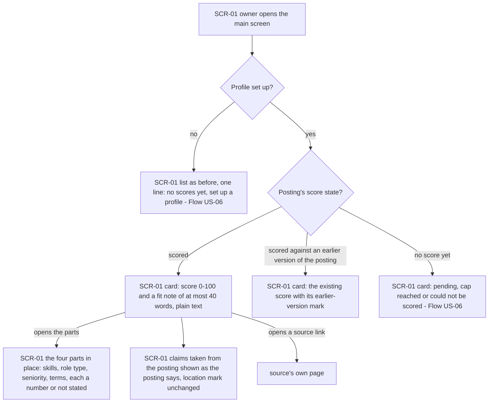
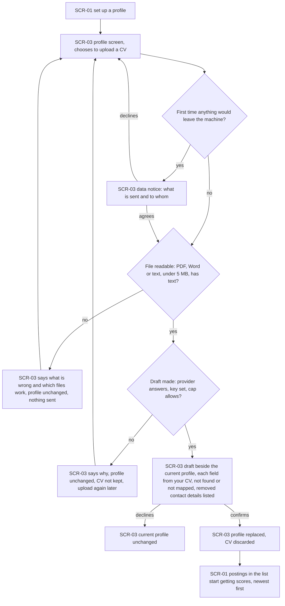
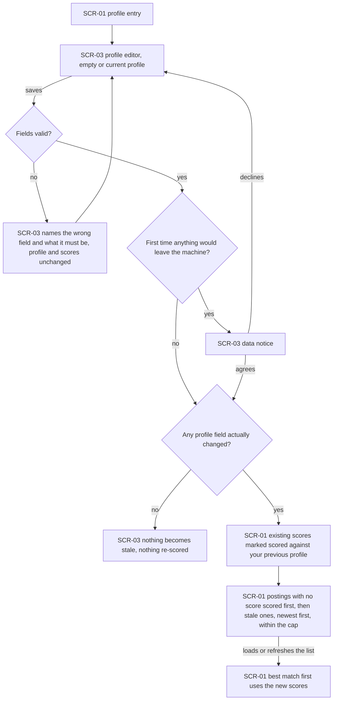
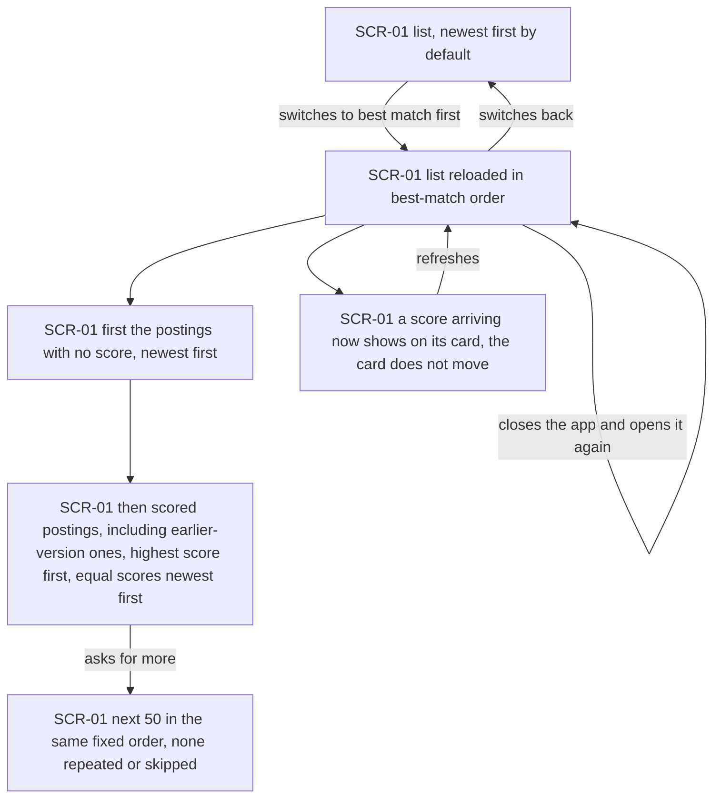
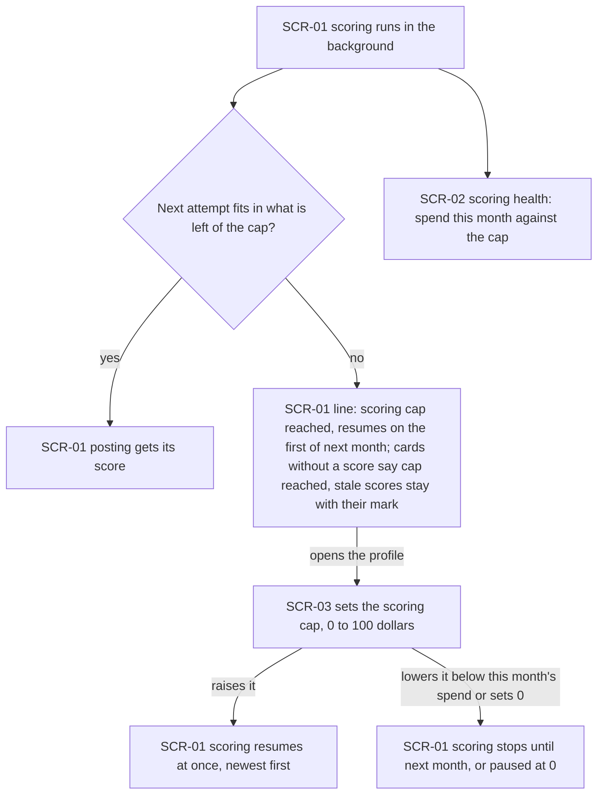
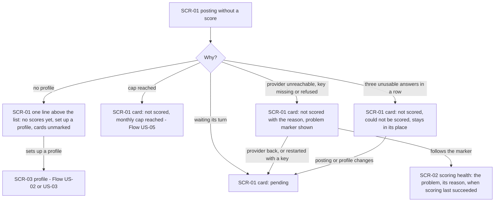

# UX flows — match-score

> User flows for every UI-touching §4 user story, produced by `ux-flows` (after `clarify`, before
> `design`) and read by `design` (evidence for the target-surface + UI-architecture decisions),
> `sequences` (UI-driven flows align on SCR ids), `screens` (details every inventory row) and
> `plan-tests` (the e2e-through-UI paths). **Always markdown + mermaid `flowchart`**, whatever the
> design tool — this artifact is flow-altitude, not visual design.

## Platform decisions

- **Posture:** mobile-first, per `docs/design-system.md`, the same as search-postings, applied-skipped and remote-filter. Every flow starts from the 360 px layout (spec §6 Phone layout: the score, its parts, the fit note, the order switch and the profile editor fit at 360 px, every action at least 44×44 px).
- **One new screen, the profile (SCR-03).** The profile editor, the CV upload with its draft review, the scoring cap and the one-time data notice live on their own screen: a form of seven fields plus a draft side by side does not fit inside the main screen at 360 px. The owner reaches it from the main screen (the "set up a profile" line, or a profile entry) and returns to the main screen when done.
- **The score lives on the card.** The match score, its state (pending / cap reached / could not be scored / scored against an earlier version) and the fit note are part of each posting's card on SCR-01, as the location mark is; the four parts open in place from the card, without leaving the list.
- **Order switch on the list.** "Newest first" / "Best match first" is a control of the SCR-01 list, kept between visits (AC-11); switching reloads the list in the new order.
- **Scoring health beside source health.** Scoring's state is a block on SCR-02, next to the sources; a scoring problem raises the same main-screen marker that leads there (AC-14).
- **Data notice is a step, not a screen.** The one-time notice (AC-20) appears on SCR-03 before the first CV upload or the first profile save; agreeing continues the action, declining returns to the editor with nothing sent.
- *Design input:* how the score reaches an open list without moving cards (AC-11 note), and where the provider key is read from (AC-14 note), are `design`'s calls.

## Screen inventory

| ID | Screen | Purpose | Entry | Exit |
|---|---|---|---|---|
| SCR-01 | Main screen | The list, now with a match score, its state and a fit note on every card, the four parts opening in place, the "Newest first" / "Best match first" switch, the "no scores yet — set up a profile" line when there is no profile, the scoring-cap-reached line, and the marked view showing each marked posting's last score | Opening the app; back from SCR-03 or SCR-02 | SCR-03 (set up or edit the profile); SCR-02 via the problem marker; a source's page via a listing link |
| SCR-02 | Source health | Per-source state as in remote-boards-collector, plus the scoring health block: when scoring last succeeded, this month's spend against the cap, pending count and oldest pending age, how many could not be scored, and the current problem with its reason | The main-screen problem marker; the app navigation | SCR-01 |
| SCR-03 | Profile | The profile editor (skills with core / nice-to-have, years, seniority, role types, minimum salary with currency and period, engagement forms), the CV upload with the draft shown beside the current profile, the scoring cap, and the one-time data notice | The "set up a profile" line or the profile entry on SCR-01 | SCR-01 after saving, confirming or leaving |

## Flows

### Flow: US-01 — See how well each posting fits

The owner opens the main screen. With no profile, the list is exactly as before, with one line saying there are no scores yet (Flow US-06). With a profile, every card in the list carries its score state. A scored posting shows a number from 0 to 100 and a fit note of at most 40 words, as plain text. Opening the score shows its four parts in place — skills, role type, seniority and terms — each as a number or "not stated". Anything the note takes from the posting, such as "visa sponsorship guaranteed" or "US residents only", reads as "the posting says…", and the remote filter's location mark stays as it was. A posting whose text has changed since it was scored keeps its old score with an "earlier version" mark until the new score arrives. A posting with no score shows why (Flow US-06). Low scores never remove a card: the list and its counts are the same with or without scores. From any card the owner can still open the source's page.

### Flow: US-02 — Draft my profile from my CV

From the main screen's "set up a profile" line (or the profile entry) the owner opens the profile screen and chooses to upload a CV. The very first time anything would leave the machine, a notice says what is sent and to whom — the CV text once, then the profile and each posting's text with every scoring, never a name or contact detail. Declining returns to the profile screen with nothing sent. A file that is not a readable CV — an image-only scan, an unsupported kind, an empty file or one over 5 MB — is refused with a plain explanation, nothing leaves the machine and the profile stays as it was. If the file is fine but the draft cannot be made (provider unreachable, key missing or refused, or the cap would be exceeded), the owner is told why, the profile stays as it was, and the CV is not kept, so they upload it again later. Otherwise the draft appears beside the current profile, each field marked "from your CV", "not found in your CV" or "not mapped", with a list of the contact details that were removed. Declining keeps the current profile; confirming replaces it and discards the CV, and the main screen's postings start getting scores, newest first.

### Flow: US-03 — Keep my profile current

The owner opens the profile editor from the main screen — empty if they have no profile and no CV at hand, or holding the current profile. On saving, an invalid field is named with what it must be: no core skill, a negative or non-numeric salary, a salary without currency or period, more than 60 years, a skill over 50 characters, or an email address, phone number or web address anywhere; nothing is saved and scores stay as they were. A first save shows the data notice, as in Flow US-02. If no field actually changed, nothing becomes stale. If something did, every existing score stays visible with a "scored against your previous profile" mark; postings with no score at all are scored first, then the stale ones, newest first and within the cap; and "best match first" takes the new scores into account the next time the list is loaded or refreshed.

### Flow: US-04 — Put the best matches first

The list starts newest first. Switching to "best match first" reloads it in a fixed order: first the postings that have no score yet, newest first, so fresh roles never sink; then every scored posting — including those scored against an earlier version of the posting or profile — from highest to lowest, equal scores newest first. Asking for more brings the next 50 in that same order, never repeating or skipping a posting. A score that arrives while the list is open shows on its card, but the card stays where it is until the owner refreshes. Switching back returns to newest first, and the chosen order is still in place the next time the app opens.

### Flow: US-05 — Stay within my scoring budget

Scoring works in the background and never starts an attempt that would not fit in what is left of the month's cap. When the cap is reached, the main screen says so and when scoring resumes (the first of next month); postings with no score say "cap reached", and scores made against an earlier version stay with their mark. Everything else — the list, search, the remote filter, marks — works as before. On the profile screen the owner can change the cap from $0 to $100: raising it resumes scoring at once, newest first; lowering it below what is already spent stops scoring until next month; $0 pauses it. The month's spend against the cap is always visible in scoring health on the source health screen. Only postings in the owner's list are scored — hidden and marked postings never are — and postings brought in by wider skills, the filter switched off or a one-off look are scored in their turn.

### Flow: US-06 — Know why a posting has no score

Every posting without a score says why. With no profile, there is one line above the list instead of a mark on every card, leading to the profile screen. A posting waiting its turn shows "pending". When the cap is reached it shows "not scored — monthly cap reached" (Flow US-05). When the provider cannot be reached or the key is missing or refused, the posting shows "not scored" with the reason, the main-screen problem marker appears, and following it leads to scoring health on the source health screen with the reason and when scoring last succeeded; scoring picks up by itself once the provider answers again, or after a restart with a key. After three unusable answers for the same posting, it shows "could not be scored" and stays in its place in the list, and it is tried again only when the posting or the profile changes. Nothing is ever hidden for lacking a score.

## AC coverage

| AC | Shown by | Notes |
|---|---|---|
| AC-01 | Flow US-01 → D, G | Score, four parts, fit note |
| AC-02 | Flow US-01 → prose ("low scores never remove a card") | A list-count invariant; no branch of its own |
| AC-03 | Flow US-01 → D, H | Plain text and "the posting says"; score bounds are an evaluation-run check |
| AC-04 | Flow US-01 → G | A part reads "not stated" |
| AC-05 | Flow US-01 → H | Location mark unchanged; description phrase as the posting's words |
| AC-06 | Flow US-01 → E | Earlier-version mark |
| AC-07 | Flow US-02 → J, L, M | Draft beside current profile; confirm replaces |
| AC-08 | Flow US-02 → F, H | File errors and drafting failures |
| AC-09 | Flow US-02 → J | Removed contact details listed |
| AC-10 | Flow US-03 → G, I, J, K | Real change only; stale marks; order after reload |
| AC-11 | Flow US-04 → B–F | Fixed best-match order, paging, choice kept |
| AC-12 | Flow US-05 → B, D | Cap reached line and card state |
| AC-13 | Flow US-05 → prose (only the owner's list is scored); Flow US-03 → J | Scoring order; marked view shows last score (SCR-01 inventory) |
| AC-14 | Flow US-06 → G, H | Provider problems, marker, scoring health |
| AC-15 | Flow US-06 → C; Flow US-01 → N | No-profile line |
| AC-16 | Flow US-03 → C, D | Field errors |
| AC-17 | N/A | Refusing other devices and other sites is not a screen flow; covered by the access rule (search AC-17, applied-skipped AC-16) |
| AC-18 | Flow US-06 → I | Could not be scored |
| AC-19 | Flow US-05 → E, F, G | Setting the cap |
| AC-20 | Flow US-02 → C, D; Flow US-03 → E, F | One-time data notice |
| AC-21 | Flow US-03 → B (empty), C, G, J | Profile by hand |
