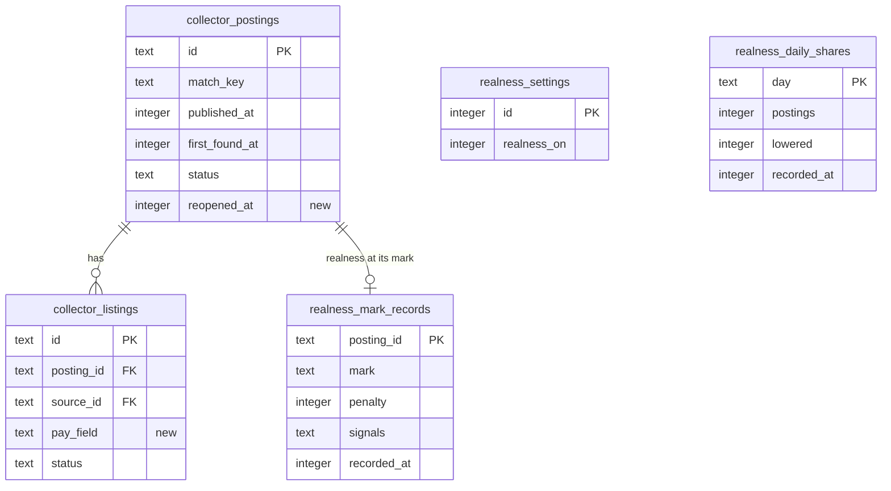

# Data model — realness-score

Derived from spec §5 (AC-06, AC-08, AC-10, AC-11, AC-14), sad.md §4 (penalty rule, signal definitions, assumptions ledger), §5 (tables named there), §6 flows 1–7 (persist and read notes), and [ADR-0002](adr/0002-work-out-realness-signals-when-search-builds-a-snapshot.md), [ADR-0004](adr/0004-keep-each-boards-pay-field-as-text-on-the-listing-and-judge-it-in-realness.md). Conventions follow project ADR `docs/adr/0003-sqlite-with-drizzle.md` and the pattern the earlier features set (`docs/architecture-map.md` §Conventions):

- SQLite through Drizzle. The new tables live in `apps/server/src/modules/realness/infra/schema.ts`, matching the `drizzle.config.ts` glob. The two collector columns go in `collector/infra/schema.ts`.
- snake_case names with the module prefix `realness_`. Enum-like text (`mark`) is checked in TypeScript, not by `CHECK`. There are no DB `DEFAULT`s, no triggers and no blanket audit columns. Booleans are `integer` (`mode: "boolean"` in Drizzle), as `remote_filter_settings.filter_on` is.
- Times are integer UTC epoch milliseconds. Rows are keyed by posting id or calendar day, so no new ids are needed.

**Scope.** Two nullable columns on collector tables (`collector_listings.pay_field`, `collector_postings.reopened_at`) and three realness tables (`realness_settings`, `realness_mark_records`, `realness_daily_shares`).

**Not stored:** signals and penalties for the list (worked out at snapshot build and kept in search's in-memory snapshot, ADR-0002); whether a listing states pay (judged by realness from the pay field and the text); the look-alike key (computed on read, applied-skipped ADR-0004); whether a source has a pay field (a fixed property of each source in the collector's source table in code); enabled sources (collector settings, as today).

## ER diagram

(Collector tables show only the columns realness reads, plus the new ones.)

## Entities

### Posting aggregate (collector-owned, two new columns)

#### `collector_listings.pay_field`

| Column | Type | Null | Notes |
|---|---|---|---|
| `pay_field` | text | yes | The board's own pay statement as text, written by the adapter on **every** fetch of the listing (spec §1). `""` = the board states nothing or has no pay field (We Work Remotely). NULL = not read since this shipped, which counts as stating pay on a board with a pay field (AC-06). Mapping: Himalayas `minSalary`/`maxSalary` + `salaryPeriod`; Remotive `salary`; Jobicy `salaryMin`/`salaryMax` + `salaryCurrency`. A change here alone is not an "Updated posting". |

#### `collector_postings.reopened_at`

| Column | Type | Null | Notes |
|---|---|---|---|
| `reopened_at` | integer | yes | When the posting last reopened (closed → open through the merge decision, collector AC-11). NULL = not reopened since this shipped. Any non-NULL value is the repost signal (AC-08). |

### Settings aggregate (realness-owned)

#### `realness_settings`

| Column | Type | Null | Notes |
|---|---|---|---|
| `id` | integer PK | no | Always 1. |
| `realness_on` | integer (boolean) | no | Written `true` with the row. No row means never chosen, which means on (AC-10). Written by `POST /api/v1/realness/settings`; a failed write reverts the switch (AC-11). |

### Mark-record aggregate (realness-owned, one per marked posting)

#### `realness_mark_records`

| Column | Type | Null | Notes |
|---|---|---|---|
| `posting_id` | text PK, FK → `collector_postings.id` ON DELETE CASCADE | no | One record per posting; removed with the posting at clean-up. |
| `mark` | text | no | `applied` or `skipped`: the latest mark. Replaced on change, row deleted on clear or undo of the only mark (flow 7). |
| `penalty` | integer | no | 0–30, switch-on rules. |
| `signals` | text (JSON) | no | Array of `{kind, basis?, days?, boards?}` as the API shows them; `[]` = no signal. |
| `recorded_at` | integer | no | When the mark was set. |

### Daily-share aggregate (realness-owned, one per day)

#### `realness_daily_shares`

| Column | Type | Null | Notes |
|---|---|---|---|
| `day` | text PK | no | `YYYY-MM-DD` in the machine's time zone. `INSERT OR IGNORE`, so the day's first opening wins (flow 6). |
| `postings` | integer | no | Postings in the owner's list (saved skills and own filter; a one-off look is not counted). |
| `lowered` | integer | no | How many of those had a penalty, by switch-on rules. |
| `recorded_at` | integer | no | When it was kept. |

## Indexes

| Index | Table | Columns | Query it serves |
|---|---|---|---|
| PK (existing pattern) | `realness_mark_records` | `posting_id` | Upsert or delete by posting on every mark change (flows 3, 7); also covers the FK, so no separate FK index |
| PK | `realness_daily_shares` | `day` | `INSERT OR IGNORE` on the day's first opening (flow 6); the §7 KPI reads all rows |
| PK | `realness_settings` | `id` | Read the switch on every snapshot build |
| *(none new)* | `collector_postings` | — | The repost rule reads closed postings' heads once per snapshot build (`status = 'closed'`) and computes look-alike keys in memory. It's a bounded table scan, because clean-up removes closed postings, and it's the same kind of read as the existing open-postings read, which has no status index either. The existing `collector_postings_match_key_idx` can't serve it, since the look-alike key is wider than the match key. Revisit if the search NFR test shows this read in its profile. |
| *(none new)* | `collector_listings` | — | `pay_field` is read with the listings search already loads by posting (`collector_listings_posting_idx`). |

## Migrations (staged)

Staged under `docs/features/realness-score/migrations/`, not in `apps/server/drizzle/`. `implement` adds the columns and tables to the Drizzle schemas, runs `db:generate` (expected next number `0007`), and checks that the generated SQL matches these files.

| Ordinal | Up | Down |
|---|---|---|
| 01 | `ALTER TABLE collector_listings ADD pay_field text` | drop column |
| 02 | `ALTER TABLE collector_postings ADD reopened_at integer` | drop column |
| 03 | create `realness_settings` | drop table |
| 04 | create `realness_mark_records` (FK cascade) | drop table |
| 05 | create `realness_daily_shares` | drop table |

All changes are additive and nullable or new, so there's no backfill and no expand → contract sequence. Listings collected before this ships keep NULL until their next fetch, which the rules treat as specified (AC-06).

## Seeds

None. `realness_settings` is upserted lazily, like the other settings singletons.

## Test fixtures

Following the repo's form (`apps/server/test/helpers/*-fixtures.ts`, `test/fixtures/sources/`):

- Re-record each source fixture with its pay data in `test/fixtures/sources/`. Jobicy needs a payload that has `salaryMin`/`salaryMax`; Remotive needs both an empty and a non-empty `salary`.
- A posting/listing builder in the search fixtures, extended with `payField`, `reopenedAt` and a closed look-alike posting, for the property tests (SAD §10 QG-1).
- The labelled salary set (≥ 100 postings, ≥ 20 stating pay only in the board field, ≥ 20 with non-pay amounts) beside the amount parser in `realness/domain/`. Company names and text come from public postings, with no personal data.
