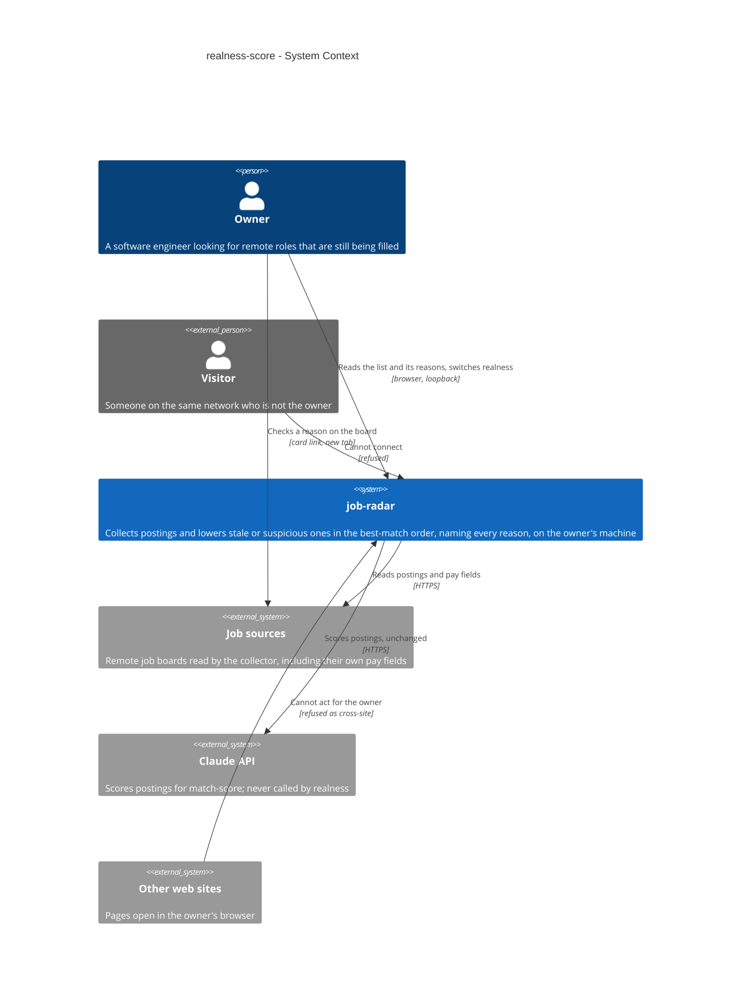
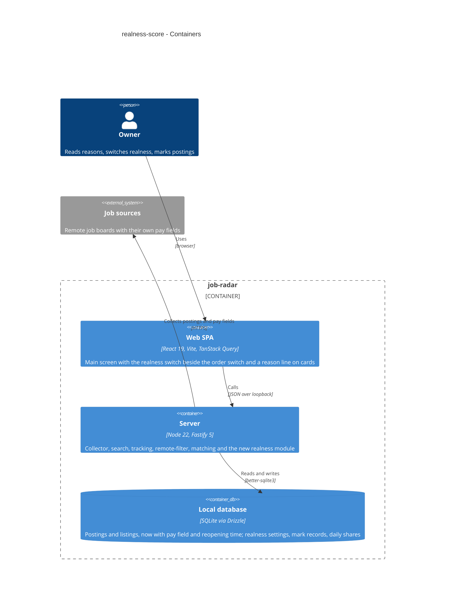
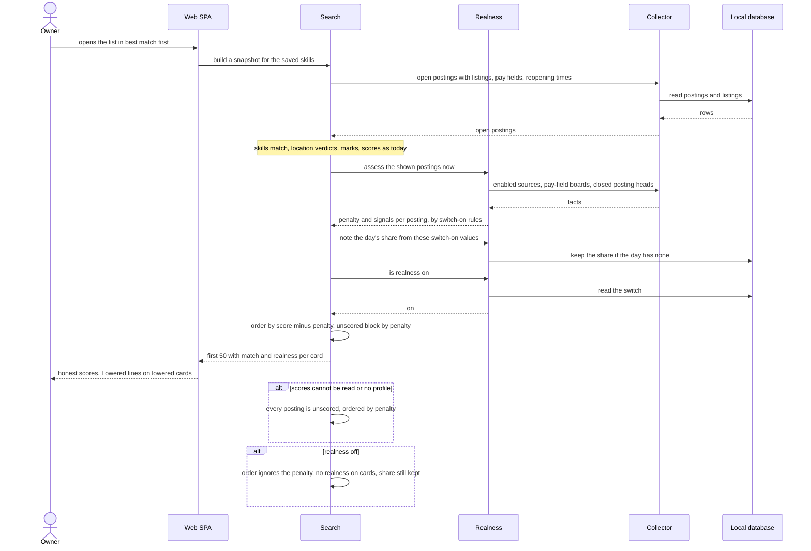
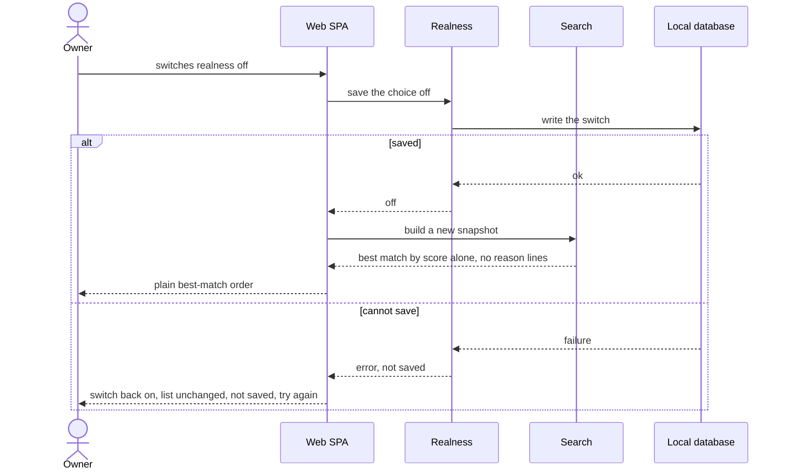
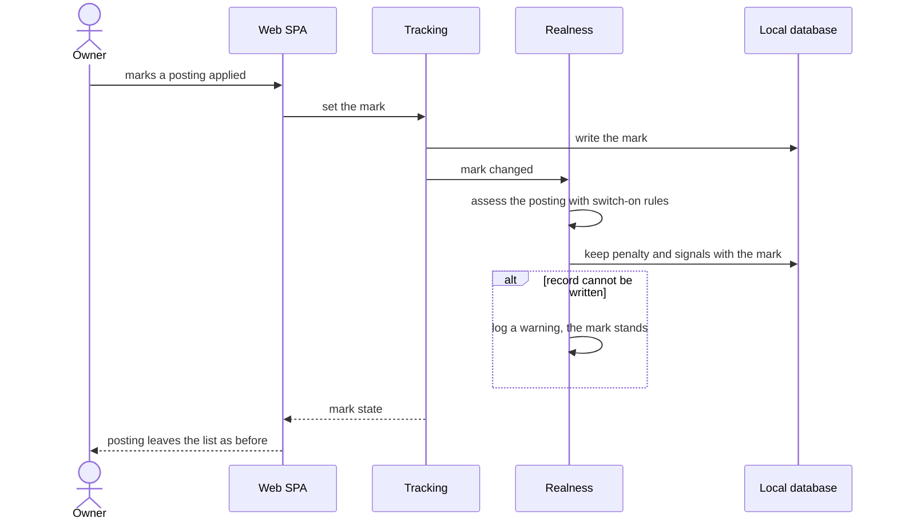

# Software Architecture Document — realness-score

<!-- 12 Arc42 sections. Empty section → <!-- N/A: <one-line reason> -->. -->
<!-- C4 Context (L1) lives inline in §3. C4 Container (L2) lives inline in §5. -->
<!-- Numbers in §10 come VERBATIM from spec.md §6 NFR — no inventing, no rounding. -->
<!-- Interview depth: easy (route quick). Decisions taken by default are listed in the assumptions ledger at the end of §4. -->

## 1. Introduction and goals

**Intent.** Realness lowers stale or suspicious postings in the owner's best-match order, so that roles still being filled reach the top before ones with a similar fit that have been open for months, are reposted, sit on many boards for weeks or state no pay. It works only from data job-radar already collects: a posting's age, how many enabled sources list it and for how long, whether it reopened or repeats an earlier closed posting, and whether its board or its text states pay. The penalty is at most 30 points and only moves a posting within the best-match order. Nothing is hidden, no count changes, the newest-first order and the honest match score stay as they are, and every lowered card names every signal behind its penalty. One switch, on by default, turns it off and on.

**Top-3 quality goals (1-liners; full scenarios in §10):**

1. **No loss** — realness never removes a posting, changes a count, the newest-first order or the shown match score.
2. **Reasons the owner can trust** — every named signal is true on the board; the "no salary" rule is right on ≥ 95% of a labelled set.
3. **Unchanged responsiveness at zero cost** — the list still answers within search's p95 with realness on, and realness makes no provider request.

**Stakeholders.**

| Role | Interest | Sign-off owner? |
|---|---|---|
| Owner | Spends applications on live roles; reads and checks the reasons; switches realness off and on | Yes (product) |
| Tech Lead | SAD approval | Yes |
| Security Lead | No new boundary; the new setting is protected like the existing ones | No |

<!-- Decision overrides (¶4) — populated by the critic resolution loop. -->

- Decision override: keep size S although the feature adds a module, a route and a migration — rationale: the module follows the repo's one-roadmap-step-one-module convention (project ADR 0002), the one route mirrors `remote-filter/filter`, and migration `0007` is additive only; the work stays within ~1 week and 2–5 PRs (critic F2, owner decision 2026-10-16).

## 2. Constraints

**Technical.**
- TypeScript on Node.js 22+, pnpm workspaces `apps/server` + `apps/web` (project ADR `docs/adr/0001-typescript-monorepo-react-fastify.md`).
- Server: Fastify `^5.12`, one process on loopback that also serves the built SPA; every state-changing request carries a JSON body and must not be cross-site (`core/access.ts`).
- Web: React 19 + Vite SPA, TanStack Query 5, the design-system components and tokens (`docs/design-system.md`).
- Datastore: one SQLite file through `better-sqlite3` + Drizzle ORM `^0.45`, forward-only `drizzle-kit` migrations in `apps/server/drizzle/` (latest `0006`), file backup before each migrate (project ADR `docs/adr/0003-sqlite-with-drizzle.md`).
- Layering per project ADR `docs/adr/0002-feature-modules-mirror-roadmap.md`: `modules/<name>/{domain,app,infra,ports}`; a module reaches another only through its `app/` exports.
- Existing dependencies between modules: search imports `tracking/app`, `remote-filter/app` and `collector/app`; tracking imports `collector/app`; matching and search are wired to each other in `app.ts` (match-score ADR-0004).
- Postings, listings, merging and reopening belong to the collector (`collector/domain/merge.ts` returns `reopen: true`; `collector/infra/repo/postings.ts` applies it). Source adapters return `RawListing` (`collector/domain/adapter.ts`), which has no pay field today. The list, its snapshots (in memory, order fixed at build), its order and paging belong to search (`search/app/search.ts`, `search/domain/order.ts`). Marks and the look-alike rule belong to tracking (`tracking/domain/look-alike.ts` `lookAlikeKey`).
- Sources in this repo: Himalayas, Remotive, Jobicy and We Work Remotely. There is no Remote OK adapter, although spec §8 Q1 names one.

**Organisational.**
- One owner-developer. Size S, route quick (`.size`, `.route`). No deadline is stated.

**Conventions.**
- `CLAUDE.md` (layout, layering, errors, IDs, persistence, tests, UI) and `docs/design-system.md` (mobile-first, 44×44 px touch targets, inline-error convention).
- Errors use one envelope `{ "error": { "code", "message" } }` via `AppError` (`core/errors.ts`). Settings singletons are one row with `id = 1`, upserted lazily (`search_state`, `remote_filter_settings`, `matching_settings`). Calendar days use `machineTimeZone()` (`core/config.ts`).
- Tests: Vitest, unit tests next to the code, server integration tests in `apps/server/test/` against a temporary SQLite file, and recorded source payloads in `apps/server/test/fixtures/sources/`.

**Regulatory / external.**
- Data classification is internal (spec §6.1). No personal data is touched, nothing is sent anywhere, and there is no new external system.
- Source terms are unchanged. Realness reads postings and listings already collected, and every card keeps its source links.

## 3. Context and scope

The owner runs job-radar on their own laptop. The collector fills the local database from remote job boards, search shows the open postings that match the owner's skills, the remote filter hides those not open to their country, marks take decided postings out of the list, and matching scores each posting against the owner's profile. Realness adds no outside party. It reads facts the collector already keeps, plus two the collector starts keeping (each listing's board pay field, and when a posting last reopened), and turns them into a penalty and a reason line inside the owner's own app. The trust boundary is unchanged. Posting text is third-party data: realness only looks for amounts of money in it and never copies it into the reason line.

<!-- brownfield: architecture-map.md is stale (reflects 133499e); the code was scanned directly on 2026-10-16. Modules: health, collector, search, tracking, remote-filter, matching. No pay field on RawListing or collector_listings; reopening is a boolean on the merge decision with no stored time; the order switch shows only with a profile and best match falls back to newest when scores are unreadable; latest migration 0006. -->

**External systems (in / out):**

| Actor or system | Type | Interaction |
|---|---|---|
| Owner | Person | Reads the list and its reason lines, switches realness off and on, marks postings |
| Visitor | Person (external) | Can reach the machine over the network but cannot connect: loopback only (AC-12, search AC-17) |
| Other web sites | System (external) | Pages open in the owner's browser; a request from them to switch realness or read the list is refused as cross-site (AC-12, applied-skipped AC-16) |
| Job sources | System (external) | Read by the collector, unchanged apart from the board's own pay field now being kept; the owner opens them through card links to check a reason |
| Claude API | System (external) | Unchanged and not used by realness: 0 requests, $0 added to the scoring cap (AC-13) |

**C4 Context (L1):**



## 4. Solution strategy

**Target surfaces: `backend-service` + `web-frontend`** ([ADR-0001](adr/0001-ship-realness-as-a-new-realness-module-read-by-search-and-told-of-marks-by-tracking.md)). The signals, the penalty, the switch and the AC-14 records live in a new `realness` server module in the existing server process. The collector gains two stored facts, and search gains the penalty in its order. The UI stays the existing React SPA. Its main screen (SCR-01) gains a realness switch next to the order switch and a reason line on each card that has signals. There is no UI-architecture change, so this is recorded inline and not as a separate decision.

**Top strategic choices (the seeds for ADRs):**

1. **Realness is its own module, read by search and told of marks by tracking** ([ADR-0001](adr/0001-ship-realness-as-a-new-realness-module-read-by-search-and-told-of-marks-by-tracking.md)). The rules, the switch, the mark records and the daily share belong to `realness`, which reads facts through `collector/app` and the look-alike rule through `tracking/app`. Search imports `realness/app`, as it already imports `tracking/app` and `remote-filter/app`. Tracking learns of mark changes through an `onMarkChanged` hook wired in `app.ts`. A static import from tracking would close a cycle, because realness reads tracking's look-alike rule. This follows the project's one-roadmap-step, one-module convention, and leaves room for step 9's fifth signal.
2. **Signals are worked out when search builds a snapshot, from stored facts only** ([ADR-0002](adr/0002-work-out-realness-signals-when-search-builds-a-snapshot.md)). The collector stores only raw facts. Each snapshot build works out the age, boards, repost and no-salary signals, including the salary-text check, for every shown posting in either order. The penalties stay fixed in the snapshot, so paging never reshuffles. Age and enabled sources change without any collection, so they must be worked out on read anyway (AC-09). Keeping the text rule on read too means a corrected rule applies at the next load, with no backfill.
3. **Best match first works without a profile; unreadable scores count as no score** ([ADR-0003](adr/0003-offer-best-match-first-without-a-profile-and-treat-unreadable-scores-as-unscored.md)). The order switch shows whether or not a profile exists. Without scores, every posting is in the unscored block, which realness orders by penalty (AC-05). Search no longer falls back to newest first when it cannot read scores.
4. **The board's own pay field is kept as text on each listing and judged by realness** ([ADR-0004](adr/0004-keep-each-boards-pay-field-as-text-on-the-listing-and-judge-it-in-realness.md)). Each adapter writes what its board states about pay on every fetch. NULL means the listing was collected before this shipped. One amount parser in `realness/domain` reads both this field and the posting text, so "competitive" in Remotive's salary field and "$5M Series A" in a description are judged by the same rule.

**Penalty rule (spec AC-01, fixed here for `tasks`):** age from `min(publishedAt, firstFoundAt)` (search's effective time) in calendar days of the machine's time zone: 30–59 days → 10, ≥ 60 → 20. Many boards: ≥ 3 enabled sources with an open listing and first found ≥ 45 days ago → 15. Only the larger of age and many boards counts. Repost → 10. No stated salary → 5. Total capped at 30. Ordering: scored postings by `total − penalty` descending, and unscored postings with penalty 0 first, then by penalty ascending. Ties keep newest first (the sort is stable). With realness off, every penalty is 0.

**Signal definitions (spec AC-06 – AC-09):**
- *Age basis* — "posted" when `publishedAt` is set and not later than `firstFoundAt`; otherwise "first found" (first fill without a publication time, or a publication time later than first found).
- *Many boards* — distinct **enabled** sources (`collector/app/location.ts` `enabledSourceIds`) with an open listing for the posting.
- *Repost* — the posting has `reopenedAt` (a reopening since this shipped); or a **closed**, not-removed earlier posting has the same `lookAlikeKey(company, title)` and an effective time more than 7 days before this one's. An earlier match that is still open means parallel hires: neither gets the signal.
- *No salary* — none of the posting's open listings from enabled sources states pay. A listing states pay when its pay field or its title or description holds an amount of money as pay (the amount parser). It also counts as stating pay when its pay field is NULL (not read since this shipped) and its source has a pay field.

**Upstream amendments (the wording spec §1 asks `design` to write):**
- *match-score AC-11*, amended: "Best match first can be chosen with or without a profile. In it, postings with no match score — pending, cap reached, could not be scored, no profile yet, or scores that cannot be read — come first, and then scored postings follow from the highest to the lowest score minus the realness penalty. Within the unscored block, postings with no realness penalty come first, then the rest from the smallest penalty to the largest. Equal values keep newest first. With realness off, the penalty is 0." (ADR-0003)
- *remote-boards-collector AC-11*, amended: "A posting that reopens also keeps when it reopened (the latest reopening). A listing keeps its board's own pay field as stated, written on every fetch of the listing, even when nothing else changed. A change in the pay field alone does not make the posting an updated posting." (ADR-0004)

**Resolves spec §8 Q1** ("Which boards state pay in their own field?"), from the recorded payloads in `apps/server/test/fixtures/sources/`:
- Himalayas: `minSalary`/`maxSalary` with `salaryPeriod`.
- Remotive: the free-text `salary` field, often empty, sometimes like "$50-$75 /hour".
- Jobicy: `salaryMin`/`salaryMax` with `salaryCurrency`, checked against the live v2 API on 2026-10-16 (filled on 12 of 20 jobs). The recorded fixtures predate these fields; `implement` re-records them.
- We Work Remotely: no pay field.
- Remote OK: not a source in this repo.

**Assumptions ledger (easy depth; accepted by the owner as a batch on 2026-10-16):**
- Assumed: pay field stored as text `collector_listings.pay_field`; `""` when the board states nothing or has no field; NULL = collected before this shipped; per-source `hasPayField` exported by the collector — because the collector keeps facts and realness keeps the interpretation (ADR-0004).
- Assumed: a pay-field change alone is not an "Updated posting" and does not move source-health counts — because pay is not one of the change fields in CONTEXT "Updated posting".
- Assumed: `collector_postings.reopened_at` set where the merge decision reopens a posting, and exported on `OpenPosting` along with `matchKey` — because collector AC-11 already decides reopening there.
- Assumed: a new collector export of closed postings' heads (`id`, `company`, `title`, `publishedAt`, `firstFoundAt`) for the repost rule — because removed postings must not count, and only the collector knows what still exists.
- Assumed: boards are counted from `enabledSourceIds` — because the remote filter already counts only enabled sources that way.
- Assumed: "N days" is worked out on the server in `machineTimeZone()` and sent as structured signals. The web builds the line from fixed phrases and never from posting text — because of the spec §6.1 abuse case.
- Assumed: search assesses every shown posting at snapshot build in both orders and keeps the result in the snapshot — because the newest-first line, the daily share and stable paging all need it. `assess` always uses switch-on rules; search alone applies `isOn()` to the order and to the cards (critic F1), so the daily share and mark records never depend on the switch.
- Assumed: the order is amended in `search/domain/order.ts` (`bestMatchOrder` takes a penalty).
- Assumed: the switch is a `realness_settings` singleton (NULL = on) behind `POST /api/v1/realness/settings {on}`, mirroring `remote-filter/filter`. The web saves first, then reruns search; on failure the switch reverts, the list keeps its order, and an inline error offers a retry.
- Assumed: AC-14 mark records go in `realness_mark_records` (one row per marked posting, removed with the posting). They are written through tracking's injected `onMarkChanged` hook after the mark is saved, computed with switch-on rules, and deleted on clear. A failed write is logged and never fails the mark.
- Assumed: the daily share goes in `realness_daily_shares` (one row per calendar day). It is written with `INSERT OR IGNORE` on the day's first build of the owner's list (a one-off look is not counted) and computed with switch-on rules even when the switch is off.
- Assumed: property tests are generated in a seeded loop in Vitest, with no new dependency. The salary fixture set sits beside the parser in `realness/domain/`.
- Assumed: no new deployment unit and one migration; §8 keeps the repo defaults.

Each tactical decision in later sections traces to one of these seeds. Tactical decisions that contradict a strategic choice are red flags — surface them in §11.

## 5. Building block view

Layered, as every module in the repo (project ADR 0002): `domain/` holds pure rules with no I/O, `app/` the use cases and the exports other modules call, `infra/` the tables and queries, `ports/` the routes. Realness reads postings, listings, closed-posting heads, enabled sources and pay-field capability through `collector/app`, and the look-alike key through `tracking/app`. Search calls `realness/app` while it builds a snapshot. Tracking calls realness only through the `onMarkChanged` hook that `app.ts` wires in (ADR-0001). Realness owns three small tables. The collector owns its two new columns.

**Internal decomposition:**

```
apps/server/src/modules/realness/
├── domain/       signals (age basis, many boards, repost, no salary), penalty (points, larger-of-time rule, cap 30),
│                 amount parser (pay vs non-pay amounts) + labelled fixture set (≥ 100 postings), calendar-day count
├── app/          assess(postings, now) → Map<id, {penalty, signals}> with switch-on rules, never reading the switch; isOn(); setOn();
│                 noteListShown(day, assessments, filterMode) from those switch-on values;
│                 onMarkChanged(postingId, mark | null)
├── infra/        schema (realness_settings singleton, realness_mark_records, realness_daily_shares), repo
├── ports/        routes: GET + POST /api/v1/realness/settings
└── index.ts      createRealness(deps) → { plugin, onMarkChanged } registered in app.ts

apps/server/src/modules/collector/  domain/adapter.ts RawListing gains payField; infra/sources/* map their board's pay field;
                                    schema: collector_listings.pay_field, collector_postings.reopened_at; repo writes pay_field on
                                    every fetch and reopened_at on a reopening; app/ exports closed-posting heads, hasPayField per
                                    source, matchKey + reopenedAt + listing payField on OpenPosting
apps/server/src/modules/search/     domain/order.ts bestMatchOrder takes a penalty; app/search.ts assesses shown postings at snapshot
                                    build, keeps penalties + signals in the snapshot, notes the day's share, no newest fallback when
                                    scores are unreadable (ADR-0003); present.ts adds `realness` to Posting
apps/server/src/modules/tracking/   app/marks.ts calls the injected onMarkChanged after a mark is set, changed, cleared or undone
apps/web/src/                       features/realness/ (RealnessSwitch, ReasonLine); routes/Home.tsx shows OrderSwitch without a profile
                                    and places RealnessSwitch beside it; the posting card renders ReasonLine
```

Tables (shapes fixed in `data-model`): `realness_settings` — one row: `on` (NULL = never chosen = on). `realness_mark_records` — one row per marked posting: the mark, the penalty and signals at that moment, and when, removed with the posting. `realness_daily_shares` — one row per calendar day: postings in the list and how many had a penalty. Collector: `collector_listings.pay_field` (text, NULL = not read since ship) and `collector_postings.reopened_at` (time, NULL = not reopened since ship).

**C4 Container (L2):**



## 6. Runtime view

The primary flows are seeded here. The `sequences` stage covers every §5 AC. Participants: the Owner, the Web SPA, and inside the Server the Search, Realness, Collector and Tracking modules, plus the Local database.

**Critical flow 1: opening the list in best match first with realness on (AC-01, AC-02, AC-05, AC-09, AC-14 daily share)**



**Critical flow 2: switching realness off, including a failed save (AC-10, AC-11)**



**Critical flow 3: marking a posting keeps its realness record (AC-14)**



## 7. Deployment view

No new deployment unit. The `realness` module runs in the existing server process on the owner's machine and is registered in `app.ts` before tracking, so tracking can be given its hook. One new migration (`0007`) adds the two collector columns and the three realness tables. It runs with the existing `db:migrate`, which backs up the database first. No new configuration and no new dependency. Listings collected before this ships keep a NULL pay field until their next fetch; one full collection run fills them in.

**Monitoring:**
- Search's existing structured log line gains `lowered` (postings with a penalty in this build) and `realnessMs` (assessment time), so a slowdown shows next to `durationMs`.
- Realness logs a warning, `module=realness`, when a mark record or daily share cannot be written, with the posting id or day only.
- No alert: realness changes only order, and its failures cost metrics, not postings.

**Scaling thresholds:**
- The assessment is linear in shown postings plus one read of closed-posting heads. The search NFR's 10,000 open postings is the design point. If the salary-text check pushes p95 past search's target, memoise the per-listing pay decision by listing id and text length + hash in process (§11).
- `realness_mark_records` holds at most one row per marked posting. `realness_daily_shares` grows by one row a day, which is negligible.

## 8. Crosscutting concepts

| Concept | Convention | Where defined |
|---|---|---|
| Access | Loopback only, same-origin, JSON body on every state-changing request; applies unchanged to the realness switch (AC-12) | `core/access.ts`, collector ADR-0007 |
| Error handling | Expected failures throw `AppError(code, message, status)`; one envelope `{ "error": { "code", "message" } }`. A failed switch save is an error the web shows inline with a retry (AC-11) | `core/errors.ts`, `CLAUDE.md` |
| Failure policy | Realness fails open for the list: if realness facts or the switch cannot be read, search builds the list with penalty 0 and no reason lines and logs a warning, as it does for unreadable scores. Mark records and the daily share are best-effort and never fail a mark or a list | here, search `readScores` precedent |
| Untrusted text | Posting text is only searched for amounts; the reason line is built in the web from fixed phrases and numbers job-radar works out, never from posting text (spec §6.1) | here |
| Time | Calendar days in the machine's time zone (`machineTimeZone()`), for the thresholds, the "N days ago" number and the daily share's day | `core/config.ts` |
| Logging | Structured; `module=realness`; posting ids and counts only | Fastify logger |
| ID strategy | No new IDs: realness rows are keyed by posting id or calendar day | `CLAUDE.md` |
| Cost | Realness calls no provider and adds nothing to the scoring cap (AC-13) | here |
| Internationalisation | N/A — single language (English UI) | — |
| Observability | Search log line fields (§7); no tracing | §7 |

## 9. Architecture decisions

| # | Title | Status | Section |
|---|---|---|---|
| 0001 | Ship realness as a new realness module, read by search and told of marks by tracking | Accepted | §4 |
| 0002 | Work out realness signals when search builds a snapshot | Accepted | §4 |
| 0003 | Offer best match first without a profile and treat unreadable scores as unscored | Accepted | §4 |
| 0004 | Keep each board's pay field as text on the listing and judge it in realness | Accepted | §4 |

ADR files live under `docs/features/realness-score/adr/NNNN-<title>.md`.

## 10. Quality requirements

**QG-1. No loss**
- **When:** the owner opens the list in either order, with or without a profile, with the remote filter on or off, and some postings carry realness signals.
- **Then:** "0 postings left out of the list or its counts because of realness" and "0 differences in the newest-first order between realness on and off"; every card shows the same match score and fit note; no penalty above 30.
- **How verify:** property tests over generated postings with signals, in a seeded loop: build the list with realness on and off and compare postings, total, hidden and marked counts, the newest-first id sequence and every card's match; assert `penalty ≤ 30`.

**QG-2. Reasons the owner can trust**
- **When:** realness works out a posting's "no salary" signal.
- **Then:** "≥ 95% of a fixed set of at least 100 real postings get the right "no salary" decision, at least 20 of them stating pay only in the board's own field and at least 20 with non-pay amounts".
- **How verify:** a fixture set labelled by hand beside the amount parser in `realness/domain/`, checked in the unit tests; plus the spec §7 hand check of 20 lowered cards within 14 days of shipping (reason precision ≥ 18 of 20).

**QG-3. Unchanged responsiveness at zero cost**
- **When:** the owner opens the list with 10,000 open postings, scores and realness on, in either order.
- **Then:** "≤ 1 s p95 to the first 50 postings shown, with 10,000 open postings, scores and realness on, in either order — unchanged from search", and "0 provider requests and $0 added to the scoring cap's spend by realness".
- **How verify:** the search integration test, rerun with realness on and best match first (and newest first); a unit test asserting realness reaches no provider client, and scoring health spend unchanged across a realness-on run.

**QG-4. Phone layout**
- **When:** the main screen is shown at 360 px.
- **Then:** "the reason line and the switch are usable at 360 px with no horizontal scrolling; the switch is at least 44×44 px".
- **How verify:** browser check at 360 px (manual at ship); design-system touch rule.

## 11. Risks and technical debt

| Risk / debt | Severity | Mitigation | Owner |
|---|---|---|---|
| A wrong reason (pay shown on the board, a real new headcount read as a repost) makes the owner distrust every reason and switch realness off | Medium | Narrow signal rules (§4); labelled salary fixture set (QG-2); spec §7 hand check of 20 lowered cards within 14 days; reason line names every signal so each can be checked | Volodymyr Kozlov |
| The salary-text check over up to 10,000 postings' text pushes the list past search's p95 | Medium | The search NFR integration test runs with realness on in both orders; fallback is an in-process memo of the per-listing pay decision (§7) | Volodymyr Kozlov |
| Thresholds and points (30/60 days, 3 boards for 45 days, 10/20/15/10/5, cap 30) are unvalidated (spec §8 Q2) | Low | Fixed in `realness/domain` as named constants; revisit after the §7 hand check, due 2026-11-30 | Volodymyr Kozlov |
| "Best match first" without a profile orders by realness alone, which may read oddly | Low | `screens` adds a short hint under the order switch when there is no profile (ADR-0003) | Volodymyr Kozlov |
| `docs/architecture-map.md` is stale (reflects 133499e) | Low | Run `/sdd:survey` to refresh it | Volodymyr Kozlov |

**Accepted debt (acceptable in v1, plan to fix later):**
- Reopenings are counted only from when this ships (spec §1), and listings collected before shipping have an unknown pay state until their next fetch, which counts as stating pay. Both fill in over the first collection runs.
- The amount parser is a hand-written pattern set, with no currency or locale library. It is good enough for the ≥ 95% target on the fixture set, and gets widened when the §7 check finds misses.

## 12. Glossary

| Term | Meaning |
|---|---|
| Realness signal | One collected fact suggesting a posting may be stale or not really hiring: open long, open at three or more enabled sources for weeks, reposted, or no stated salary (CONTEXT) |
| Realness penalty | The points a posting's signals take off its place in the best-match order, at most 30; the card keeps its honest match score (CONTEXT) |
| Effective time | A posting's publication time, never later than when job-radar first found it; the time newest first orders by and age counts from (search `order.ts`) |
| Repost | A posting that reopened since this shipped, or that matches an earlier closed, not-removed posting by the look-alike key with an effective time more than 7 days earlier |
| Pay field | A board's own statement of pay for a listing, kept as text on the listing; empty when the board states nothing or has no field; unknown (NULL) until the listing's first fetch after this ships (CONTEXT) |
| Reason line | The one line on a card naming every signal: "Lowered: …" in best match first, "Signals: …" in newest first, built from fixed phrases (CONTEXT) |
| Daily lowered share | The share of postings in the owner's list that had a penalty, kept once per calendar day on the first opening of that day; the baseline for the spec §7 "applications go to live roles" KPI (CONTEXT) |
| Look-alike posting | Same company and title by the collector's merge matching, bracketed non-region parts dropped, Sr/Jr read as Senior/Junior (CONTEXT; here applied to any earlier posting) |
