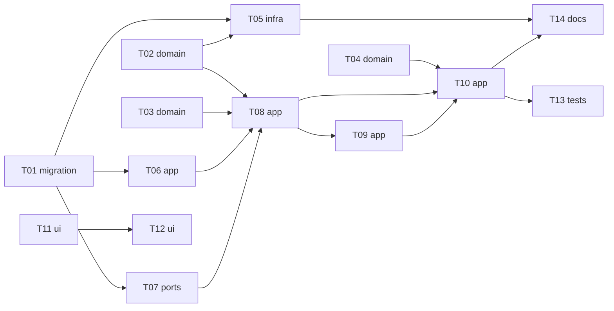

# Epic — realness-score

> **Spec:** [spec.md](../spec.md) · **Design:** [sad.md](../sad.md) · **Data model:** [data-model.md](../data-model.md) · **API:** [openapi.yaml](../contracts/openapi.yaml) · **Screens:** [screens.md](../screens.md) · **ADRs:** [adr/](../adr/)

## Goal

Postings still being filled reach the top of best match first before stale or suspicious ones with a similar fit, every lowered card names every signal behind its penalty, and realness never costs the owner a posting, a count, the newest-first order or the honest match score (spec §2). It ships as a new `realness` module, two stored collector facts, a penalty in search's best-match order, and a switch plus a reason line on SCR-01.

## Scope

- **In:** collector (pay field, reopening time, read exports) · new `realness` module (rules, amount parser, assess, switch, mark records, daily share) · search (order, snapshot, presentation, no newest fallback) · tracking (`onMarkChanged` hook) · web SCR-01 (ReasonLine, RealnessSwitch, OrderSwitch without profile) · upstream spec amendments. Surfaces: `backend-service`, `web-frontend`.
- **Out (spec §3):** hiding postings · a live careers-page check · per-signal tuning or weights · fraud detection · recording employer replies.

## Task map

- **Wave 1:** T01, T02, T03, T04, T11
- **Wave 2:** T05, T06, T07, T12
- **Wave 3:** T08
- **Wave 4:** T09
- **Wave 5:** T10
- **Wave 6:** T13, T14

## Tasks

See [tracker.md](./tracker.md) for status. Machine contract: [tasks.json](../tasks.json).

| # | Task | Layer | Blocked by | DoD (short) |
|---|---|---|---|---|
| T01 | [Promote the staged schema: pay_field, reopened_at and the three realness tables](./t01-realness-schema.md) | migration | — | The generated drizzle migration 0007 matches the staged 01–05 SQL, applies on a copy of a database at… |
| T02 | [Write the amount parser and its labelled salary set](./t02-amount-parser.md) | domain | — | `pay.test.ts` passes: the parser gets the right decision on ≥ 95% of a hand-labelled set of ≥ 100 real… |
| T03 | [Write the signal and penalty rules: age basis, many boards, repost, no salary, cap 30](./t03-signal-and-penalty-rules.md) | domain | — | `signals.test.ts` passes: every threshold edge (29/30, 59/60, 44/45 days, 2/3 boards, 7/8 days for… |
| T04 | [Let search's bestMatchOrder take a realness penalty](./t04-best-match-order-with-penalty.md) | domain | — | `order.test.ts` passes for AC-01's example (A 88, C 70, B 92−25) and AC-05's unscored block (8 unpenalised… |
| T05 | [Keep each board's pay field on every fetch and the reopening time in the collector](./t05-collector-keeps-pay-field-and-reopening.md) | infra | T01, T02 | `collector-realness-facts.integration.test.ts` passes: each board's pay field is written on every fetch… |
| T06 | [Export the realness facts from collector/app: reopening, pay fields, closed heads, pay-field boards](./t06-collector-realness-exports.md) | app | T01 | `collector-read-exports.integration.test.ts` passes for `reopenedAt` and listing `payField` on… |
| T07 | [Add the realness module with its switch: settings repo, GET/POST /api/v1/realness/settings, registration](./t07-realness-module-and-switch.md) | ports | T01 | `realness-routes.integration.test.ts` passes: GET reads `true` with no row and creates nothing, POST saves… |
| T08 | [Implement assess(): work out penalty and signals for a set of postings with switch-on rules](./t08-realness-assess.md) | app | T02, T03, T06, T07 | `realness-assess.integration.test.ts` passes for AC-06 – AC-09 over a temp DB (pay field / text /… |
| T09 | [Keep realness with every mark and once a day: mark records, daily share, tracking's onMarkChanged hook](./t09-mark-records-and-daily-share.md) | app | T08 | `realness-records.integration.test.ts` passes: set/change/clear/undo keep one record matching the current… |
| T10 | [Assess at snapshot build, order by penalty, and present realness and realness_on in search](./t10-search-orders-and-presents-realness.md) | app | T04, T08, T09 | `search-realness.integration.test.ts` passes for AC-01, AC-04, AC-05 and AC-09 through `POST… |
| T11 | [Show the reason line on posting cards (ReasonLine + api types)](./t11-web-reason-line.md) | ui | — | `ReasonLine.test.tsx` and `PostingCard.test.tsx` pass: "Lowered: …" in best match first, "Signals: …" in… |
| T12 | [Add the realness switch to the main screen and offer best match first without a profile](./t12-web-realness-switch.md) | ui | T11 | `RealnessSwitch.test.tsx` and `Home.realness.test.tsx` pass for SCR-01's realness off, switching, save… |
| T13 | [Prove no loss, unchanged speed, zero cost and refused outsiders end to end](./t13-no-loss-nfr-and-access-tests.md) | tests | T10 | The seeded property test shows identical postings, counts, newest-first sequence and match per card with… |
| T14 | [Write the amended match-score AC-11 and collector AC-11 into their specs](./t14-upstream-amendments.md) | docs | T05, T10 | match-score spec AC-11 and remote-boards-collector spec AC-11 carry the amended wording from… |

## Risks / Hard rules

- **No loss** — realness never hides a posting, changes a count, the newest-first order or the shown match score (spec AC-03, AC-04; T10, T13).
- **Fail open** — unreadable facts or switch → penalty 0, no reason lines, a warning; mark records and the daily share never fail a mark or a list (sad §8; T09, T10).
- **Untrusted text** — the reason line is built from fixed phrases and numbers only, never posting text (sad §8, spec §6.1; T11).
- **Zero cost** — realness calls no provider and adds nothing to the scoring cap (AC-13; T08, T13).
- **Boundaries** — realness reaches other modules only through `collector/app` and `tracking/app`; tracking reaches realness only through the injected hook (ADR-0001; T06, T08, T09).
- **Wrong reasons** (sad §11, Medium) — narrow rules, the ≥ 95% salary set (T02) and the §7 hand check after ship.
- **p95 with the salary-text scan** (sad §11, Medium) — measured in T13; memo fallback from sad §7.
