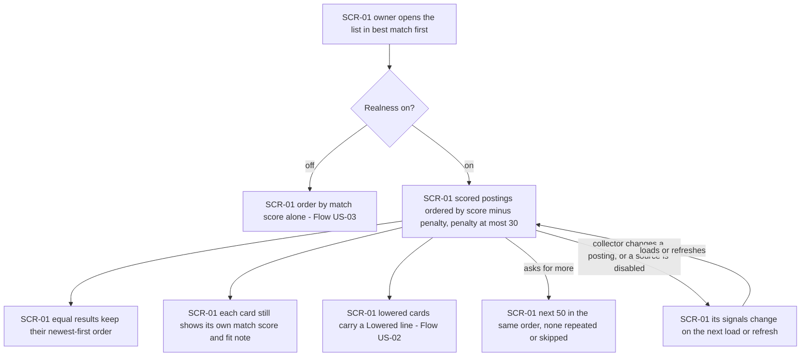
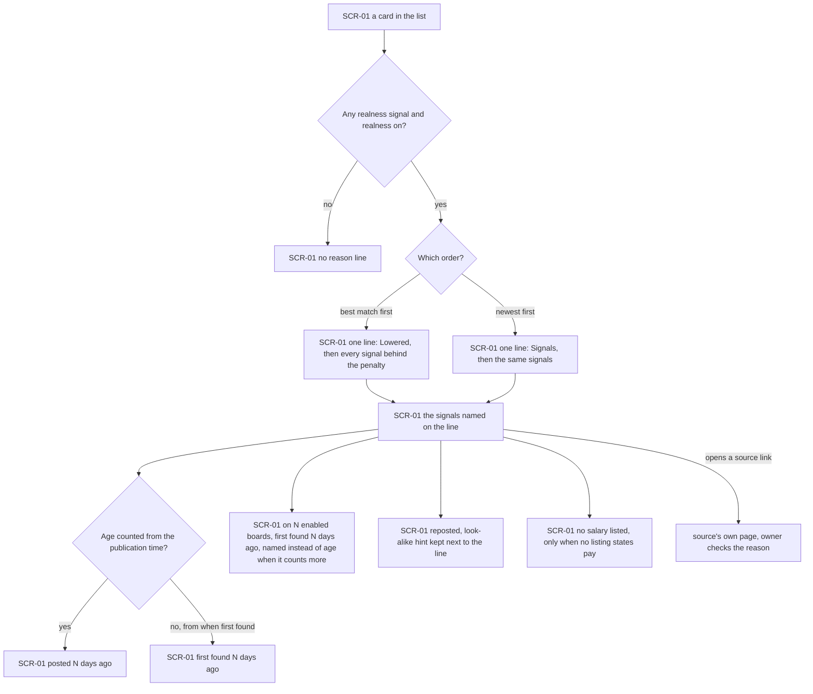
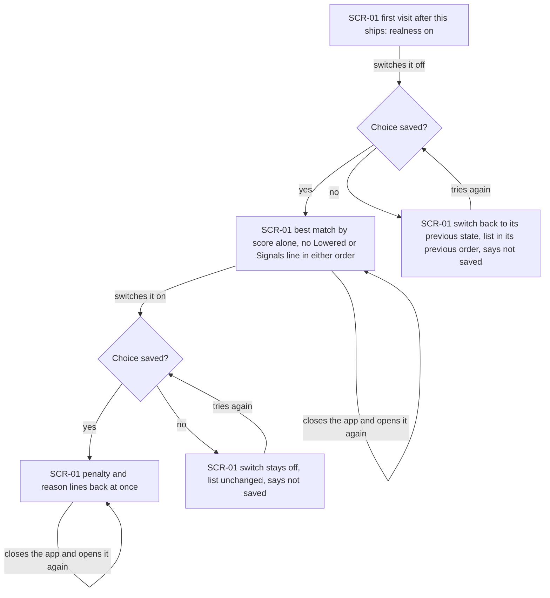
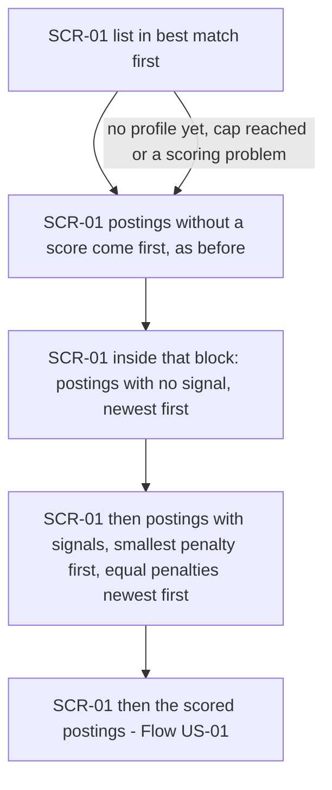
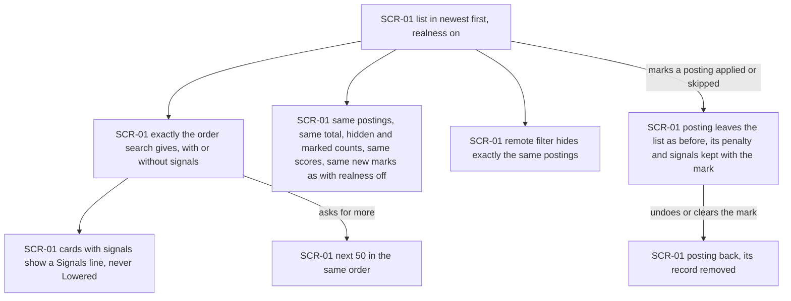

# UX flows — realness-score

> User flows for every UI-touching §4 user story, produced by `ux-flows` (after `clarify`, before
> `design`) and read by `design` (evidence for the target-surface + UI-architecture decisions),
> `sequences` (UI-driven flows align on SCR ids), `screens` (details every inventory row) and
> `plan-tests` (the e2e-through-UI paths). **Always markdown + mermaid `flowchart`**, whatever the
> design tool — this artifact is flow-altitude, not visual design.

## Platform decisions

- **Posture:** mobile-first, per `docs/design-system.md`, as in search-postings, applied-skipped, remote-filter and match-score. Every flow starts from the 360 px layout (spec §6 Phone layout: the reason line and the switch fit at 360 px with no horizontal scrolling, and the switch is at least 44×44 px).
- **No new screen.** Everything realness adds lives on the main screen (SCR-01): the reason line is part of each posting's card, like the match summary and the location mark, and the switch is a control of the list.
- **The switch sits on the list, next to the order switch.** US-03 is about comparing the plain best-match order with the lowered one, so the owner flips realness on the list and sees the result in place, without leaving it. The choice is kept between visits (AC-10). Switching reloads the list, as switching the order does.
- **Save failure is answered in place.** If the choice cannot be saved, the switch goes back to where it was, the list keeps its order, and a message next to the switch offers a retry (AC-11), following the design system's inline-error convention.
- **Checking a reason means leaving for the board.** The owner checks a reason through the card's existing source links (new tab). Realness adds no link of its own.
- **Sources are switched in the settings file, not in the app** (remote-boards-collector). A disabled source changes "on N boards" the next time the list is loaded (AC-09), with no screen step.
- *Design input:* whether the reason line is worked out when the list is asked for or kept on the posting, and how the switch's state reaches search (a saved setting next to the order choice), are `design`'s calls. So is where the AC-14 records live; they have no screen.

## Screen inventory

| ID | Screen | Purpose | Entry | Exit |
|---|---|---|---|---|
| SCR-01 | Main screen | The list as before, now with a realness switch next to the order switch, a reason line on each card that has signals ("Lowered: …" in best match first, "Signals: …" in newest first), the best-match order using the score minus the penalty, and the unscored block ordered by penalty | Opening the app; back from source health (SCR-02) or the profile (SCR-03), both unchanged by this feature | A source's page through a listing link, to check a reason; SCR-02 / SCR-03 as before |

## Flows

### Flow: US-01 — See live roles first

The owner opens the list in "best match first". With realness off, the order is the match score alone (Flow US-03). With it on, every scored posting is placed by its match score minus its realness penalty, and no penalty is above 30 points. In the spec's example the order is A (88), then C (70), then B (92, lowered to 67 for its age and no stated salary). Postings that end up equal keep their newest-first order. Every card still shows its own honest match score and fit note, and a lowered card names its reasons (Flow US-02). Asking for more brings the next 50 in the same order. If the collector changes a posting while the list is open (a new listing, a reopening, new text that states pay) or the owner disables a source in the settings file, the posting's signals change the next time the list is loaded or refreshed. Nothing moves while the list is open.

### Flow: US-02 — Know why a posting is lower

Every card with a realness signal names all the signals behind its penalty, on one line. In "best match first" the line starts with "Lowered:", for example "Lowered: first found 47 days ago · reposted · no salary listed". In "newest first" nothing is lowered, so the same signals start with "Signals:". The age says "posted N days ago" only when it counts from the publication time. Otherwise it says "first found N days ago", which covers a posting from the first fill with no publication time and one whose source gives a publication time later than when job-radar found it. A long life on many boards reads "on 4 boards · first found 50 days ago" and counts only enabled sources. When both time signals apply, the line names only the one that counts more. A repost reads "reposted", and a look-alike posting keeps its look-alike hint next to the line. "No salary listed" appears only when neither the board's pay field nor the posting's text gives an amount, and a listing with unknown pay state never counts as "no salary". A card with no signal, or any card while realness is off, has no line. To check a reason, the owner opens one of the card's source links and looks at the board.

### Flow: US-03 — Switch realness off and on

Realness is on the first time the owner opens the list after this ships. The switch sits next to the order switch. Switching it off reloads the list. "Best match first" orders by match score alone, and no card in either order shows a "Lowered" or "Signals" line. Switching it on again brings the penalty and the reason lines back at once. The choice is still in place the next time the app opens. If job-radar cannot save the choice, either way, the switch returns to its previous state, the list keeps its previous order, and the owner is told the choice was not saved and can try again.

### Flow: US-04 — Realness without a score

In "best match first", postings without a match score still come before every scored posting, as match-score set it. That covers pending postings, postings not scored because the cap was reached, postings that could not be scored, and every posting when there is no profile yet. Inside that block, postings with no signal come first, newest first. Postings with signals follow, from the smallest penalty to the largest, and equal penalties go newest first. Their cards carry the same "Lowered" line as scored ones. The scored postings follow as in Flow US-01. This holds with no profile, with no key, and when scoring has a problem, so realness works before any score exists.

### Flow: US-05 — Keep newest first and nothing hidden

In "newest first" the list is exactly the order search gives, with realness on or off. Cards with signals show them as "Signals: …" and never as "Lowered". Asking for more continues in the same order. In either order, realness never removes a posting. The list holds the same postings, the total, hidden and marked counts are the same, and every card shows the same match score, fit note and "new" mark as with realness off. The remote filter hides exactly the same postings. Marking a posting applied or skipped moves it out of the list as before. Behind the scenes, job-radar keeps the posting's penalty and signals at that moment with the mark, even when the switch is off. Changing the mark keeps only the latest record, and clearing it removes the record. The first time the owner opens the list on a calendar day, job-radar also keeps the share of postings in that list that had a penalty. Neither record shows on the screen.

## AC coverage

| AC | Shown by | Notes |
|---|---|---|
| AC-01 | Flow US-01 → D, E, F | Order by score minus penalty, own score on card, ties newest first; point values are a unit check |
| AC-02 | Flow US-02 → C, E, F, H, J, K | Reason line wording in both orders; no line without a signal |
| AC-03 | Flow US-05 → E, F; Flow US-01 → D, F | Same postings, counts and scores; penalty cap 30 |
| AC-04 | Flow US-05 → B, C, D | Newest-first order untouched, "Signals" never "Lowered" |
| AC-05 | Flow US-04 → B, C, D | Unscored block first, then penalty order inside it |
| AC-06 | Flow US-02 → M | "No salary" only when no listing states pay; amount parsing is a fixture-set unit check (§6) |
| AC-07 | Flow US-02 → G, H, J | Age from the search time, "posted" vs "first found" |
| AC-08 | Flow US-02 → L | Repost reason and the look-alike hint; detection rules are domain checks with no branch of their own |
| AC-09 | Flow US-01 → I; Flow US-02 → K | Enabled boards only; changes show on next load or refresh |
| AC-10 | Flow US-03 → A, C, F | On by default, off removes the penalty and lines, choice kept |
| AC-11 | Flow US-03 → D, G | Save failure: switch reverts, order kept, retry |
| AC-12 | N/A | Refusing other devices and other sites is not a screen flow; covered by the access rule (search AC-17, applied-skipped AC-16) |
| AC-13 | Flow US-05 → E, F, G | Filter, marks, "new" mark and scores unchanged; zero provider calls is a unit check |
| AC-14 | Flow US-05 → G, H | Record kept with the mark, latest only, removed on clear; the daily share has no screen (prose) |
