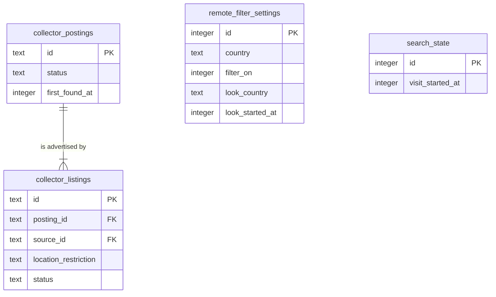

# Data model — remote-filter

Derived from:
- spec §5: AC-04 (country remembered), AC-06 (one-off look), AC-07 (off state remembered), AC-10 ("Anywhere" kept as stated), AC-13 (changing the country switches the filter on);
- sad.md §4 inline decisions, §5 "State kept by remote-filter";
- the persist notes of sad.md §6 Flows 2–6.

Conventions follow project ADR `docs/adr/0003-sqlite-with-drizzle.md` and the pattern of `search_state` (search-postings data-model). Nothing new is decided here:

- SQLite through Drizzle. The table lives in `apps/server/src/modules/remote-filter/infra/schema.ts`, which the existing `drizzle.config.ts` glob `./src/modules/*/infra/schema.ts` already picks up.
- Names are snake_case with the module prefix `remote_filter_`.
- A singleton state row uses `id integer PK`, always `1`, upserted lazily with `onConflictDoNothing`, so there is no seed migration.
- Booleans are `integer` in Drizzle's boolean mode (as `collector_run_sources.is_first_fill`). Times are integer UTC epoch milliseconds.
- There are no `CHECK` constraints, no DB `DEFAULT`s, no triggers and no audit columns. Rules live in `remote-filter/domain`.

**Scope.** The feature adds one table: `remote_filter_settings`. Snapshots, with their country and hidden count, stay in memory (search ADR-0003). Location verdicts are never stored (ADR-0002). **The collector schema is unchanged.** An explicit "Anywhere" now lands in the existing `collector_listings.location_restriction` text column instead of `NULL` (AC-10). Listings already held as `NULL` take the new reading the next time their source offers them, so there is no backfill.

## ER diagram

`remote_filter_settings` has no FK. The other tables are shown only for the read side: `search_state.visit_started_at` is the visit start search passes in when it asks for the active filter, and the collector tables are where the stated locations are read. They are owned and migrated by search and the collector.

## Entities

### Module state (remote-filter-owned)

#### `remote_filter_settings`

| Column | Type | Constraints | Notes |
|---|---|---|---|
| `id` | integer | PK | Always `1`. The app writes it; no `CHECK` enforces it (convention above). |
| `country` | text | | The owner's country as an ISO 3166-1 alpha-2 code from the ADR-0003 country list (e.g. `PL`, `XK`). `NULL` means no country chosen yet: no filter and the prompt to choose (AC-04). Written only after the name was found in the list, so a refused name never changes it (AC-05). |
| `filter_on` | integer (boolean) | NOT NULL | Written `true` when the row is first created. Switched off and on only by the owner (AC-07). Choosing or changing the country sets it `true` (AC-13). Has no effect while `country` is `NULL`. |
| `look_country` | text | | The one-off look's country, ISO alpha-2. `NULL` means no look. Starting a look never changes `country` or `filter_on` (AC-06). |
| `look_started_at` | integer | | When the look was started. Search passes its current `search_state.visit_started_at` when it asks for the active filter; the look is active only if `look_started_at` is not before it. A reload stays in the same visit and keeps the look; a new visit (more than 30 min away) starts later and ends it, with no clean-up job (AC-06). Remote-filter never reads search state. Cleared together with `look_country` on "back". |

**Aggregate root:** root (singleton).
**Access patterns:** read and written by PK only. It is read on every search, waiting poll and settings read (Flows 1–5), and written only by the owner's actions: choose or change the country, switch the filter, start or end a look (Flows 2–4). No secondary index.

### Read from the collector and search (not owned, unchanged)

| remote-filter need | Column(s) | Rule |
|---|---|---|
| A listing's stated location (AC-01 – AC-03) | `collector_listings.location_restriction` | Read as stated; `NULL` = not stated; an exact "Anywhere" / "Anywhere in the World" = Worldwide when it stands alone (AC-10) |
| Open listings only (AC-03) | `collector_listings.status`, and the enabled-source set from the collector's settings | `status = 'open'` and the source is enabled; read through the collector `app/` exports |
| The current visit (AC-06) | `search_state.visit_started_at` | Passed in by search; compared with `look_started_at` |

## Indexes

No new index. `EXPLAIN QUERY PLAN` for the settings read: `SEARCH remote_filter_settings USING INTEGER PRIMARY KEY (rowid=?)`.

| Query (flow) | Plan | Verdict |
|---|---|---|
| Settings by id (Flows 1–5, every search and waiting poll) | PK | Covered |
| Stated locations of open postings (Flows 1, 5) | The read search already does: `SCAN collector_postings` → `collector_listings_posting_idx` (search-postings data-model §Indexes) | No change: the verdict reuses the rows search already loads, so there is no extra query |

## Test fixtures

Not in migrations. They go in `apps/server/test/helpers/` beside `temp-db.ts`:

- `setRemoteFilterSettings(db, partial)` upserts the singleton row, to set up no-country, off, and look-in-this-visit / look-from-an-earlier-visit scenarios under a fake clock (AC-04, AC-06, AC-07).
- Postings whose listings carry the spec examples ("USA", "EMEA", "🇵🇱 Poland, 🇺🇦 Ukraine", "UTC-1 to UTC+3", `NULL`, "Worldwide except Poland", "Anywhere" beside "USA") are built with the existing `seedOpenPostings` helper and listing overrides. Company `Example Co`, URLs `https://jobs.example.test/<id>`.
- The fixed verdict example list (every distinct statement of 2026-10-14 plus AC-01 – AC-03) is a **unit-test table** in `remote-filter/domain/verdict.test.ts`, not DB data.
