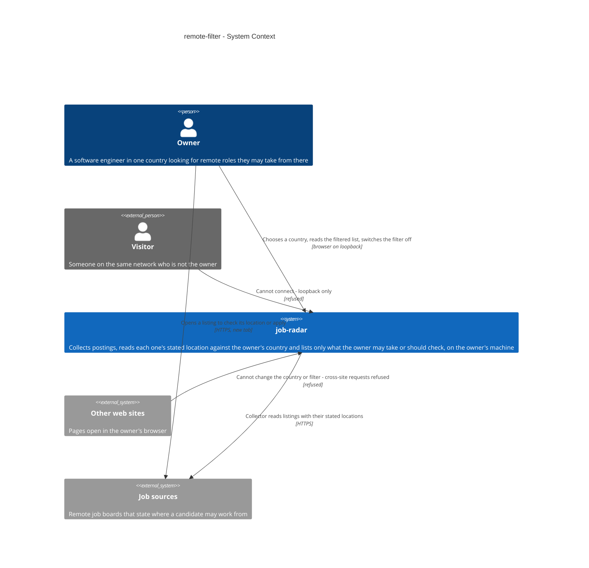
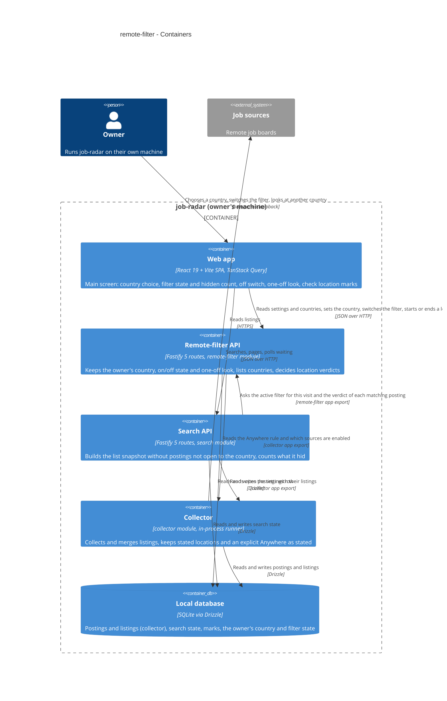
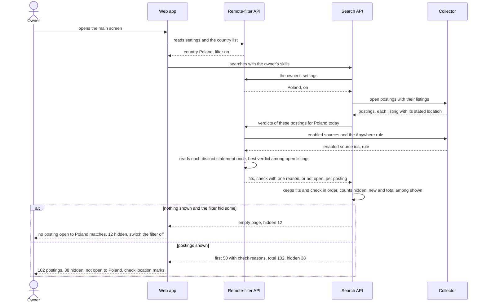
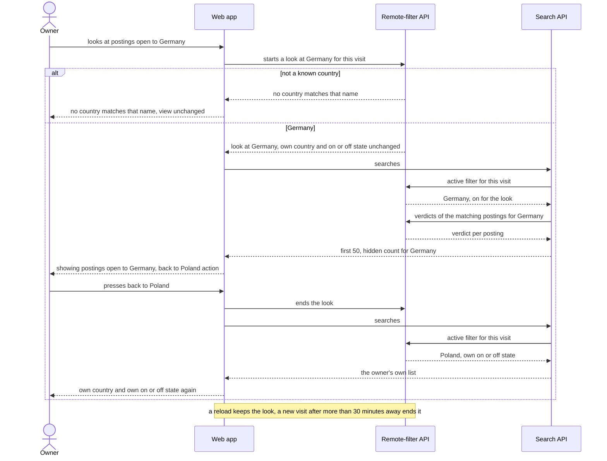
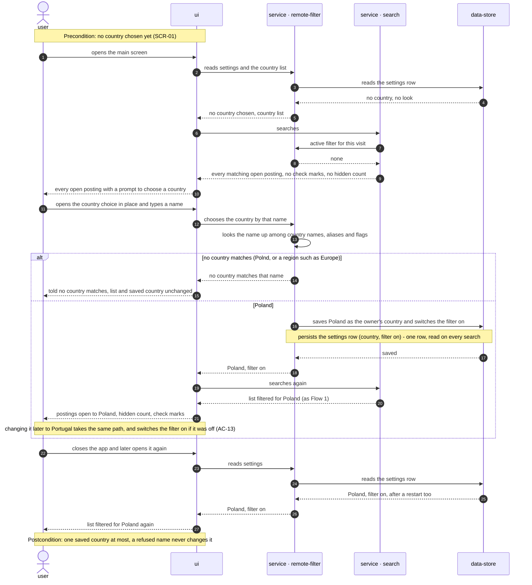
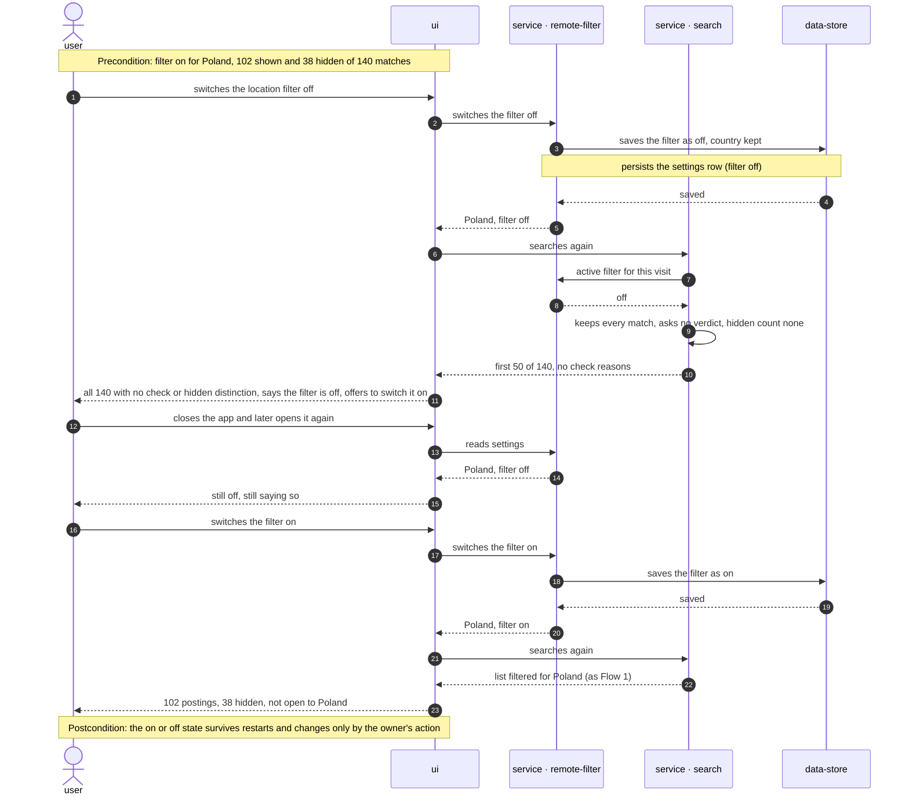
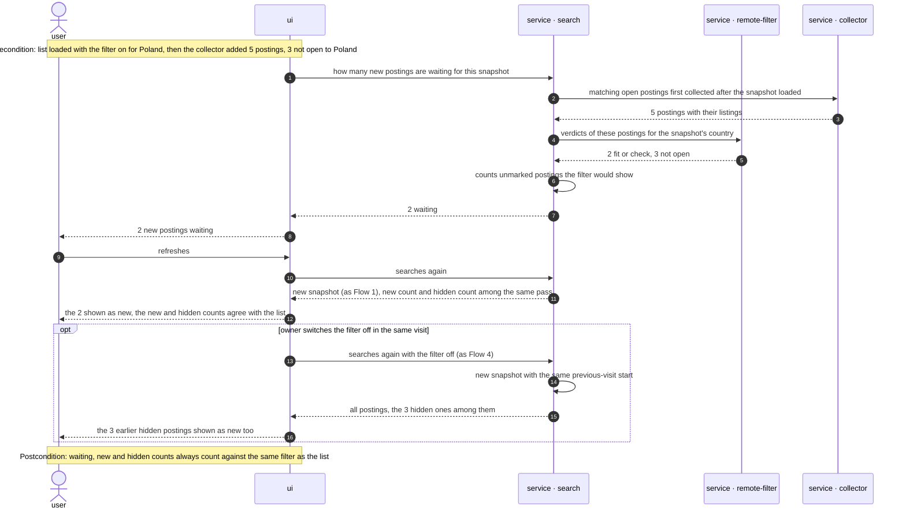
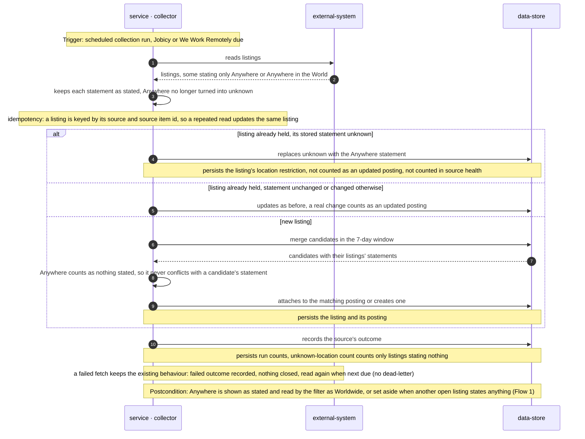
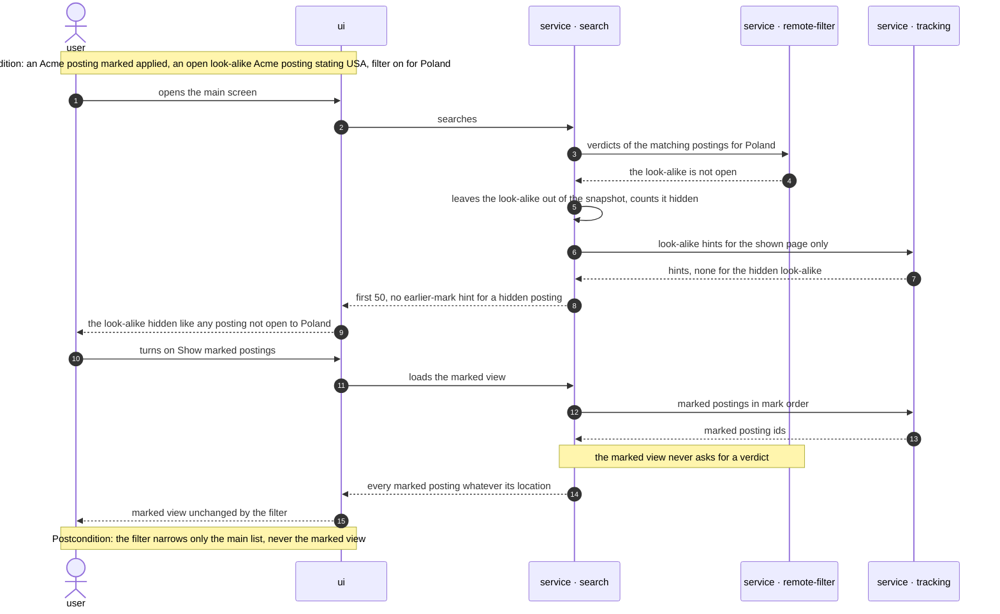

# Software Architecture Document — remote-filter

## 1. Introduction and goals

**Intent.** The remote filter gives every open posting one location verdict for one country: fits, check, or not open. The owner picks their country once and job-radar remembers it. The main list then hides only the postings whose open listings all state a readable location that leaves that country out. Anything the filter cannot read with confidence stays in the list with a "check location" mark and one reason. The main screen always says how many postings were hidden, and the owner can switch the filter off. A second mode, "open to country X", applies the same rules to a one-off country for the rest of the visit without changing the owner's own country. The collector changes in one place: a source's explicit "Anywhere" is kept as stated, read as Worldwide, and still counts as nothing stated when merging (spec AC-10).

**Top-3 quality goals (1-liners; full scenarios in §10):**

1. **No wrong hide on uncertainty.** A posting is hidden only on a confident reading. 0 hidden postings whose statement is unknown, unrecognised, contains an exception, or fits only by working hours. 100% of the fixed examples give the expected verdict, on a winter date and a summer date alike.
2. **The shorter list always explains itself.** The screen states which filter is on (own country, a one-off country, off, or no country yet), how many postings it hid, and why a list is empty. The total, "new" and waiting counts agree with what the list shows (AC-07 – AC-09).
3. **Search stays fast with the filter on.** ≤ 1 s p95 to the first 50 postings shown, with 10,000 open postings and up to 20 skills, unchanged from search.

**Stakeholders.**

| Role | Interest | Sign-off owner? |
|---|---|---|
| Owner | Chooses and changes their country, reads the filtered list with its "check location" marks and hidden count, switches the filter off, looks at another country (US-01 – US-06) | No |
| Visitor | None. Must not read or change the owner's country or filter; cannot connect at all (AC-12) | No |
| Tech Lead | SAD approval; owner of spec §8 Q3 (the country, region, filler-word, zone-name and short-code lists), resolved in this SAD | Yes |
| Security Lead | Confirms no new access boundary: the country and filter change only through the existing loopback, same-origin rule (spec §6.1, collector ADR-0007) | Yes |

## 2. Constraints

**Technical.**
- TypeScript on Node.js 22+ (`.nvmrc`), pnpm workspaces: `apps/server` + `apps/web` (project ADR `docs/adr/0001-typescript-monorepo-react-fastify.md`).
- Server: Fastify `^5.12`, one process on `127.0.0.1:3000` that also serves the built SPA (collector ADR-0001, ADR-0007).
- Web: React 19 + Vite single-page app, TanStack Query, Tailwind v4 with the semantic tokens in `apps/web/src/styles/tokens.css`.
- Datastore: one SQLite file through `better-sqlite3` + Drizzle ORM; migrations from `drizzle-kit`, forward-only, with a file backup before each migrate (project ADR `docs/adr/0003-sqlite-with-drizzle.md`). One connection shared by every module; calls are synchronous on the server's single event loop.
- Node's built-in `Intl` (full ICU, shipped with Node 22) supplies English country names (`Intl.DisplayNames`), each country's time zones (`Intl.Locale` region info) and a zone's offset on a given date (`Intl.DateTimeFormat` `longOffset`). Checked on Node 22.23 on 2026-10-14: Poland → `Europe/Warsaw` → GMT+01:00 in January, GMT+02:00 in July.
- Location restrictions are stored by the collector exactly as each source states them, `null` when nothing is stated (collector AC-21, AC-22). Listings and postings, merging and source readers belong to the collector (collector ADR-0004, ADR-0005). The list, its snapshots, visits and counts belong to search (search ADR-0003, applied-skipped ADR-0002). Marks belong to tracking.
- Layering per project ADR `docs/adr/0002-feature-modules-mirror-roadmap.md`: `modules/<name>/{domain,app,infra,ports}`; a module reaches another only through that module's `app/` exports.

**Organisational.**
- One owner-developer. Size S, route quick (spec §1, `.size`, `.route`). No deadline is stated.
- Roadmap wave 4: step 5 touches `collector/` (two source readers and the merge rule), so step 10 (LinkedIn adapter) lands after it (roadmap execution path, spec §1). Step 4 (match score) will also change the list; whichever lands second rebases onto the other's `search/app/` change.

**Conventions.**
- `CLAUDE.md` (layout, layering, errors, IDs, persistence, tests, UI) and `docs/design-system.md` (mobile-first posture, component inventory, 44×44 px touch targets).
- Errors use one envelope `{ "error": { "code", "message" } }`, shaped only by `core/errors.ts`; expected failures throw `AppError(code, message, status)`.
- Tests use Vitest. Unit tests sit beside the code; server integration tests live in `apps/server/test/` against a temp SQLite file; web tests use Testing Library.

**Regulatory / external.**
- Data classification is internal. The only new personal data is the owner's chosen country and the filter's on/off state: low sensitivity, kept on the owner's machine, never sent anywhere (spec §6.1). No compliance regime applies.
- Source terms are unchanged: every shown posting names its sources and shows each listing's location as the source stated it (`CLAUDE.md` §Source terms).

## 3. Context and scope

The owner runs job-radar on their own laptop. The collector fills the local database from remote job boards, keeping each listing's location restriction as stated, and search shows the owner the open postings that match their skills. This feature reads those stated locations against the owner's country and narrows the list. Everything happens on the owner's machine: no country list, time-zone data or verdict comes from an outside service, and nothing new leaves the machine.

<!-- brownfield: architecture-map.md is stale (reflects 133499e, greenfield-bootstrap); the code was scanned directly on 2026-10-14. Modules: health, collector (postings, listings, merge with a location-conflict rule, source readers that turn Jobicy's "Anywhere" and WWR's "Anywhere in the World" into null), search (in-memory snapshots of ordered ids, one-row search_state with last skills and the visit), tracking (marks; search drops marked ids as each page loads). No location module yet; latest migration 0004. -->

**External systems (in / out):**

| Actor or system | Type | Interaction |
|---|---|---|
| Owner | Person | Chooses their country, reads and narrows the list, switches the filter off, looks at another country |
| Visitor | Person (external) | Can reach the machine over the network but cannot connect: loopback only (AC-12, collector ADR-0007) |
| Other web sites | System (external) | Pages open in the owner's browser; a request from them to change the country or the filter is refused as cross-site (AC-12) |
| Job sources | System (external) | Read by the collector; Jobicy and We Work Remotely now have their explicit "Anywhere" kept as stated (AC-10) |

**C4 Context (L1):**



The owner uses job-radar in their browser to choose a country and read the filtered list, and opens a source's own page to check a marked location or apply. job-radar reads the job sources as before and does all location reading itself. The two ways in that must stay shut are a visitor on the network, who cannot connect, and another site's page in the owner's browser, whose requests to change the country or switch the filter are refused, so nobody else can hide postings from the owner.

## 4. Solution strategy

**Target surfaces:** `[backend-service, web-frontend]`, per [ADR-0001](adr/0001-ship-the-filter-as-a-new-remote-filter-module-plus-main-screen-controls.md). A new `remote-filter` module in the existing Fastify server owns:
- the statement reader and the verdict rules;
- the country vocabulary;
- the owner's country and on/off state, with their routes.

Search asks remote-filter for verdicts when it builds a list. The web app's main screen (SCR-01) gains the country choice, the off switch, the one-off look with its "back" action, the hidden count, the "check location" mark with its reason, and the filter's empty-list message. There is no new screen (ux-flows.md).

**UI architecture (web-frontend):** unchanged from the project. It stays a single-page app (project ADR-0001) with server data through TanStack Query (collector ADR-0002).
- The owner's country and on/off state are a query plus mutations against remote-filter's routes.
- The one-off look is kept by remote-filter on the server, tagged with when it was started, so a browser reload within the visit keeps it (AC-06). It ends on "back", or by itself once search starts a new visit (search AC-14).
- Any change of country, look or on/off runs a new search, and the list reloads from the top (ADR-0002).
- Visual states belong to `screens.md`. Existing components are reused (Badge for the mark, InlineBanner for the filter state and empty message, Button).

No new UI-architecture choice crosses the gate; this note is inline only.

**Top strategic choices (the seeds for ADRs):**

1. **A new `remote-filter` module, with its controls on the main screen.** It owns the rules, the vocabulary and the owner's settings end to end. Dependencies run search → remote-filter → collector through `app/` exports. Alerts (roadmap step 7) and the match score (step 4) can ask for a verdict without going through search. See [ADR-0001](adr/0001-ship-the-filter-as-a-new-remote-filter-module-plus-main-screen-controls.md).
2. **Decide verdicts on read, when search builds its snapshot.**
   - Search asks for the verdict of every matching posting, marked or not. The snapshot keeps only shown postings (fits, check) in order, plus the hidden count and the country it was built for.
   - Each distinct statement is read once per search, and a rule fix takes effect on the next search with no backfill.
   - Marks are still dropped as each page loads (applied-skipped ADR-0002).
   - See [ADR-0002](adr/0002-decide-location-verdicts-on-read-when-search-builds-its-snapshot.md).
3. **Build the country vocabulary from `Intl` plus small hand-kept tables.**
   - From `Intl`: names, flags, time zones and winter/summer offsets.
   - Kept by hand in `remote-filter/domain`: aliases, region membership, zone names, filler words and short codes (fixed in §8).
   - The chooser and the filter use the one list the server builds.
   - This answers spec §8 Q3. See [ADR-0003](adr/0003-build-the-country-vocabulary-from-intl-plus-small-hand-kept-tables.md).

**Inline decisions (below the ADR gate):**
- The owner's country (an ISO alpha-2 code) and the on/off state live in one row of a new `remote_filter_settings` table. No country chosen means no filter (AC-04). Choosing or changing a country switches the filter on (AC-13).
- The one-off look lives in the same row: the look country and when it was started. Search passes its current visit start, and a look started before it (an earlier visit) is ignored, which ends it with no clean-up job. Starting a look never touches the owner's own country or on/off state (AC-06).
- "Anywhere" (spec AC-10) is one predicate, `isStatedAnywhere()`, in `collector/domain/listing.ts`: an exact "Anywhere" or "Anywhere in the World", any case, after trimming. The Jobicy and We Work Remotely readers keep it as stated instead of turning it into `null`. The merge rule's location-conflict check and the listing's change check treat it as `null`, so a listing going from `null` to "Anywhere" is not an updated posting. Source health's unknown-location count counts only `null`. remote-filter reads the predicate through a collector `app/` re-export.
- An open listing for the verdict is one with status open from an enabled source (spec AC-03). remote-filter reads the enabled-source set through a new read-only collector export.

Each tactical decision in later sections traces to one of these seeds. Tactical decisions that *contradict* a strategic choice are red flags — surface them in §11.

## 5. Building block view

remote-filter follows the repo's feature-module layering (project ADR-0002).
- **`domain`** holds the rules the acceptance criteria state. They are pure and take the date as an input:
  - the vocabulary built from `Intl` and the hand tables (ADR-0003);
  - the statement reader: parts, fillers, countries longest name first, regions, zones, exceptions, soft wording, cut-short lists;
  - one listing's verdict for a country and a date;
  - one posting's verdict from its open listings (best wins, "Anywhere" set aside), with the single reason shown by priority (AC-01 – AC-03).
- **`app`** answers search's "verdicts for these postings, for this country" and "the owner's settings". It also runs the settings use cases and the country lookup (AC-05).
- **`infra`** holds the one settings row.
- **`ports`** holds the Fastify routes: read settings and the country list, set the country, switch the filter on or off.

Search changes only its snapshot, counts and waiting count. The collector changes its two readers, its merge and change checks, and gains two read-only exports.

**Internal decomposition:**

```
apps/server/src/
├── app.ts                         registers remote-filter; search receives its verdict reader
├── modules/collector/
│   ├── domain/listing.ts          + isStatedAnywhere(); toLocationRestriction unchanged
│   ├── domain/merge.ts            conflicts(): an "Anywhere" statement counts as nothing stated
│   ├── infra/repo/postings.ts     null → "Anywhere" is not a change (no updated posting)
│   ├── infra/sources/jobicy.ts    keeps "Anywhere" as stated
│   ├── infra/sources/weworkremotely.ts  keeps "Anywhere in the World" as stated
│   ├── app/ingest.ts              unknownLocationNew counts only null (unchanged code path, now true by data)
│   └── app/location.ts            NEW read-only: re-export isStatedAnywhere, enabledSourceIds()
├── modules/remote-filter/         NEW
│   ├── domain/                    vocabulary.ts (Intl + aliases, regions, zones, fillers, short codes)
│   │                              statement.ts (read one statement) · verdict.ts (listing + posting verdict, reason)
│   ├── app/                       verdicts.ts (verdicts for postings and a country, per-call cache)
│   │                              settings.ts (read, choose country, switch on/off, start or end a look, active filter for a visit) · countries.ts (list, lookup)
│   ├── infra/                     schema.ts (remote_filter_settings) · repo.ts (the only SQL in the module)
│   ├── ports/routes.ts            settings + countries, set country, switch on/off
│   └── index.ts                   Fastify plugin
└── modules/search/app/
    ├── deps.ts                    + LocationReader (remote-filter's verdicts, replaceable in tests)
    ├── search.ts                  asks the active filter for this visit (own country, a look, or off); filters by verdict before the snapshot;
    │                              total / new / hidden / marked counts; check reason on each shown posting
    ├── snapshots.ts               Snapshot + location { country, on }, hiddenCount
    ├── present.ts                 Posting + location_check (reason or null)
    ├── pages.ts                   next pages carry each posting's check reason
    └── waiting.ts                 counts only postings the snapshot's filter would show

apps/web/src/
├── api/remoteFilter.ts            NEW typed client for remote-filter's routes
├── features/remote-filter/        NEW CountryChoice (in place, unknown-name message) · FilterBar (state line,
│                                  hidden count, off/on, look at another country, back) · LocationCheck mark
└── features/search/               SearchList re-searches after any filter change, shows the filter's empty message;
                                   PostingCard shows the LocationCheck mark
```

**State kept by remote-filter.** One `remote_filter_settings` row:
- the owner's country: an ISO 3166-1 alpha-2 code, or none until chosen;
- whether the filter is on;
- the one-off look country, if any, and when it was started.

Exact columns belong to `data-model`. Nothing goes in browser storage.

**Snapshots.** Search's in-memory snapshots keep their shape, limits and expiry (search ADR-0003). A main-list snapshot now also records:
- the country it was filtered for, or none when the filter is off or no country is chosen;
- its hidden count.

Its ids are only the shown postings, marked ones included, which pages drop as before.

**C4 Container (L2):**



The owner's browser talks to two server parts. The Remote-filter API holds the owner's country, on/off state and any one-off look, and serves the country list. The Search API builds the list. Search asks remote-filter for the settings and for each matching posting's verdict, then keeps only what is shown. Remote-filter reads two things from the collector: the "Anywhere" rule and which sources are enabled. The collector keeps collecting as before, now keeping an explicit "Anywhere" as stated. All three keep their data in the one local SQLite file. Tracking is unchanged and left out of this view.

## 6. Runtime view

**Critical flow 1: the owner opens the main screen with the filter on (US-01, US-02, US-05; AC-01 – AC-03, AC-07, AC-08)**



**Critical flow 2: the owner looks at another country, then goes back (US-04; AC-05, AC-06)**



### Flow 3: the owner chooses a country, then changes it (US-03; AC-04, AC-05, AC-13)



### Flow 4: the owner switches the filter off, and later on again (US-05; AC-07)



### Flow 5: new postings arrive while the filtered list is shown (US-05; AC-09)



### Flow 6: a collection run meets an explicit Anywhere (US-06; AC-10)



### Flow 7: the marked view and look-alikes with the filter on (US-01; AC-11)



**Coverage (spec §4 / §5 → flow).**

| User story | Flows |
|---|---|
| US-01 Hide roles I can't take | Flow 1, Flow 7 |
| US-02 See uncertain locations marked | Flow 1 |
| US-03 Set my country once | Flow 3 |
| US-04 Check another country | Flow 2 |
| US-05 Know what the filter hides | Flow 1 (empty message), Flow 4, Flow 5 |
| US-06 Count Anywhere as open to me | Flow 6 (collector), Flow 1 (read as Worldwide or set aside) |

| AC | Shown in |
|---|---|
| AC-01 | Flow 1, verdict step and the postings-shown branch |
| AC-02 | Flow 1, check with one reason |
| AC-03 | Flow 1, best verdict among open listings from enabled sources, Anywhere set aside |
| AC-04 | Flow 3, no-country start, Poland branch, reopen |
| AC-05 | Flow 3, no-country-matches branch; Flow 2, the same branch for a look |
| AC-06 | Flow 2, look start, back, reload and new-visit note |
| AC-07 | Flow 4 |
| AC-08 | Flow 1, nothing-shown branch |
| AC-09 | Flow 5 |
| AC-10 | Flow 6; Flow 1 for the reading |
| AC-11 | Flow 7 |
| AC-12 | N/A, not a remote-filter runtime flow: the global loopback bind, Host check and same-origin JSON guard reject the request before any route runs (collector ADR-0007, `core/access.ts`) |
| AC-13 | Flow 3, the change-to-Portugal note |

**Flags from `sequences` (for design / data-model; no ADR written).**
- Participant labels differ. Flows 1 and 2 use module names; Flows 3–7 use generic roles qualified by the §5 module (`service · remote-filter`), as in applied-skipped. Flows 1 and 2 were left untouched.
- Flow 7 needs `service · tracking`. The §5 container view leaves tracking out as unchanged; it is the existing tracking module, not a new participant.
- Flow 6 has no dead-letter. Collection is in-process and runs on the schedule; a failed fetch records a failed outcome and is read again when next due (collector ADR-0003). This is existing collector behaviour, not a new decision.
- Persist and read hints for `data-model`:
  - One settings row (country, on/off, look country, look start time) is read on every search and every waiting poll, and written only by the owner's actions (Flows 2–5).
  - No new collector column. The listing's location restriction now also holds Anywhere statements, and the merge and change checks compare them as nothing stated (Flow 6).

## 7. Deployment view

<!-- N/A: reuses existing deployment unit, no infra change -->

The deployment is unchanged: one Node.js process on `127.0.0.1:3000` serving the API and the built SPA (collector SAD §7). remote-filter is one more Fastify plugin registered in `app.ts`. The only persistent addition is the `remote_filter_settings` table, created by a forward-only migration with the usual file backup. Country and time-zone data come from the ICU data that ships with Node, so a Node upgrade is the only way that data changes (§11).

## 8. Crosscutting concepts

| Concept | Convention | Where defined |
|---|---|---|
| Logging | Fastify's pino logger with child field `module=remote-filter`. Search's existing `search` log line gains `hidden` and `checked` counts and the country code. Statements are not logged one by one | `apps/server/src/main.ts` + here |
| Access control | Unchanged: loopback bind, Host check, and state-changing requests accepted only same-origin with a JSON body; no CORS. Setting the country and switching the filter are JSON POSTs behind the global guard (AC-12) | collector [ADR-0007](../remote-boards-collector/adr/0007-allow-only-loopback-same-origin-requests-without-accounts.md), `core/access.ts` |
| Error handling | Envelope `{ "error": { "code", "message" } }` via `AppError`. A name that matches no known country is refused with its own code and the message "No country matches that name", leaving the saved country unchanged (AC-05); an unknown look country in a search is refused the same way. Codes are fixed by `api` | `core/errors.ts` + here |
| Reading a statement | Split on commas, semicolons, "and", "&", "/" and line breaks. Drop flags after reading them as their country, and drop the filler words. A statement with nothing left after that (a bare "Remote") is "not recognised", never "not stated" (AC-01). "Anywhere" and "Anywhere in the World" are Worldwide only when they are the whole statement: beside countries or other parts they are dropped and only the rest is read (AC-10). Match country names and aliases longest first, whole words only. Then regions, zones, exception words and soft words. Any word left over makes the statement "not recognised". "Anywhere" is set aside when another open listing states anything (AC-03). Markup is never interpreted: statements are plain text (search AC-09) | `remote-filter/domain/statement.ts`, `verdict.ts` |
| Filler words (spec AC-01) | `remote`, `only`, `based`, `fully`, `in`, `the`, `100%`, `-based` suffixes, brackets, dashes, slashes, `&`, `and`, `or`. Everything else unknown makes the statement not recognised | `remote-filter/domain/vocabulary.ts` |
| Soft and exception wording | Soft (read as check, never hide): `preferred`, `ideally`, `nice to have`, `welcome`, `plus`. Exception (check, never fits, never hidden): `except`, `excluding`, `not`, `outside`. A cut-short list (`…`, `...`, `+N more`) is check unless its visible part names the country | `remote-filter/domain/vocabulary.ts` |
| Zones (spec AC-01) | `UTC±N` and `GMT±N` with optional `:MM` or a fractional `.5`/`.75`, ranges (`UTC-1 to UTC+3`, `UTC-1 – UTC+3`); `CET`/`CEST`, `EET`/`EEST`, `WET`/`WEST`, `GMT`, `UTC`; US `ET`/`EST`/`EDT`, `CT`/`CST`/`CDT`, `MT`/`MST`/`MDT`, `PT`/`PST`/`PDT`. A zone fits when it covers one of the country's offsets on 15 January or 15 July of the year of the date asked. Other time wording ("European time zones", "USA timezones", "overlap with PST") is not recognised | `remote-filter/domain/vocabulary.ts` |
| Short codes (spec AC-01) | `US`, `USA`, `U.S.`, `U.S.A.`, `UK`, `UAE` as countries; `EU` as a region. No other two-letter code is read ("CA", "IN" are not recognised) | `remote-filter/domain/vocabulary.ts` |
| Regions | Worldwide: `Worldwide`, `Global`, and `Anywhere` / `Anywhere in the World` when alone (all countries). `Europe` (EU, EEA, UK, Switzerland, Western Balkans, Ukraine, Moldova, Belarus, microstates; not Russia or Turkey: hand list). `EU` (the 27 members). `EMEA` (Europe + Middle East + Africa, Turkey and Russia included). `LATAM` / `Latin America` (Mexico, Central and South America, Spanish- and Portuguese-speaking Caribbean). `Americas` (North, Central and South America, Caribbean). `North America` / `Northern America` (US, Canada, Mexico; Greenland, Bermuda). `APAC` / `Asia-Pacific` (East, South-East and South Asia, Oceania). Exact member codes live in the vocabulary file and are covered by the example-set test | `remote-filter/domain/vocabulary.ts`, ADR-0003 |
| Aliases | Beyond the `Intl` English name: `United States of America`, `United Kingdom of Great Britain and Northern Ireland`, `Great Britain`, `Czech Republic`, `Hong Kong`, `Moldova (Republic of)`, `Türkiye`, `South Korea`, `Russia`, `Vietnam`, `Macau`, `Ivory Coast`, plus each WWR ISO-official name met in the example set. A name that is both a country and part of another (`Georgia`) is not recognised unless another part decides | `remote-filter/domain/vocabulary.ts` |
| Untrusted source content | Location statements and reasons are rendered as React text only, the same as search AC-09 | search SAD §8 |
| ID strategy | No new ids. The settings table has one row; countries are ISO alpha-2 codes | `core/id.ts` (unchanged) |
| Time | The verdict takes the date from search's injected clock; offsets come from `Intl` for that year's 15 January and 15 July, so tests can run a winter and a summer date (spec §6 Seasonal stability) | `remote-filter/domain/verdict.ts` |
| UI data access | TanStack Query: one query for settings and countries, mutations for the country and on/off. Any change invalidates the search query, which reloads from the top (ADR-0002). The settings query includes the active look; starting or ending a look is a mutation | collector [ADR-0002](../remote-boards-collector/adr/0002-fetch-ui-data-with-tanstack-query-and-poll-run-progress.md) |
| UI styling | Semantic tokens only, mobile-first from 360 px. The country choice, look, back and off actions are each at least 44×44 px | `docs/design-system.md` |
| Internationalisation | N/A: single language (English) UI; country names in English | — |
| Events | N/A: modules call each other's `app` exports in-process; there is no event bus | project ADR-0002 |

## 9. Architecture decisions

| # | Title | Status | Section |
|---|---|---|---|
| 0001 | Ship the filter as a new remote-filter module plus main-screen controls | Accepted | §4 |
| 0002 | Decide location verdicts on read when search builds its snapshot | Accepted | §4 |
| 0003 | Build the country vocabulary from Intl plus small hand-kept tables | Accepted | §4 |

ADR files live under `docs/features/remote-filter/adr/NNNN-<title>.md`.

## 10. Quality requirements

**QG-1. No wrong hide on uncertainty**
- **When:** the filter reads every statement in the example set for Poland, on a winter date and on a summer date. A generated set of statements with unfamiliar words, exceptions and empty values is also read.
- **Then:**
  - Verdict correctness: 100% of the fixed examples give the expected verdict. The examples are every distinct location restriction in the owner's collection on 2026-10-14, each judged for Poland, plus the whole-name, exception, mixed and merged examples of AC-01–AC-03.
  - Never a wrong hide on uncertainty: 0 postings hidden whose statement is unknown, unrecognised, contains an exception, or fits only by working hours.
  - Seasonal stability: the same verdict for every example on a winter date and a summer date.
- **How verify:**
  - A unit test over the example list in `remote-filter/domain`, run at two dates. Beyond the spec's examples, the list includes "USA, Anywhere" (not open: the countries are the statement, AC-10) and a bare "Remote" (check, not recognised, AC-01).
  - A property test over generated statements asserting no "not open" for those classes.
  - A unit test pinning the `Intl`-derived data for PL, US, GB and NZ (ADR-0003).

**QG-2. The shorter list always explains itself**

*The numbers below are the spec's AC-07 – AC-09 example cases, not spec §6 NFR targets.*

- **When:** the filter for Poland hides 38 of 140 matching postings; it hides all 12 of a search's matches; the collector adds 5 postings, 3 not open to Poland, while the list is shown; the owner switches the filter off; the owner looks at Germany, reloads the page, and comes back.
- **Then:**
  - "102 postings — 38 hidden, not open to Poland", and the off switch shows all 140 (AC-07).
  - The filter's empty message with "12 hidden" and the off action (AC-08).
  - "2 new postings waiting", and after refresh the new and hidden counts agree with the list (AC-09).
  - The look names Germany, survives the reload, and "back" restores Poland and the owner's own on/off state (AC-06).
- **How verify:**
  - Server integration tests over the search routes with a seeded collection and a fake clock (counts, waiting, off, look).
  - Web component tests of FilterBar and the empty-list message.

**QG-3. Search stays fast with the filter on**
- **When:** the owner searches with the filter on.
- **Then:** ≤ 1 s p95 to the first 50 postings shown, with 10,000 open postings and up to 20 skills (unchanged from search).
- **How verify:** the search integration test, rerun with the filter on for Poland.

**QG-4. Usable on a phone**
- **When:** the main screen with the country choice, mode and off switch is shown at 360 px width.
- **Then:** the country choice, mode and off switch are usable at 360 px width with no horizontal scrolling; every action is a target of at least 44×44 px.
- **How verify:** browser check at 360 px (manual at ship until search-postings §8 R6 is automated); design-system touch rule.

**QG-5. Only the owner sets the country and the filter**
- **When:** a visitor on the network, or a page from another site in the owner's browser, tries to read or change the country, the mode or the filter.
- **Then:** they cannot. The visitor cannot connect, and the cross-site request is refused before any route runs (AC-12).
- **How verify:** an integration test sending remote-filter's routes a request with a foreign Host and one marked cross-site. Both are refused, and the settings row is unchanged.

## 11. Risks and technical debt

| Risk / debt | Severity | Mitigation | Owner |
|---|---|---|---|
| A source spelling the reader does not know turns many postings into "check", and the check share passes the 10% target (spec §7) | Medium | Unknown wording never hides (QG-1). The example-set test grows with each new spelling. Count the check share 7 days after shipping, as spec §7 says | Volodymyr Kozlov |
| A wrong region membership or alias hides postings the owner could take, which is the silent wrong hide | Medium | Region lists err toward inclusion. Every hide needs every open listing readable and leaving the country out (AC-03). The owner logs wrongly hidden postings for 14 days (spec §7) | Volodymyr Kozlov |
| A Node upgrade changes `Intl` output: a renamed country, or the region time-zone accessor (`timeZones` getter in Node 22, `getTimeZones()` in newer V8) | Low | The code reads both accessors. A unit test pins PL, US, GB and NZ names, zones and offsets (ADR-0003) | Volodymyr Kozlov |
| A source rewrites its location format so the filter starts hiding its postings (spec §6.1) | Low | The hidden count on the main screen rises and the owner can switch the filter off. Whether source health should flag it is spec §8 Q1, due 2026-10-31 | Volodymyr Kozlov |
| Search still links a disabled source's open listing (search AC-08), while the verdict ignores it (AC-03). A posting can be hidden while one of its shown links names a disabled source that states a fitting location | Low | It follows spec AC-03 as written. Revisit if the owner meets it | Volodymyr Kozlov |
| Wave 4: this feature edits `search/app/` (snapshot, counts) and `collector/` (two readers, merge, change check). Step 4 (match score) will change the same list, and step 10 (LinkedIn) the same collector | Medium | Land this feature's `search/app/` change in one PR; step 10 lands after step 5 (roadmap). Whichever of steps 4 and 5 lands second rebases | Volodymyr Kozlov |
| `docs/architecture-map.md` is stale (reflects `133499e`, greenfield-bootstrap) and misses collector, search, tracking and now remote-filter | Low | Re-run `/sdd:survey` after this feature ships | Volodymyr Kozlov |
| Open spec question: should "check" postings be resolved from description text once the match score reads descriptions? (spec §8 Q2) | Low | Out of scope here (spec §3). Due 2026-10-31 or when roadmap step 4 is specified | Volodymyr Kozlov |

**Accepted debt (acceptable in v1, plan to fix later):**
- One home country. A second one is a one-off look only (spec §3).
- Region membership and aliases are hand-kept (ADR-0003).
- Every search re-reads statements; there is no cross-search cache (ADR-0002).

## 12. Glossary

| Term | Meaning |
|---|---|
| Owner | The one person who runs job-radar on their own machine; the only human role in v1 (CONTEXT). |
| Visitor | Anyone who can reach the owner's machine over a network but is not the owner; cannot connect to the app (CONTEXT). |
| Posting | One open role at one company as the owner sees it; may be advertised on several sources (CONTEXT). |
| Listing | One source's copy of a posting, with that source's link, text and location restriction (CONTEXT). |
| Source | An external job board or feed job-radar reads postings from (CONTEXT). |
| Location restriction | What a source states about where a candidate may work from, kept exactly as stated; unknown when nothing is stated. NOT the verdict (CONTEXT). |
| Location verdict | The remote filter's decision for one posting and one country: fits, check (with one reason), or not open (CONTEXT, AC-01 – AC-03). |
| Check location mark | The mark on a shown posting whose location the filter cannot read with confidence, with one reason: mentions an exception, only working hours fit, location not recognised, or location not stated (AC-02). |
| Hidden count | How many matching postings the filter left out as not open to the country (AC-07). *Not yet in CONTEXT — glossary follow-up.* |
| One-off look | "Open to country X": the same rules for another country until "back" or a new visit, without changing the owner's country; kept on the server, so a reload keeps it (AC-06). *Not yet in CONTEXT — glossary follow-up.* |
| Open listing | For the verdict, a listing its source still offers, from an enabled source (AC-03). |
| Mark | The owner's applied or skipped decision on a posting; marked postings live in the marked view, which the filter never touches (CONTEXT, AC-11). |
| Snapshot | The ordered list of posting ids a search produced, kept in server memory; now only the shown postings, plus the country it was filtered for and the hidden count (search ADR-0003, ADR-0002). |
| Visit | The span of use that starts when the main screen opens after more than 30 minutes without it (search AC-14); a one-off look ends with it. |
