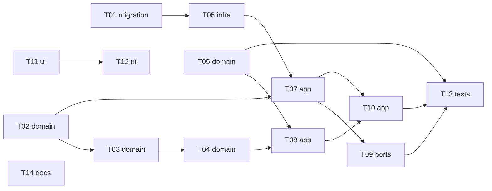

# Epic — remote-filter

> **Spec:** [spec.md](../spec.md) · **Design:** [sad.md](../sad.md) · **Data model:** [data-model.md](../data-model.md) · **API:** [openapi.yaml](../contracts/openapi.yaml) · **Screens:** [screens.md](../screens.md) · **ADRs:** [adr/](../adr/)

## Goal

The owner's main list holds only postings they may take from their country, or postings whose location honestly needs a look; no posting they could take is hidden by the filter; and they can check another country's openings without losing their own setting (spec §2). Every posting gets one location verdict — fits, check (with one reason), or not open — and only "not open" is hidden, with the hidden count always on screen.

## Scope

- **In:** new `remote-filter` module (domain vocabulary + statement reader + verdict, settings repo, use cases, four routes) and the `remote_filter_settings` migration; `search/app/` snapshot, counts, check reasons and waiting count; the collector's "Anywhere" reading (two readers, merge and change checks, two read-only exports); SCR-01's LocationFilterBar, CountryChoice, check-location mark, hidden count and filter empty message; CONTEXT.md and the amended upstream docs.
- **Out:** reading restrictions from the description; the company's own country; visa / permit / contract-type questions; more than one home country; filtering the marked view (spec §3).

## Task map

- **Wave 1:** T01, T02, T05, T11, T14
- **Wave 2:** T03, T06, T12
- **Wave 3:** T04, T07
- **Wave 4:** T08, T09
- **Wave 5:** T10
- **Wave 6:** T13

## Tasks

See [tracker.md](./tracker.md) for status. Machine contract: [tasks.json](../tasks.json).

| # | Task | Layer | Blocked by | DoD (short) |
|---|---|---|---|---|
| T01 | [Create the remote_filter_settings table and promote its staged migration](./t01-remote-filter-settings-table.md) | migration | — | drizzle-kit generates the next migration from `remote-filter/infra/schema.ts`, and `remote-filter-schema.inte… |
| T02 | [Build the country vocabulary from Intl plus the hand-kept alias, region, zone, filler and short-code tables](./t02-country-vocabulary.md) | domain | — | `vocabulary.test.ts` passes: PL/US/GB/NZ pinned (names, zones, winter and summer offsets), the lookup accepts… |
| T03 | [Read one location statement and decide one listing's verdict for a country and a date](./t03-statement-reader-and-listing-verdict.md) | domain | T02 | `statement.test.ts` passes for every AC-01 and AC-02 statement and the edge cases above, each giving the same… |
| T04 | [Combine listing verdicts into one posting verdict and pin the fixed example set at a winter and a summer date](./t04-posting-verdict-and-example-set.md) | domain | T03 | `verdict.test.ts` passes: 100% of the fixed examples give their expected verdict on both dates, and the prope… |
| T05 | [Keep an explicit "Anywhere" as stated in the collector, treat it as nothing stated for merge and change checks, and export it with the enabled sources](./t05-collector-keeps-anywhere.md) | domain | — | `listing.test.ts` and `merge.test.ts` cover the predicate and the merge rule, and `collector-ingest` / `colle… |
| T06 | [Write the settings repo with the lazily created singleton row and its test fixture](./t06-settings-repo.md) | infra | T01 | `remote-filter-repo.integration.test.ts` passes on a temp DB: lazy create, each write, look cleared as a pair… |
| T07 | [Implement the settings use cases: choose country, switch on/off, start or end a look, the country list, and the active filter for a visit](./t07-settings-use-cases.md) | app | T02, T06 | `remote-filter-settings.integration.test.ts` passes every row of the edge-case table plus AC-04's reopen (a f… |
| T08 | [Answer search's verdict question: verdicts for a set of postings and a country, from open listings of enabled sources, one parse per distinct statement](./t08-verdicts-for-postings.md) | app | T04, T05 | `remote-filter-verdicts.integration.test.ts` passes for the three AC-03 postings and the closed / disabled-so… |
| T09 | [Expose remote-filter's four routes behind the access guard and register the plugin in app.ts](./t09-remote-filter-routes.md) | ports | T07 | `remote-filter-routes.integration.test.ts` validates every response against `contracts/openapi.yaml` and prov… |
| T10 | [Make search's main list location-aware: active filter, verdicts before the snapshot, hidden/total/new counts, check reasons and the waiting count](./t10-search-location-aware.md) | app | T07, T08 | `search-location.integration.test.ts` passes: AC-01/02 list and reasons, 102/38/140 counts and off (AC-07), a… |
| T11 | [Add the web remote-filter client, the LocationFilterBar and the CountryChoice on SCR-01](./t11-web-location-bar-and-country-choice.md) | ui | — | the LocationFilterBar and CountryChoice tests pass for every bar mode (none, own, off, look, loading, switchi… |
| T12 | [Wire the filter into the main list: re-search on change, hidden count in the summary, the check-location mark, the filter's empty message and the marked view](./t12-web-main-list-with-filter.md) | ui | T11 | `PostingCard.test.tsx` and `SearchList.test.tsx` pass for the four check reasons, the summary with and withou… |
| T13 | [Prove "Anywhere" end to end from collection to verdict, and search speed with the filter on](./t13-end-to-end-and-speed.md) | tests | T05, T09, T10 | `remote-filter-e2e.integration.test.ts` passes AC-10 and AC-11 through the real collector and routes, and `se… |
| T14 | [Add the hidden count and one-off look to CONTEXT.md, amend the collector spec's "Anywhere" reading, and point applied-skipped's contract at this one](./t14-glossary-collector-spec-and-contract-pointers.md) | docs | — | `grep -n "Hidden count\|One-off look" CONTEXT.md` shows both entries, the collector spec carries the three am… |

## Risks / Hard rules

- **Never a wrong hide on uncertainty:** 0 postings hidden whose statement is unknown, unrecognised, contains an exception, or fits only by working hours (spec §6) — T03, T04 own the property test.
- **Seasonal stability:** the same verdict on a winter and a summer date (spec §6) — the date is always a parameter of the domain.
- **Search speed:** ≤ 1 s p95 to the first 50 postings with 10,000 open postings and 20 skills, filter on (spec §6) — T13.
- **Layering:** a module reaches another only through its `app/` exports; dependencies run search → remote-filter → collector, nothing calls back into search (sad §2, ADR-0001).
- **Access:** loopback, Host check, same-origin JSON POSTs only; no CORS (AC-12, collector ADR-0007) — T09.
- **Wave-4 overlap:** this feature's `search/app/` change lands in one PR (T10); roadmap step 10 (LinkedIn) lands after T05's collector change; whichever of steps 4 and 5 lands second rebases (sad §11).
- **Phone layout:** every control ≥ 44×44 px, no horizontal scroll at 360 px — manual browser check at ship (spec §6).
