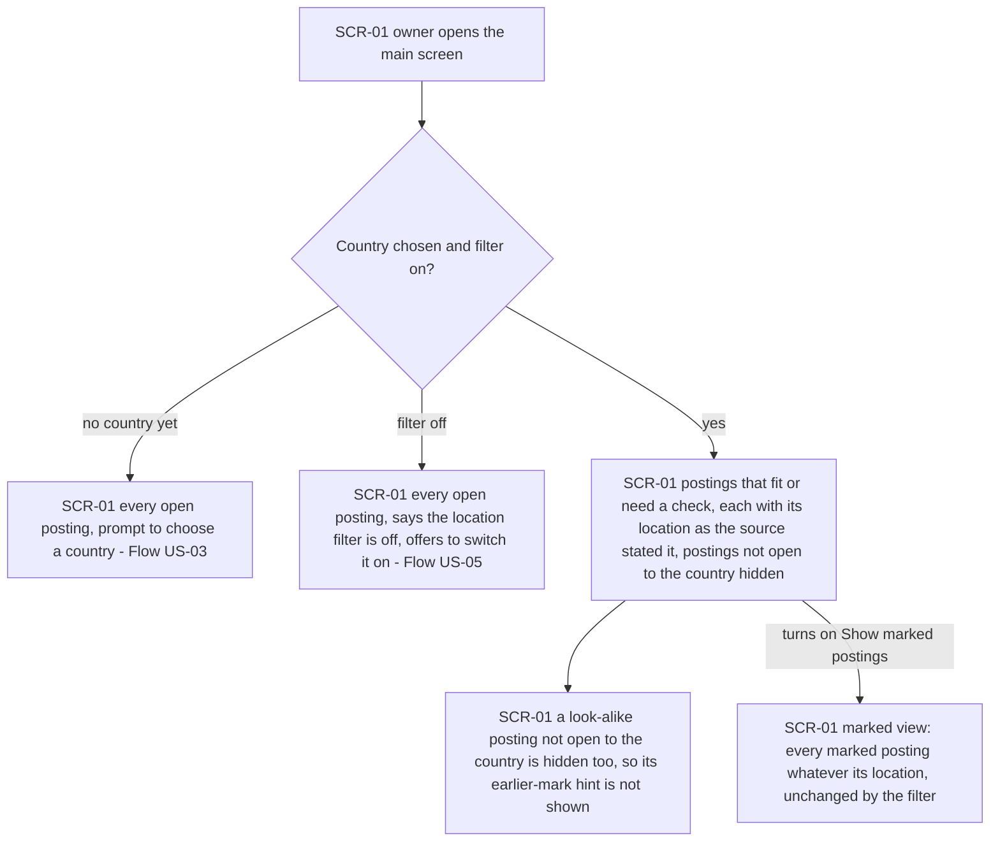
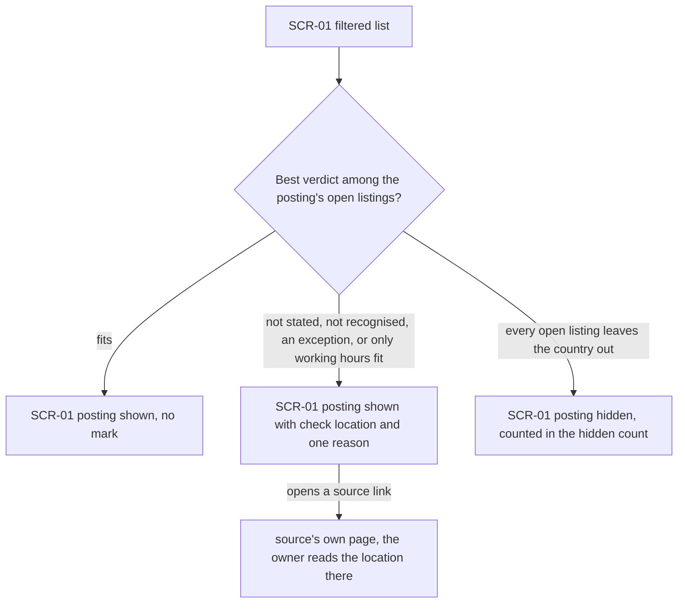
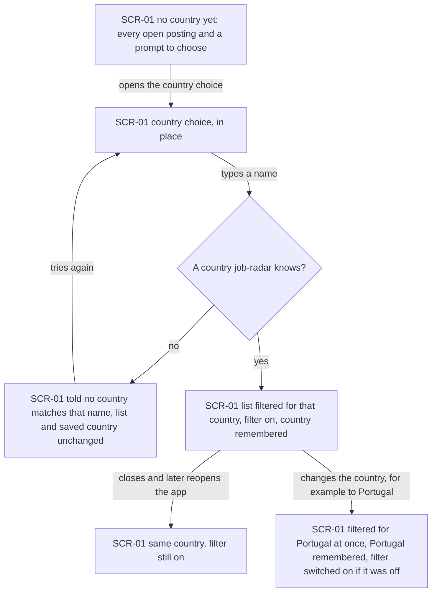
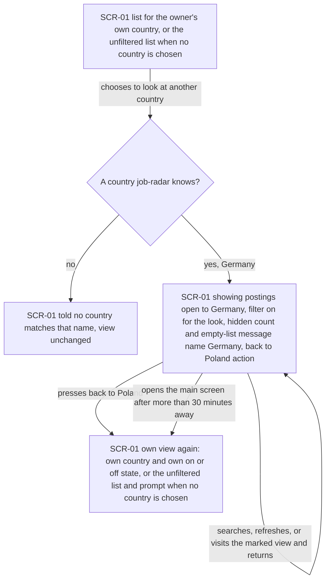
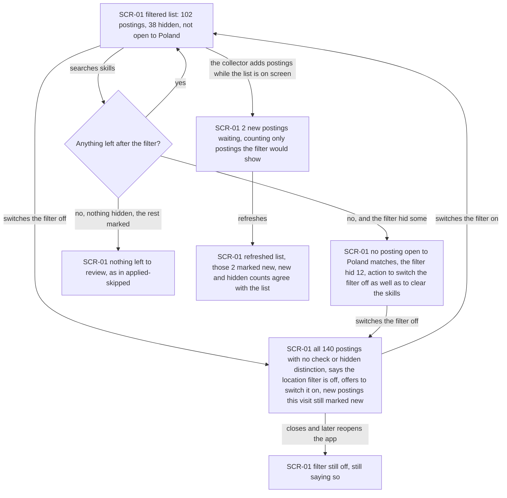

# UX flows — remote-filter

> User flows for every UI-touching §4 user story, produced by `ux-flows` (after `clarify`, before
> `design`) and read by `design` (evidence for the target-surface + UI-architecture decisions),
> `sequences` (UI-driven flows align on SCR ids), `screens` (details every inventory row) and
> `plan-tests` (the e2e-through-UI paths). **Always markdown + mermaid `flowchart`**, whatever the
> design tool — this artifact is flow-altitude, not visual design.

## Platform decisions

- **Posture:** mobile-first, per `docs/design-system.md`, the same as search-postings and applied-skipped. In v1 the app opens only on the owner's machine, so it runs in a laptop browser, but every flow starts from the 360 px layout (spec §6: the country choice, mode and off switch fit at 360 px, every action at least 44×44 px).
- **Navigation:** no new screen. The filter lives on the main screen (SCR-01): the chosen country, the off switch, the "look at another country" action and the hidden count sit with the list, and choosing or changing the country opens in place, without leaving the screen. SCR ids match the search-postings and applied-skipped inventories; only SCR-01 changes.
- **Filter state always visible:** whichever state the filter is in — on for the owner's country, on for a one-off country, off, or no country chosen yet — the main screen says so (US-05, AC-07). The list never looks shorter without a visible reason.
- **One-off country look:** a mode of SCR-01, not a separate view. It survives searches, refreshes and a trip to the marked view and back, and ends with a visible "back to Poland" action or a new visit (AC-06).
- **Check mark:** information on the posting's card (one reason, spec AC-02), with no action of its own; the owner checks the location on the source's page through the listing link.
- *Design input:* where the owner's country and the filter's on/off state are kept, so they survive restarts and stay out of reach of other sites (AC-04, AC-12), is `design`'s call.

## Screen inventory

| ID | Screen | Purpose | Entry | Exit |
|---|---|---|---|---|
| SCR-01 | Main screen | The search-postings list, now filtered by location: the country choice (first choice, change, unknown-name message), the off switch, the "look at another country" mode with its "back" action, the hidden count, the "check location" mark with its reason on each uncertain posting, the filter's empty-list message, and the marked view (applied-skipped), which the filter leaves untouched | Opening the app | A source's page via a listing link; source health as in search-postings (SCR-02, unchanged and not visited by these flows) |

## Flows

### Flow: US-01 — Hide roles I can't take

The owner opens the main screen. If they have never chosen a country, they see every open posting with a prompt to choose one (continued in Flow US-03); if they switched the filter off earlier, they see every posting with a line saying the location filter is off and an offer to switch it on (Flow US-05). Otherwise the list holds only the postings that fit or need a check for their country, each showing its location exactly as the source stated it, and the postings not open to that country are hidden — including a look-alike posting, whose earlier-mark hint therefore does not appear. Turning on "Show marked postings" swaps in the marked view, where every marked posting shows whatever its location: the filter never touches it.

### Flow: US-02 — See uncertain locations marked

For each posting the filter takes the best verdict among its open listings. If any listing fits, the posting shows normally with no mark. If none fits but something is uncertain — nothing stated, wording the filter does not recognise, an exception such as "except Poland", or countries that leave the owner out while the working hours fit — the posting stays in the list with a "check location" mark and one reason. Only when every open listing states a readable location that leaves the country out is the posting hidden, and it then counts in the hidden count. From a marked posting the owner follows a source link to read the location on the board itself.

### Flow: US-03 — Set my country once

An owner who has never chosen a country sees every open posting and a prompt to choose. They open the country choice on the same screen and type a name. A name that is not a country job-radar knows (a typo, or a region such as "Europe") gets a message that no country matches; nothing changes and they can try again. A known country filters the list at once, switches the filter on and is remembered, so reopening the app later shows the same country with the filter on. Changing the country later — say to Portugal after a move — filters for Portugal at once, remembers it, and switches the filter on if it was off.

### Flow: US-04 — Check another country

From the main screen — filtered for their own country, or unfiltered if they have not chosen one — the owner chooses to look at another country. An unknown name gets the same "no country matches" message and the view stays as it was. A known country, say Germany, shows the postings open to Germany under the same rules: the filter is on for the look even if the owner had it off, and the hidden count and the empty-list message name Germany, with a visible "back to Poland" action. The look survives new searches, refreshes and a trip to the marked view and back. It ends when the owner presses "back to Poland" or comes back after more than 30 minutes away (a new visit); either way their own country and their own on/off state return, or the unfiltered list with the prompt if they never chose a country.

### Flow: US-05 — Know what the filter hides

With the filter on, the owner sees how many postings are listed and how many were hidden as not open to their country ("102 postings — 38 hidden"). Switching the filter off shows all 140 with no check marks, a line saying the filter is off and an offer to switch it back on; postings first collected since the previous visit stay marked new, even ones the filter had hidden, and the filter stays off on later openings until switched on again. When a search leaves nothing: if the filter hid some matches, the owner is told that no posting open to Poland matches, how many the filter hid, and offered to switch the filter off as well as to clear the skills; if nothing was hidden and the rest are marked, applied-skipped's "nothing left to review" appears instead. While the list is on screen, the waiting count counts only new postings the filter would show, and after a refresh those postings are marked new and every count agrees with the list.

### Out of scope

- **US-06 — Count "Anywhere" as open to me:** no owner action or screen of its own; it changes how the collector reads a source's "Anywhere". Its only visible effect is that such a posting appears in Flow US-01 unmarked, with "Anywhere" as its stated location.

## AC coverage

| AC | Shown by | Notes |
|---|---|---|
| AC-01 | Flow US-01 → C | locations shown as stated; not-open postings hidden |
| AC-02 | Flow US-02 → D | one reason per mark, in the spec's priority order |
| AC-03 | Flow US-02 → B (best verdict among open listings) → C / D / E | |
| AC-04 | Flow US-03 → A, E, F; Flow US-01 → P | |
| AC-05 | Flow US-03 → D; Flow US-04 → C | the same rule for the one-off country |
| AC-06 | Flow US-04 → D, its self-loop, E | lifetime, filter on for the look, own state restored |
| AC-07 | Flow US-05 → A, B, B2 | |
| AC-08 | Flow US-05 → D, E | the filter's message wins whenever something was hidden |
| AC-09 | Flow US-05 → F, G, B | new flag kept when the filter is switched off in the same visit |
| AC-10 | N/A: collector reading, no owner action | visible only as an unmarked "Anywhere" posting in Flow US-01 → C |
| AC-11 | Flow US-01 → D, E | |
| AC-12 | N/A: not a screen flow | enforced by the app being reachable only on the owner's machine and refusing other sites (design) |
| AC-13 | Flow US-03 → G | |
